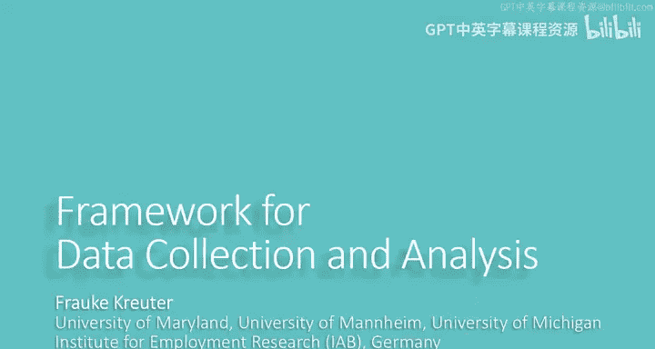
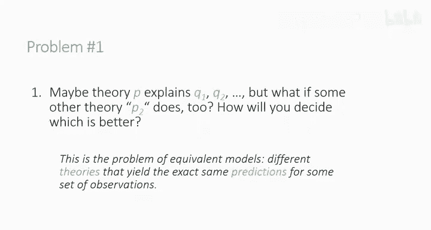
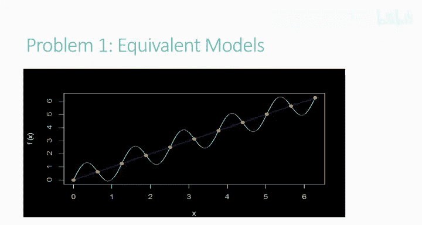
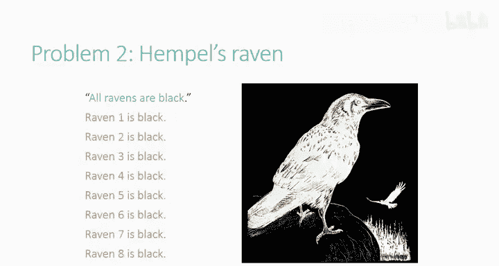
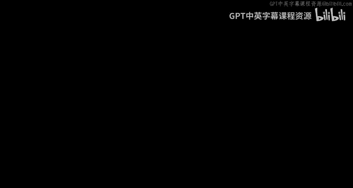

# 密歇根大学《调查数据收集和分析》第1课：框架 - P10：归纳推理的局限性 🧠

## 概述

在本节课中，我们将要学习归纳推理的局限性。我们将探讨为什么在数据分析中，拥有一个明确的研究问题和假设至关重要，尤其是在处理“有机与发现数据”时。我们将通过具体的例子，理解从观察中直接推导理论所面临的挑战。

---

## 从数据分类到推理挑战

在第一模块中，我们介绍了两种不同的数据分类方式。一种我们称之为**有机与发现数据**，另一种我们称之为**设计数据**。无论你处理哪种数据，我们都强调需要理解数据的生成过程。

今天，我们将更深入地探讨为什么认真思考设计数据是有意义的，以及为什么从任何类型的数据（特别是“有机与发现数据”）中进行推理会很困难，除非你心中有一个具体的研究问题和假设，并且这个假设与你想要达成的目标紧密契合。

---

## 为什么需要研究问题与设计？

那么，我们为什么要考虑研究设计和研究问题呢？请看下面这张图，你可能熟悉，也可能不熟悉。

你看到了什么？有些人可能会说看到一只鸭子，另一些人可能会说看到一只兔子。确实，人们可以从同一物体中看到不同的东西。

当你观察数据时，同样的情况也可能发生。如果没有一个指导你观察的框架，做出正确的推理会相当困难。让我们更正式地来看待这个问题。

---

## 归纳推理的问题

假设我们有三个观察结果：Q1、Q2 和 Q3。你观察到它们全部，并认为这证明了关于 P 和 Q 之间关系的理论一定是正确的。

问题是，从已知的观察结果中构建解释非常困难，甚至是不可能的。这种从观察中推导理论的原则被称为**归纳推理**。

但它存在一些问题，尤其是在当今数据泛滥的时代，这些问题再次被广泛讨论。主要问题是存在**肯定后件**的倾向，即你只看到你期望看到的东西，而不一定能从数据中真正学到什么。

因此，当你尝试进行归纳推理时，心中应该牢记两个主要问题。

以下是归纳推理面临的两个核心挑战：

1.  **存在多个等效模型**：可能有多个不同的理论模型都能解释你手头的数据。如果你只在事后提出一种解释，或者即使你考虑了替代模型，你也可能没有合适的数据来检验它们。这个问题在设计数据和有机数据中都会出现，但在设计数据中，你可以通过规划来避免。
2.  **需要无限次观察**：从理论上讲，要完全证实一个普遍规律（如“所有乌鸦都是黑色的”），需要进行无限次观察，这在实际中是不可能的。

---

## 问题一：等效模型

让我们先看第一个问题。也许理论 P 可以解释 Q1 和 Q2 的出现。但如果存在另一个理论 P2，也能解释这些观察结果呢？

以这张图为例，图中的橙色圆点代表我们拥有的观察数据点。这里有两个理论：一个由蓝线表示，描述了 x 与 f(x) 之间的关系；另一个是绿色的正弦曲线。**两条线都能完美地拟合或描述这些数据点**。

那么，如果你只有这些橙色数据点，你如何知道哪一条线代表真实的关系呢？你无法知道哪个理论才是正确的。

如果你能提前思考这些关系和理论，你就可以确保收集数据的位置是蓝线和绿线不重叠、有差异的地方。拥有了这些观察结果，你就能区分这两个理论，从而确定哪一个真正解释了现实世界的现象。这就是**等效模型问题**。

---

## 问题二：无限观察与“亨佩尔的乌鸦”

第二个问题通常用“亨佩尔的乌鸦”这个科学哲学中的著名命题来演示：**“所有乌鸦都是黑色的”**。

你观察到第一只乌鸦是黑色的，第二只是黑色的，第三只也是黑色的，一直观察下去。

你可能会说，你总是看到黑色的乌鸦。但这并不意味着所有乌鸦都是黑色的。有可能在你开始寻找时，出现了一只非黑色的乌鸦，而那只黑色的乌鸦已经飞走了。

这个例子说明了归纳法的根本局限性：无论你观察到多少只黑乌鸦，都不能逻辑上绝对地证明“所有乌鸦都是黑色的”这个全称命题。要完全证实它，理论上需要观察世界上所有过去、现在和未来的乌鸦，这显然是不可能的。

---

## 总结

本节课中，我们一起学习了归纳推理在数据分析中的局限性。我们了解到，如果没有预先设定的研究问题和假设，仅仅从观察到的数据中进行归纳，可能会面临**等效模型**的困扰和**需要无限观察**的逻辑困境。这强调了在研究设计阶段明确目标、规划数据收集的重要性，特别是在使用“设计数据”时，我们可以通过精心设计来区分竞争性理论，从而做出更可靠、更有意义的推断。