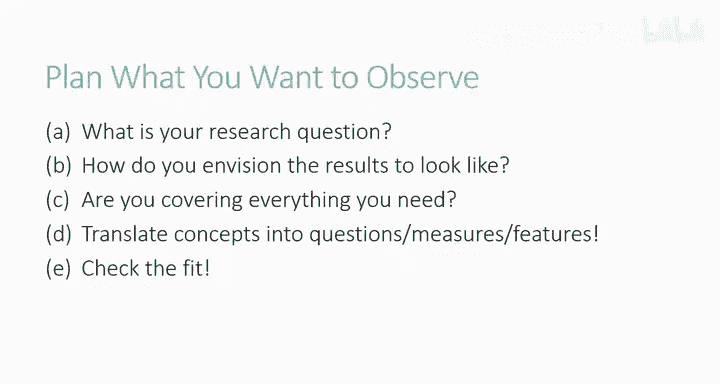
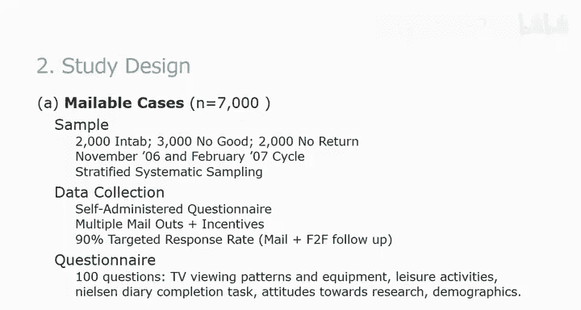
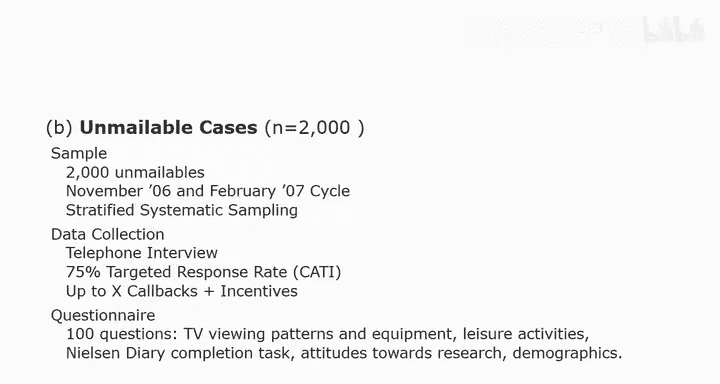
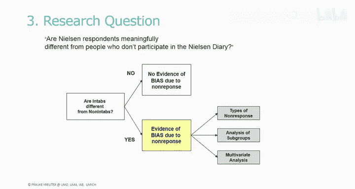
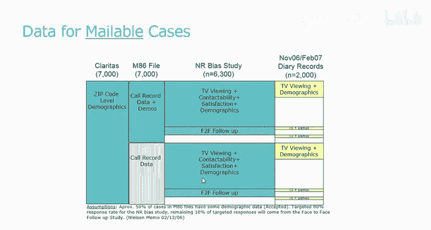

# 11：观察目标规划 📊

在本节课中，我们将学习如何为研究项目制定清晰的分析计划。无论你计划使用何种数据源，明确研究问题并预先规划分析步骤都至关重要。这能确保你收集的数据足以支持你的结论，并排除其他可能的解释。

## 🎯 明确研究问题与理论检验

无论你计划使用哪种数据源，都必须清楚你的研究问题是什么。如果你要检验一个理论，就需要规划收集哪些数据点，以**排除其他可能的解释**。这意味着你需要确认，你所观察到的现象只能由你研究的因素来解释。

在之前讨论的实验中，这一点相对容易做到，因为你可以控制所有其他变量保持不变（**保持恒定**），然后只改变处理效应，再观察处理与其他结果之间的关系。

然而，如果你进行的是描述性分析、预测性分析，或者试图基于观察数据进行因果推断，那么预先规划就**更加重要**。

## 📝 制定分析计划：预想结果

一个好的方法是：通过预想你的结果应该是什么样子，来停止盲目的思考。这意味着你需要制定一个**分析计划**。

理想情况下，这个计划应详细规定你最终报告中的**每一张表格、每一幅图表**。然后，确保你收集数据或从现有材料中生成新变量的方式，能够支持你完成这个分析计划。

这样做的一个好处是，它能迫使你将所有讨论的**概念**都转化为数据集中的具体**特征**。如果某个概念无法被测量或表示，你就需要在数据收集阶段解决这个问题。

## 🔍 案例分析：尼尔森媒体研究的无应答偏差

为了更具体地说明，让我们看一个由媒体研究实验室为研究卓越委员会准备的案例。该研究关注的是尼尔森媒体研究服务中的**无应答与无回应偏差**。

尼尔森要求受访者填写关于电视观看行为的日记，并安装记录设备来实际记录频道调谐行为。但并非所有人都参与，这就产生了**无应答**问题。该研究的核心问题是：合作者与不合作者之间是否存在有意义的差异？

### 研究设计与数据

这项针对特定研究问题的研究设计包含两组数据：
1.  **有邮寄地址的样本**（约7000个）：由三组人构成
    *   2000名“合作者”
    *   3000名“低质量回应者”（返回了信息但质量不佳）
    *   2000名“无回应者”
2.  **无地址的个案**（约2000个）：使用了电话号码进行联系。

数据收集通过**自填式问卷**和多次邮件寄送完成，目标是让这个特定无应答研究中的90%受访者都参与进来。

### 分析计划示例

该研究的研究问题再次明确：参与者和不参与者之间是否存在有意义的差异？（特别是针对日记本身）。

分析计划的第一步是：**我们是否在不同类型的无回应中看到了偏差的证据？**

完整的分析计划包括：
1.  首先分析不同类型无回应中的偏差证据。
2.  然后，针对对尼尔森有意义的**子群体**进行分析。
3.  最后进行**多变量分析**。

### 数据结构与信息需求

为了评估无应答偏差，你需要**受访者和非受访者两方面的信息**。在最初的调查中，非受访者没有信息，因为他们没有参与。

但可以通过其他数据来弥补，例如：
*   **辅助数据**：如尼尔森在招募参与者时收集的电话记录数据。
*   **商业数据**：通过地理编码与每个地址链接，从而可以比较受访者和非受访者。
*   **本次无应答研究本身**：通过额外努力，希望获取所有受访者和非受访者的信息。

### 预先规划的价值

下图展示了研究前预先制定的分析计划示例，用于确定样本量是否足够，并确保最终能交付所有要求的报告和图表。

（*此处原为一张计划图表，核心是展示如何为“合作者”、“非合作者”及“总计”群体，规划报告“平均电视观看小时数”这一结果变量。*）

创建这样的**模拟图表和表格**能帮助你明确：我需要哪些信息？我需要它们以何种形式呈现？

我曾见过一些调查，仅仅因为觉得问题太明显，而忘记了询问诸如**性别**这样的基本信息。当他们想按不同性别类别分析数据时，却发现数据集中没有这个变量。同理，如果文件中没有“合作者”与“非合作者”这个关键信息，无论是通过前期记录链接还是通过问卷获取，你都无法进行分析。预先规划能帮你避免这类问题。

## ✅ 总结

本节课中，我们一起学习了制定研究分析计划的重要性与方法。核心要点包括：
1.  无论使用何种数据，都必须**清晰定义研究问题**，并规划能排除其他解释的数据点。
2.  通过**预先设想结果**并制定详细的**分析计划**（包括所有图表和表格），可以指导数据收集与变量生成。
3.  案例分析表明，将抽象概念转化为数据中的**可测量特征**是计划的关键。
4.  预先规划能有效防止遗漏关键变量，确保最终分析能够顺利执行。

记住，好的开始是成功的一半。在投入资源收集数据之前，花时间进行周密的分析规划，将为你的整个研究项目奠定坚实的基础。