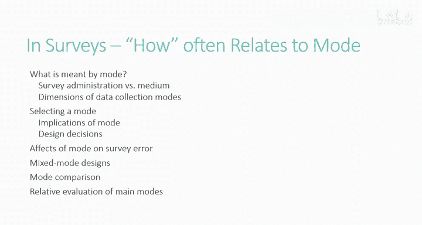
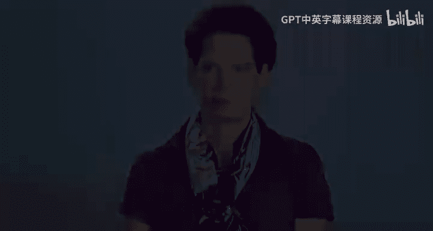
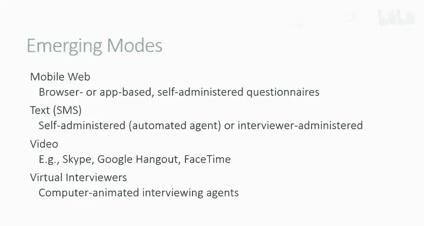

# 12：数据收集方案设计 📊

在本节课中，我们将要学习调查研究中一个核心环节：**数据收集方案的设计**。我们将重点探讨“模式”这一关键概念，了解不同数据收集模式的特点，以及如何根据研究目标选择合适的模式。

---

上一节我们介绍了调查设计的基本框架，本节中我们来看看数据收集的具体执行方式——即“模式”。

在调查中，“如何执行”通常与“模式”相关。当我们思考如何进行数据收集、如何规划后续步骤时，一个关键问题是：**应该采用哪种数据收集模式？**

这里将介绍几种不同的模式，以及选择模式时的一些考量。同时，我们也会探讨这些不同模式如何影响调查误差，以及它们可能如何组合使用。

其中一些内容将在我们关于数据收集的课程中更详细地讨论。这里仅对面对面、网络和电话调查进行概览，以便你了解该特定课程的主要内容。

当我们思考数据收集时，我们认为方法或模式是规划研究设计时所做的**影响最大的决策之一**。

影响最大是因为它与数据收集中的任何误差以及成本都密切相关。例如，仅仅询问任何可用的人，或从网络上收集任何人发布的数据，成本可能非常低廉。

但这绝不意味着你获得了足够质量的数据来进行你想要的分析。

因此，选择哪种模式、哪种数据源、使用哪种数据收集方法，都应**以理论和实证证据为指导**。这也是我刚刚提到的课程（关于在线、电话和面对面数据收集）的意义所在。

现在的问题是，“模式”究竟意味着什么？传统上，模式仅限于**面对面或入户访问调查**、**邮件或邮政服务调查**，以及后来出现的**电话调查**。

近年来，出现了各种各样的新模式。这当然与从纸质到计算机的转变有关。你仍然可以在下图中看到，M. Cooper 和 Fred Conrad 在其数据收集课程中传统上使用的模式：邮件、电话和面对面。

但随着计算机辅助技术的引入，它们衍生出了多种形式。让我们看看：
*   **邮件调查**：本质上是自填式、书面作答。在计算机化格式中，你可以通过邮件发送磁盘、通过电子邮件发送调查问卷，或将其编程为网络工具。
*   **电话调查**：你仍然可以让人工拨打电话，进行**计算机辅助电话访谈**。或者，你可以完全自动化，使用交互式语音应答系统，根据来电者的按键输入播放录制好的问题。如今，我们很多人都遇到过这种情况，许多公司、航空公司甚至办公室都采用这种方式。
*   **面对面调查**：传统上，访员会带着需要填写的问卷上门。问卷可以由访员协助完成，或者也可能是自填式（但访员仍在场）。如果你在其中加入计算机，那么你就有了**计算机辅助个人访谈**。还有其他形式，例如访员将笔记本电脑交给受访者，并为其戴上耳机，进行所谓的**音频辅助计算机辅助自填式访谈**。视频访谈也是类似。

你在前一张表格中看到的缩写再次列在这里，以便你了解它们的含义。新出现的模式比我们录制这些课程的速度还要快，但始终可以这样思考：是否有访员参与？媒介是什么？是纸笔、计算机还是其他东西？

了解这些分类很重要，因为它们确实会对成本和误差产生影响。关于不同数据收集模式以及如何进行这些数据收集的课程将为你提供更深入的见解。

放眼整个领域，当然还有更多你可能感兴趣的新兴模式。

以下是其中一些：
*   **移动网络数据收集**：越来越多地出现基于浏览器的应用程序、自填式问卷，这些成为人们随身携带的移动设备的一部分。
*   **短信调查**：通常也是自填式，但如果另一端有访员，则是一种访员协助的模式。

但还有其他有趣的形式：
*   **通过Skype、Google Hangout、Facetime等视频会议产品进行的访谈**。
*   甚至**虚拟访员**也是一种新兴模式，密歇根大学的Fred Conrad正在对此进行研究，即计算机动画生成的访员作为访谈中的代理。

---

**本节课总结**

在本节课中，我们一起学习了调查数据收集的核心——**模式选择**。我们了解到，数据收集模式（如面对面、电话、网络、邮件等）是研究设计中的关键决策，它直接影响数据质量、误差类型和项目成本。传统模式随着计算机辅助技术（如CAPI、CATI、ACASI）的发展而演变，并涌现出移动端、短信、视频访谈乃至虚拟访员等新兴模式。选择何种模式应基于理论和实证证据，而非仅仅考虑成本。理解不同模式的特点及其对误差的影响，是设计出有效、可靠调查方案的基础。