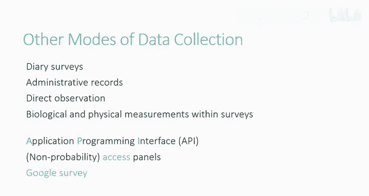
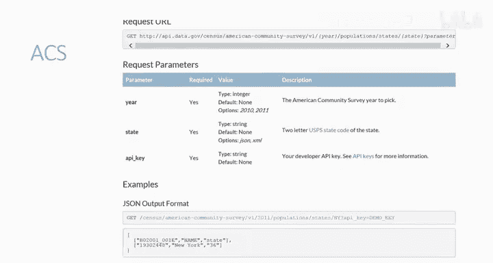

# 13：新型调查模式 📊

在本节课中，我们将探讨几种新型的数据收集模式，特别是应用程序编程接口（API）的应用。我们将了解这些模式如何扩展传统调查方法，并学习如何利用API获取和分析数据。

---

上一节我们介绍了传统的数据收集方式，本节中我们来看看其他几种数据收集模式。

除了之前讨论的方法，其他数据收集模式还包括我们在米尔梅迪亚研究中看到的日记服务、行政记录代码的使用（这在模块1中已广泛介绍），以及某种形式的直接观察。

然而，我想特别向你们指出的一点是，现在有越来越多的可能性让你通过应用程序编程接口（API）来收集自己的数据。

---

以下是关于调查模式选择的讨论要点：

关于调查模式，存在激烈的争论，并且显然与成本相关。我们是否仍应尝试获取基于概率的样本？特别是，我们是使用基于概率的固定样本组，还是使用在市场营销研究中非常常见的非概率访问固定样本组？

---

最后，我们将介绍另一种新兴的数据收集模式，例如谷歌调查。

我们将结合API来学习。你们中如果有人更接近计算机科学领域，可能听说过这个关键词。

我们在此提供一个维基百科条目的链接，供你阅读大量相关信息。

最重要的是要知道，这是一种简便的方式，用于提供数据或获取托管在网络上某处的数据。

你的数据基本上会以两种常用的导出格式提供：**XML**（可扩展标记语言）和**JSON**（JavaScript对象表示法）。

你不需要会写这种文件，但可能需要会读取，因为就像你最终习惯了Excel文件格式，或者知道如何使用分隔符将文件导入Excel一样。

像Excel或其他软件包越来越多地配备了导入过滤器，可以处理这种JSON格式。

---

那么，这在什么时候有用呢？即使是美国人口普查局也允许你从美国社区调查中获取数据，并在其在线发布时自动抓取，然后读入你相应的分析程序。

如果你访问我们在模块1中扩展介绍的网站 **data.gov**，你会看到一个注册表。注册后，你会收到一封确认邮件（此处展示的略有改动），邮件会提供一个密钥，让你可以访问这些服务请求。

截图的底部有关于如何操作的进一步说明。你会看到JSON输出格式。如果你曾经查看过那些不是以SAS、SPSS或类似统计软件包格式存储的数据集，你可能见过这种格式。在这里，文本字段或数据字段用引号括起来，并用逗号分隔，但JSON文件的结构比我们通常习惯的要复杂一些。因此，需要花些时间来适应，但这是可以掌握的，并且似乎正日益成为人们交换数据、以及你作为数据提供者收集数据时使用的格式。

---

那么，这些数据提供者是谁呢？可以是任何拥有网络应用程序的人。

我们已经看到，许多编程应用程序的人都会为其程序设置API，因为他们希望应用程序创建的数据能在其他情境下被使用，从而为特定应用程序带来流量，或使其更具吸引力。

例如，甚至Yelp也允许访问其数据，以便其他应用程序的用户可以交叉链接并使用这些信息。

你会感到惊讶的。只需开始深入挖掘，看看有哪些数据可以通过这种方式获取和收集。

---

本节课中，我们一起学习了新型调查数据收集模式，特别是API的应用。我们了解了API如何作为一种强大的工具，从各种在线来源获取结构化数据（如JSON格式），并探讨了其在扩展研究可能性方面的潜力。掌握这些新兴模式，将有助于你在数据驱动的环境中更有效地开展工作。