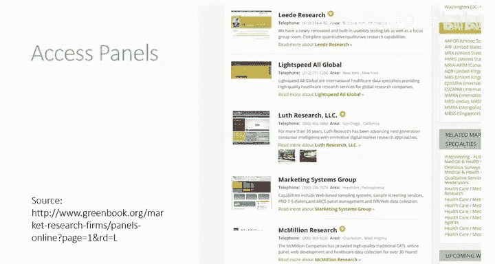
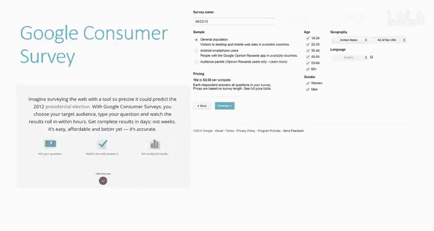

# 📊 调查数据收集和分析（第1课：框架）｜第14节：网络与谷歌调查

在本节课中，我们将学习两种近年来兴起的新型数据收集方式：在线访问面板和谷歌消费者调查。我们将探讨它们的特点、优势、潜在问题以及适用场景。

---

上一节我们介绍了传统的调查模式，本节中我们来看看两种基于互联网的新型数据源。

第一种是**在线访问面板**。这种形式在过去几年中广泛传播。幻灯片左侧的链接列出了许多此类调查的示例，下图仅是一个长列表的截图。

例如，我们的同事在Markham Systems Group工作，此外还有许多其他机构也在运营此类面板。这些面板拥有大量预先招募的成员，他们通过多种方式不断招募新成员。

以下是访问面板常见的招募方式：
*   概率抽样招募（部分面板采用）。
*   访问网站时弹出的邀请加入面板的菜单。
*   其他形式的广告。

优秀的访问面板通常会尝试多种招募策略，以确保成员构成具有多样性。

访问面板的优势在于它拥有庞大的人员库。对于每项具体的调查或数据分析，都可以从中抽取一个较小的群体进行访问。这种方式通常成本低廉。在我们第三模块讨论不同误差来源时，请记住这种形式。

这样，你就能针对自己的研究问题做出判断：使用访问面板是否会带来问题？

回顾第一模块，我们讨论了描述性、因果性和预测性研究的不同目标。对于某些研究，访问面板可能并非理想选择。

例如，在以下情况中需谨慎使用：
*   若想准确估计患有某种疾病的人口比例。
*   若研究与读写能力高度相关，因为相关人群可能根本不会参与此类在线面板。
*   对于某些特定人口年龄分布的估计。

不过，对于大多数人口统计群体而言，访问面板的数据质量并不差。随着这类面板越来越普遍，每次研究前你都需要问自己：**面板成员的自选择机制是否与我关心的核心变量相关？数据是否存在被扭曲的风险？**

正如之前所说，如果你的研究目的是进行因果分析（例如，使用访问面板开展一项问卷措辞实验），那么只要你不认为加入面板的自选择行为会扭曲你的实验结果，你的研究结果很可能是可靠的。这正是我们在第一模块强调理解数据收集目的重要性的原因。现在，我们向你介绍几种不同的调查模式，以便为第三模块讨论不同误差来源打下基础。

访问面板种类繁多，不仅用于市场研究，也存在学术访问面板。

例如，荷兰的LISS面板就是一个学术访问面板的范例，由CentERdata运营。它的基础是概率抽样，甚至为没有互联网接入的受访者提供了上网设备，使其能够参与面板。这更接近传统的抽样调查程序。因此，尽可能了解数据生成过程、确保其抽样方法的透明度，对于评估数据质量至关重要。

如果你想深入了解学术访问面板、其他访问面板，或评估比较这些面板数据质量的研究，可以使用**WebSM**这个资源平台。它几乎收录了迄今为止所有相关出版物，是极佳的信息来源。

---

接下来我们看看**谷歌消费者调查**，这是另一种非常不同的数据收集方式。

它的特点是问题数量很少，并分发给大量受访者。如果你想自己开展一项谷歌消费者调查，你会看到可以选择目标人群的人口统计特征。其中许多特征是基于用户资料估算的，谷歌官网上有一份关于此方法的有趣报告。然后，你可以在该平台上创建自己的调查，如下图所示。

如今，有更多专门的网站提供了强大的在线调查创建功能。

例如：
*   SurveyMonkey
*   Qualtrics
*   LimeSurvey

以及其他众多供应商。

如果你计划进行在线调查，从这些平台开始通常是个好主意，而不是尝试从头开始编程一切。这可以节省大量资源，并且可能更经济。

如果你确实计划进行网络调查，牢记一些通用设计原则非常重要。例如，左侧显示的Mick Couper出版的关于如何设计有效网络调查的书籍，或是Reg Baker、Fred Conrad和Mick Couper总结的科学发现纲要。还有Maria Kygara和Katja Lozar（后者也负责之前提到的WebSM平台）及其同事最近出版的网络调查方法论著作，都是宝贵的资源。

---

**本节课总结**

本节课我们一起学习了两种基于互联网的新型调查数据收集方式：**在线访问面板**和**谷歌消费者调查**。我们了解了访问面板的招募方式、优势及其在描述性研究中的潜在局限性，也认识了谷歌调查简短、广泛分发的特点。最后，我们指出了利用现有专业平台（如SurveyMonkey、Qualtrics）创建网络调查的实用性，并强调了遵循网络调查设计最佳实践的重要性。理解这些模式的特性，将帮助你在后续课程中更好地评估不同数据源的误差，并为自己的研究选择合适的数据收集工具。