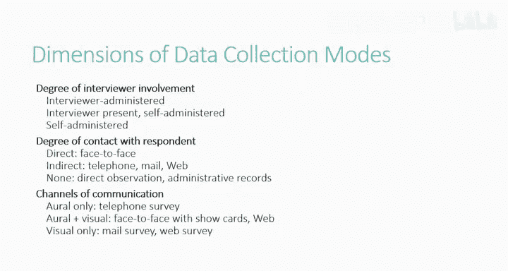
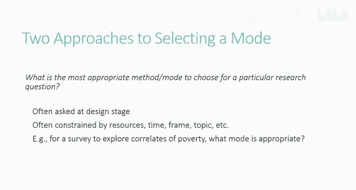
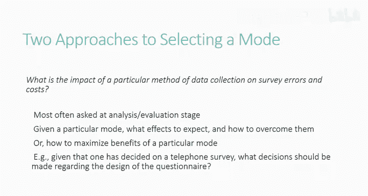
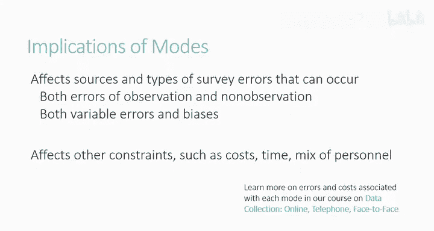
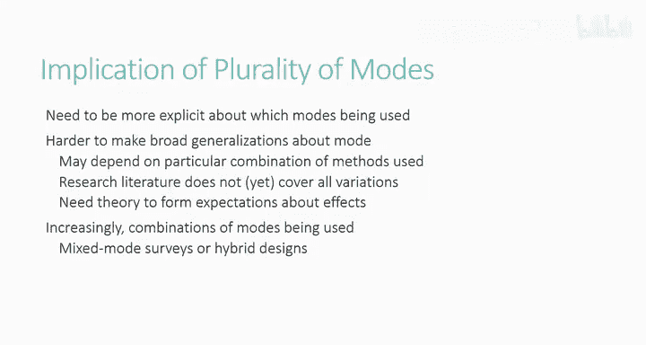

# 15：调查模式选择 📊

在本节课中，我们将学习如何为调查项目选择合适的数据收集模式。我们将探讨不同模式的特点、选择时需考虑的关键因素，以及模式选择对数据质量的影响。

---

思考数据收集模式的另一种角度，是考虑**访谈介入的程度**、**与受访者的接触程度**以及**沟通渠道**。我们之前已经讨论过其中部分内容。

在选择模式时，需要牢记这些因素，就如同考虑隐私程度和技术使用情况一样。这里不会深入细节，因为在后续的数据收集课程中你会学到更多。

在选择模式时，可以牢记两种基本思路：**选择何种方法是合适的？**

---

这个问题通常应在设计阶段提出。正如本模块的主题所强调的，你最初拥有研究问题，然后尝试获取所有相关的目标信息。

基于你的分析计划，你需要决定需要哪些具体的变量。现在，你掌握了一系列要求和约束条件。

你会知道可用的资金有多少。这将指导你判断：是足以从行政记录中获取观察数据或过程数据，还是需要外出进行自己的数据收集，以便获得计划使用的特定问卷中的所有变量。

如今，越来越常见的是**多种模式的组合**，因为你无法以同一种方式接触到所有人，或者并非所有人都能被同一种模式覆盖。

随之而来的问题是：你是否尝试在所有不同模式中收集完全相同的数据？至少在本专项教学团队中，我们倾向于支持这样一种方法：**尝试最大化特定模式的优势**。因此，如果在特定模式下可以添加视频或插图，那就这样做。

---

你所做的这些选择，无论涉及何种数据来源、模式或数据收集方法，都会对**观察误差**和**非观察误差**的可能来源产生影响。

为了理解这些误差源，我们为你准备了第三个模块，将详细讲解这些具体的误差来源。

当人们分析你的数据时，**明确说明使用了哪些模式**非常重要。很难对单一模式在所有可能主题上进行广泛的概括，因此这可能取决于特定主题或赞助方与多种模式的结合。

而且，正如我之前提到的美国社区调查等案例，越来越多的调查采用**混合模式设计**，即特定模式的混合体。

---

审视现有的实践和已完成的调查，会给你带来启发。但对于你自己的研究问题，你需要回过头去思考：你需要什么？你的分析计划是什么？需要纳入哪些变量？我如何获取它们？我有多少资金？我能使用哪种特定模式？以及这些选择如何受到各种误差源的影响？我们将在模块3中讨论这些误差源。

因此，我鼓励你思考：对于以下调查，哪种模式或数据收集类型是最佳的？
*   针对专业协会成员的调查。
*   比较贫困线以下人群营养需求的调查。
*   调查动物园游客满意度或关于环境政策声明的公众态度的调查。

这些都是非常不同的类型。请思考你将如何着手寻找所需的信息，利用我们展示给你的数据格局，然后在你评估每种方法的质量时，可以回过头来参考这类例子。

---

在本节课中，我们一起学习了调查模式选择的核心考量。我们了解到，选择数据收集模式时，需综合考虑研究目标、变量需求、预算、受访者覆盖以及不同模式的优势。同时，模式选择会直接影响数据误差的来源，而采用混合模式设计正变得越来越普遍。最终，选择应基于对具体研究需求的深入分析。