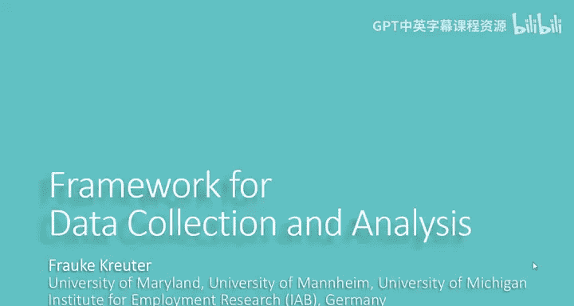
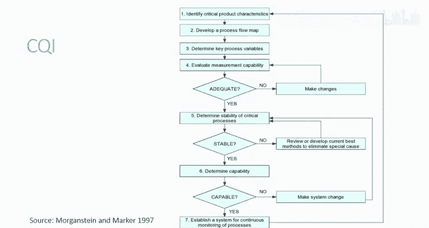

# 16：数据质量 📊

在本节课中，我们将学习如何从质量的角度审视数据产品。我们将介绍数据质量的核心概念、评估框架以及确保数据质量的实用方法。

---

## 概述：什么是数据质量？

上一节我们讨论了数据收集的整体框架，本节中我们来看看如何评估和确保数据的质量。数据质量远不止“准确”这么简单，它包含多个维度，共同决定了数据产品的可信度和可用性。

一个很好的入门资源是《欧洲统计质量评估方法手册》。这份文件提供了关于如何思考统计数据质量的通用指南。

## 数据质量的多个维度

以下是在思考数据质量时需要考虑的几个最重要类别，总结自Paul Biemer在《公共舆论季刊》上发表的文章：

*   **准确性**：这是总调查误差框架旨在最小化的核心目标。它关乎数据与真实值的接近程度。
*   **可信度**：数据发布机构的公信力至关重要，这关系到社区（不仅是调查使用者，也包括政府官员、公众人物、企业等）对该实体的信任。
*   **可比性**：特别是当您关注长期时间序列或跨国数据比较以进行投资或政策决策时，必须确保比较的是相似的事物。不同数据可能各自准确，但因测量标准不同而缺乏可比性。
*   **可用性**：数据的文档和访问方式是否组织有序，便于使用。
*   **相关性**：我们不想投入资源去收集、设计甚至挖掘那些缺乏相关性的数据。数据生产者有责任论证其相关性，或至少与利益相关者就此进行沟通。
*   **可访问性**：我们之前讨论过开放数据基金会和研究数据中心的重要性，这确保了数据能够被获取。
*   **及时性**：某些统计数据有固定的报告周期（我们将在第4模块展示例子）。按计划交付数据非常有帮助，而您可能想使用的某些数据源则不具备这一特性。
*   **完整性**：数据是否足够原始和全面，足以支持我们在第2模块讨论的分析目标？
*   **一致性**：估算结果是否具有一致性？能否将这些数据结果与其他数据源结合使用？是否存在最终会混淆统计用户的错配？

## 持续质量改进框架

有多种框架可用于管理数据质量，其中之一是**持续质量改进**框架，同样在Paul Biemer的论文中有所讨论。该框架建议在生成统计数据时，始终将质量放在首位。

以下是实施该框架的关键步骤：

1.  **准备工作流程图**：这有助于可视化整个数据生产过程，并识别关键的**过程变量**。
2.  **监控与调整**：这些过程变量可以被识别并随时间进行监控。如有必要，可引入变更以改进流程。
3.  **过程控制**：您需要确保对流程有控制力。对于希望深入研究的学者，有一整套关于**过程控制**和**质量控制**的文献。

Morganstein和Marker开发的一个流程图非常有用，它涵盖了上述所有关键词，值得仔细思考和参考。

---

## 总结

本节课中，我们一起学习了数据质量的多维度内涵，包括准确性、可信度、可比性等核心要素。我们还介绍了**持续质量改进**框架，该框架通过可视化流程、监控关键变量和实施控制来确保数据产品的高质量。理解这些概念是生产可靠、有用数据产品的基石。