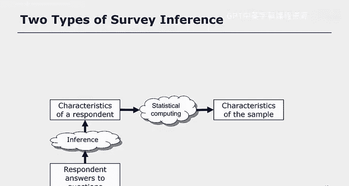
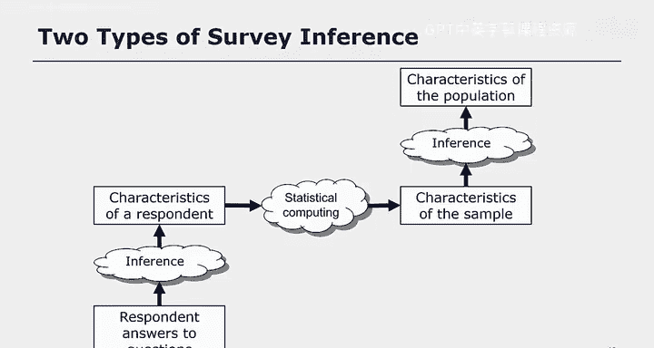

# 📊 调查数据收集和分析（第1课：框架）｜P17：统计推断

在本节课中，我们将要学习统计推断的核心概念。统计推断是调查数据分析的关键步骤，它帮助我们如何从收集到的有限数据中，得出关于更广泛群体的可靠结论。

---

## 统计推断的两个步骤

当我们谈论推断时，需要记住几个重要的步骤。在调查设定中，存在两种类型的推断。

上一节我们介绍了统计推断的重要性，本节中我们来看看这两种具体的推断类型。

1.  **从受访者到受访者特征的推断**
2.  **从样本特征到总体特征的推断**

---

## 第一步：从受访者到特征的推断

让我们聚焦于第一部分：从受访者到其特征的推断。这是什么意思呢？

假设你得到了一个非常简单的答案。例如，对于“你多大了？”这个问题的回答。你测量了年龄，但你真正感兴趣的是一个更广泛的概念，比如：细胞的衰老过程、心智经验、某种形式的生活经验等等。

因此，你得到了受访者的答案，但你感兴趣的“衰老”特征，已经是从你感兴趣的那个具体项目（年龄）及其答案，到你感兴趣的一般概念之间的一次推断跳跃。

这就是我们在此进行的第一部分推断。你从我对于年龄问题的回答，推断出关于我的经验、生活条件、健康状况等方面的信息。

---

## 统计计算与样本特征

现在，结合所有个体回答及其隐含的特征，我们进行一些统计计算。

以下是常见的统计计算方式：

*   我们计算所有受访者答案及其隐含特征的平均值。
*   如果你来自心理学领域，你可能习惯于使用多个测量项，它们共同构成一个心理学特质的维度。这当然也属于第一部分。然后，再次计算所有受访者在该特征上的平均值，就是一种统计计算形式，它能让你得到样本的特征。

因此，你得到了每个人的数值。例如，一个班级的平均年龄，或一个总体的平均年龄。

**注意**：对于总体，只有当你询问了每一个人时，你得到的才是总体平均年龄。如果这是一个样本，那么首先你得到的是特定样本的平均年龄。

例如，我从一所拥有35,000名学生的大学中，随机抽取了1,000名学生作为样本，并计算了他们的年龄。这就是到此为止的步骤。

---

## 第二步：从样本特征到总体特征的推断

然后，存在一个从样本特征到总体特征的推断环节。

因此，如果我的大学生样本平均年龄是，比如说，21岁。那么我可以根据我抽取样本的方式，对整个总体进行推断。

我可能直接推断总体特征就是同一个值，但为了做到这一点，你必须以某种特定方式设计你的调查，使得这两个推断环节有意义。这就是我们在研究不同的调查设计决策时要讨论的内容。

---

## 核心要点总结

请记住推断发生的两个部分：

本节课中，我们一起学习了统计推断的两个核心环节。

1.  **测量推断**：我们介绍了测量的一个方面，即关于测量的推断特征。这是第一部分。
2.  **代表性推断**：另一个是从你所收集信息的人群的代表性出发，允许对整个人口进行推断的特征。

理解这两个步骤是设计有效调查和进行可靠数据分析的基础。