# 密歇根大学《调查数据收集和分析》第1课：框架 - P18：设计视角下的调查生命周期——测量 📊

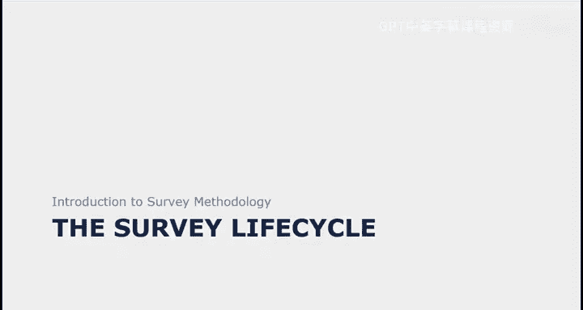

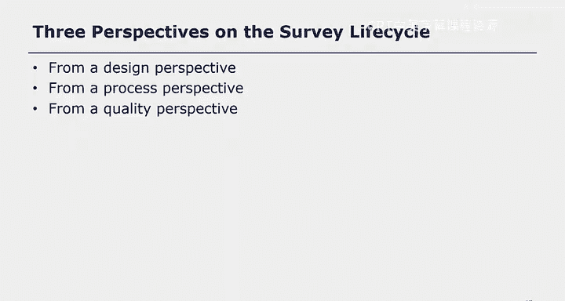

在本节课中，我们将从设计视角出发，深入探讨调查生命周期的核心环节——测量。我们将学习如何将一个抽象的概念转化为可观测、可分析的数据，并理解这个过程中每一步的关键作用。

---

上一节我们介绍了调查生命周期的三个视角。本节中，我们来看看从设计视角出发的第一个核心方面：测量。

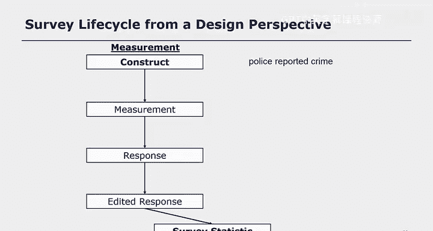

从设计视角看，调查生命周期主要关注两个方面：**测量**和**代表**。最终目标是形成一个高质量的服务统计量。让我们一步步来看这个过程。

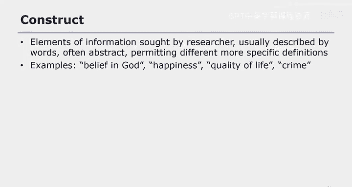

在测量这一侧，我们首先有一个**构念**。构念是研究者希望获取的所有信息，通常用文字描述，它可以是抽象的。

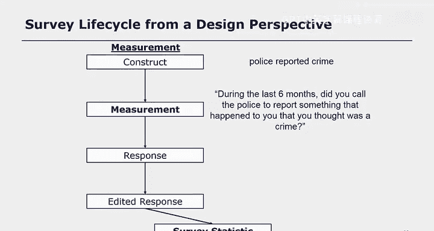

例如，构念可以是“对课程的满意度”、“对上帝的信仰”、“幸福感”、“生活质量”，或者如前所述，“警方记录的犯罪率”。

为了测量这个构念，你需要询问具体的**测量项**。其中一个测量项可能是：“在过去六个月里，你是否曾因发生在你身上、你认为属于犯罪的事情而报警？”

通过这个测量项，你将从每个受访者那里获得信息。这里假设受访者给出的答案确实与你真正感兴趣的“警方记录的犯罪”这一构念相关。

测量本身是将理论构念与观测变量连接起来的过程。这其中涉及许多步骤，本专项课程中关于问卷设计的课程将详细讲解如何实现这一点。

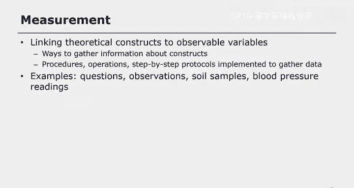

根据你使用的数据收集方式，测量可以是**问题**，也可以是**个体观察**。例如，在一个观察行为的研究中，网站上的点击量就是一个观测值，它关联到一个更大的概念（如对网站上某个特定商品的兴趣）。如果你进行土壤调查，那么土壤样本及其测量值就属于这里。在公共卫生领域，血压测量值也属于此类。

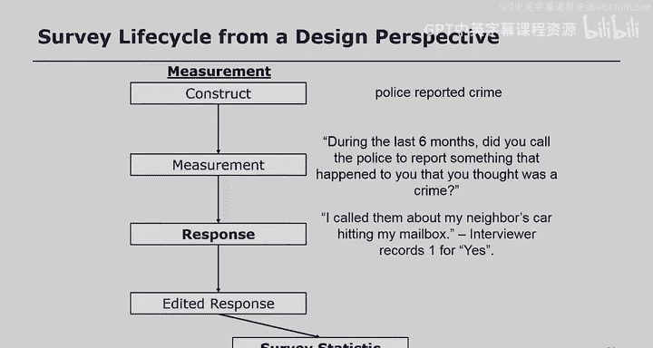

然后，你会得到一个**个体回答**。这一点很有趣。在问卷问题中，这就是对那个特定问题的回答。

在血压读数中，它则是来自特定个体的一个具体读数。重要的是在概念上将**回答本身**与**测量工具**（问题）区分开来，因为可能存在细微的差异。我们都知道血压测量就是如此：现在测量和半小时后测量，我的血压很可能不同。当然，答案也可能出现同样的情况。

在这个具体案例中，回答是：“我因为邻居的车撞了我的邮箱而报警了。”访问员记录为“1”代表“是”。这就是一个**回答记录**。

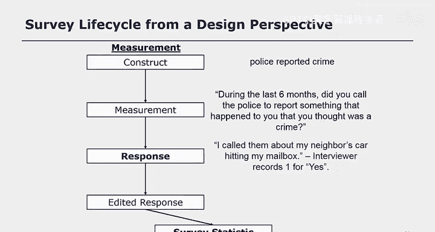

然而，故事并未结束。当回答被记录时，那只是该特定测量的**受访者输出结果**。在我们的例子中，问题的答案、土壤的数量、血压计上的读数，都属于记录提取。

但这个特定的数值可能并不正确。在我们的调查例子中，访问员可能备注了“这是邻居的车撞了受访者的邮箱”。随后，编辑可以将其归类为实际上是一起事故而非犯罪，因此不应计入我们试图测量的构念中。

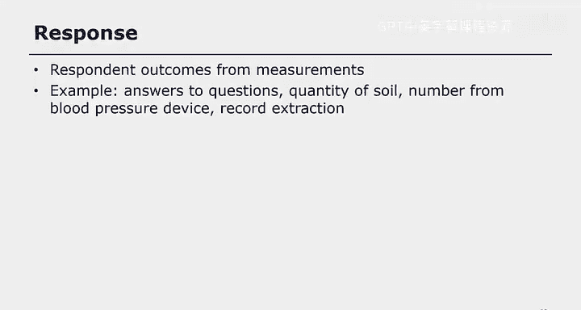

在这种情况下，回答会从“1”（是）被**编辑**为“2”（否）。只有这样，我们才能正确地捕捉到这个过程中的测量部分。

因此，对回答进行编辑意味着，在编辑之后，特定的数值才被存储在我们的数据中并被记录下来，以便用于后续分析。

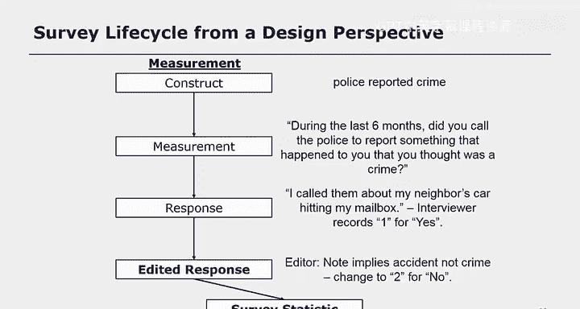

---

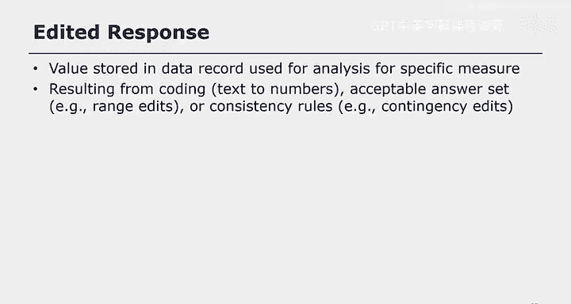

本节课中，我们一起学习了从设计视角理解调查生命周期的第一步——测量。我们看到了一个抽象的构念如何通过具体的测量项转化为个体回答，并理解了原始回答记录可能经过编辑处理，以确保最终数据的准确性，为形成可靠的统计量奠定基础。下一节，我们将继续探讨设计视角下的另一个关键方面：代表。