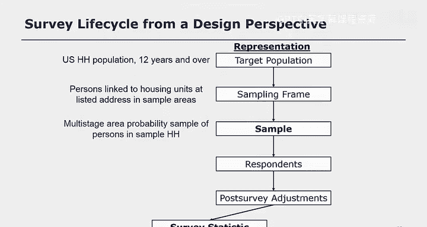
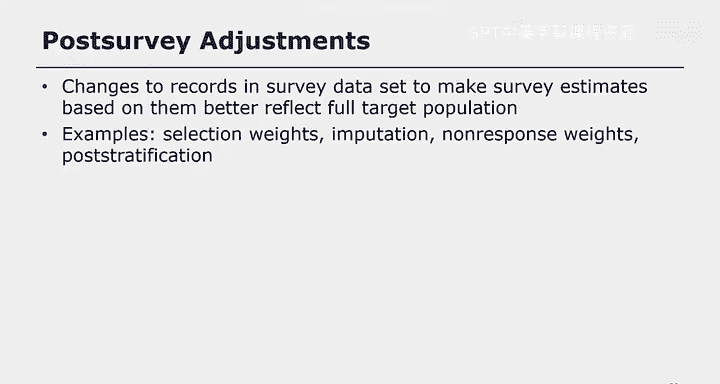

# 📊 调查数据收集和分析（第1课：框架）｜P19：设计视角下的调查生命周期——代表性

在本节课中，我们将从设计视角探讨调查生命周期的“代表性”方面。我们将了解从目标总体到最终调查结果的完整流程，并认识其中每个环节对确保数据代表性的重要性。

---

上一节我们介绍了调查生命周期的不同视角，本节中我们来看看从设计角度如何确保调查的代表性。这个过程始于对研究对象的明确定义。

我们通常从**目标总体**开始。你经常会在方法报告中看到类似这样的描述：“美国12岁及以上的家庭人口”。这描述的就是目标总体。值得注意的是，这通常不包括美国的全部人口。它会排除机构中的人员、无家可归者，以及所有12岁以下的人。这通常是出于实际原因，因为这些群体难以接触或难以调查。阅读这些方法报告有助于了解数据收集的背景。

总的来说，目标总体被定义为**所要研究的所有单位的集合**。它的定义通常非常抽象，并且有多种方式可以具体操作化这个集合。我刚才展示的是一个例子。在其他情况下，例如在严重依赖行政数据的国家，任何在行政记录中的人就构成了总体，这当然会让抽样框的构建变得容易得多。

---

接下来，我们需要一个**抽样框**来连接目标总体与实际调查。

抽样框将目标总体的每个元素与一个特定的列表联系起来。抽象地看，抽样框可以被视为一个**以某种方式识别、可供抽样和定位的单位集合**。如果没有现成的列表，你就必须构建一个，或者找到其他方法来创建一个抽样方案，从而能够定位每个独立的单位。在讨论抽样时，我们会告诉你这个过程的一些实际方面。

理想的抽样框应满足：目标总体中的每个单位都包含在抽样框中，并且抽样框中只包含属于目标总体的单位。然而，如果你考虑家庭电话调查，很容易想象，电话号码列表或随机生成的电话号码并不会包含目标总体中的所有人，同时列表中也可能包含不属于目标总体的号码（例如商业实体）。由此可见，这并非总是直截了当的。

---

有了抽样框后，我们就可以从中**抽取样本**。

在关于抽样的课程中，你会了解更多不同的抽样方法。在美国，当试图对家庭进行抽样时，你通常会处理**多阶段区域概率样本**。这是一种按地理定义、分多个阶段收集的样本。

这是一种相当复杂的抽样形式。在许多情况下，有更简单的形式可用。假设你有一个良好的抽样框，例如一个国家拥有所有公民的登记册，你就可以直接从该列表中抽取所谓的**简单随机样本**。

样本本身被定义为**你选择进行测量的、来自抽样框总体的一个子集**。

---

样本确定后，下一步是获取个体的回答。

然后，我们有提供答案的**个体受访者**。他们通过填写问卷来完成调查。这些就是他们对所实施问卷的回答。当然，这要求样本单位能够被成功联系并完成测量。否则，该单位就无法成为受访者。

---

最后，我们通常需要进行**调查后调整**。

这有时是必要的，因为你可能采用了复杂的抽样方案，或者并非所有人都回答了问题。因此，你需要尝试应用一些调整，以便恰当地代表你的目标总体。这是我们将在本专项课程中教授的统计内容。

总的来说，调查后调整是对记录的修改，在某种程度上类似于编辑，但其目的是使调查估计值能更好地反映完整的目标总体。以下是常见的调整方法示例：

*   **选择权重**：根据被选入样本的概率进行调整。
*   **缺失值插补**：为缺失的回答估算一个值。
*   **无回答权重**：对未回答的受访者类型进行调整。
*   **事后分层**：根据已知的总体分布（如年龄、性别）对样本进行加权。

如果这些术语对你来说还很陌生，请不要担心，这正是我们课程将要涵盖的内容。现在我们只是试图给你一个宏观的概览，了解你将在这里学到什么，并将在后续每门课程中深入这些细节。

---

本节课中，我们一起学习了从设计视角看调查生命周期的代表性链条：从**目标总体**的定义，到连接理论与现实的**抽样框**，再到实际抽取的**样本**，最终通过**受访者**的回答并经过必要的**调查后调整**，才能得到能够有效推断总体的调查结果。理解这个流程是确保任何调查数据科学性和有效性的基础。