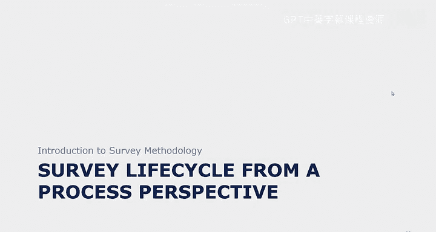
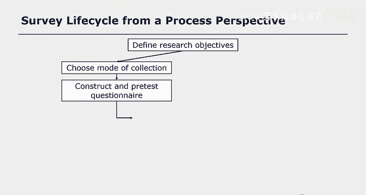
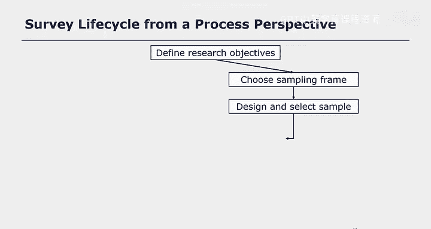
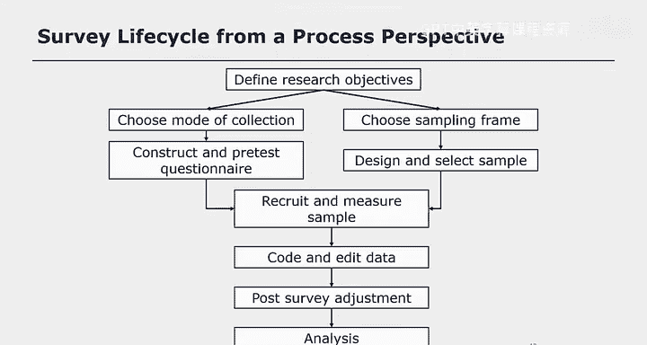

# 20：流程视角下的调查生命周期 📊

在本节课中，我们将从流程的视角来审视调查的生命周期。这个视角更侧重于你在调查过程中必须做出的决策及其后果。

上一节我们介绍了调查生命周期的不同视角，本节中我们来看看从流程出发的视角。这个视角强调行动导向，关注“你必须做什么”。根据你的抽样计划和测量工具，后续流程会有所不同。

以下是流程视角下调查生命周期的核心步骤：

**第一步：设计与准备**
首先，你必须设计研究目标，选择数据收集模式，并构建问卷初稿和预测试。我们的专项课程中有两门课专门涵盖这部分内容：数据收集课程将指导你如何做出明智的决策；问卷设计课程则详细讲解如何构建和预测试问卷。

**第二步：抽样与执行**
接着，你需要选择抽样框，并设计和抽取样本。我们的抽样课程将教授你如何完成这些步骤。将前两步结合起来，就进入了实际执行阶段：招募样本并进行测量。数据收集课程也会部分涉及此阶段的内容。

**第三步：数据处理与调整**
然后，是数据的编码、编辑过程，可能还需要用其他来源的数据进行补充，并进行调查后调整（如对无回答的处理和插补）。我们关于无回答和插补的课程将涵盖这部分内容。

**第四步：分析与报告**
最后，是分析环节。如果你处理的是调查统计数据，并且样本设计较为复杂，这就需要应用与常规分析不同的统计技术。我们专项课程中的另一门课将专门讲解这种分析。

本节课中，我们一起学习了从流程视角分解的调查生命周期，它明确了从设计目标到最终分析的每一步关键行动和决策点。理解这个流程有助于系统化地规划和执行调查项目。