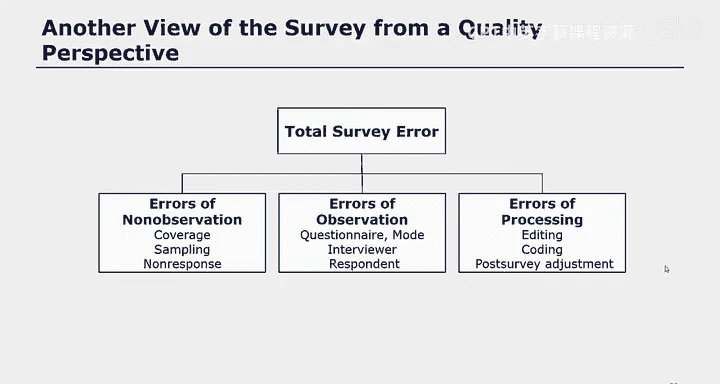
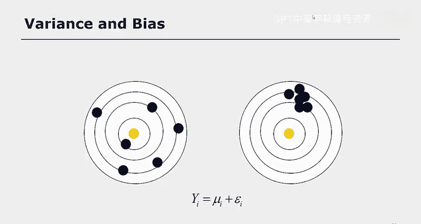

# 21：质量视角下的调查生命周期 📊

在本节课中，我们将从质量视角审视调查生命周期。我们将学习如何识别调查过程中各个阶段可能出现的误差，并理解这些误差如何影响最终数据的质量。课程将引入总调查误差框架，并解释其核心概念，包括测量误差、代表性误差以及变量误差与系统偏差的区别。

***

上一节我们介绍了调查生命周期的基本框架。本节中，我们来看看从质量角度出发，这个框架中的每一步是如何运作的。

下图展示了我们已经见过的调查生命周期，包括测量侧和代表性侧，以及不同的步骤。

从质量视角来看，我们关心的是这些步骤中的每一步工作效果如何。

以下是各个步骤可能出现的误差类型：
*   **效度问题**：从构念到测量步骤。
*   **测量误差**：从测量到回答步骤。
*   **处理误差**：从回答到编辑后回答步骤。
*   **覆盖误差**：从目标总体到抽样框步骤。
*   **抽样误差**：在抽样框中抽取样本的步骤。
*   **无回答误差**：在征集回答的步骤。
*   **调整误差**：在试图将受访者答案调整至目标总体的步骤。

这些误差都与特定步骤相关联。

如前所述，这个框架同样适用于其他类型的数据，我们在此使用调查数据来阐明它。

我们还将使用一些数学符号，这些符号对于你在概念、文字、抽象思想、数学模型、数据、分析模型和结果解释之间进行转换非常重要。最近与我交流过的亚马逊、Expedia等公司的数据科学家指出，他们招聘的人员同时具备这两种技能至关重要。

***

对于数学基础较弱的同学，我将逐一解释这些符号。

以下是测量侧和代表性侧各阶段数值的符号表示：
*   **μᵢ**：希腊字母μ，表示个体`i`的构念值。这通常是无法直接测量的。
*   **Yᵢ**：大写`Y`，表示个体`i`的理想测量值。例如，如果我的抽象构念是年龄，测量问题是“你多大了？”，这就是理想的答案。
*   **yᵢ**：小写`y`，表示个体`i`的实际回答。由于可能存在测量误差（例如，我不想透露真实年龄），这个值可能与`Yᵢ`不同。在概念上，将它们视为不同的部分很重要。
*   **yᵢᴾ**：小写`y`带下标`P`，表示经过编辑处理后的个体回答值。
*   **Ȳ**：大写`Y`上加横线，表示目标总体的平均值。
*   **Ȳᶜ**：表示覆盖总体的平均值。
*   **Ȳₐ**：表示样本的平均值。
*   **Ȳᵣ**：表示实际受访者的平均值。样本平均值和受访者平均值可能存在差异。
*   **Ȳᵥ**：表示经过加权或调整后的受访者数据平均值。

我们最终感兴趣的调查统计量，通常源于测量侧底部的编辑后回答（因此下标为`P`），并基于受访者数据（通常未加权）计算得出一个平均值（因此不再有下标`i`）。

***

快速回顾这些符号后，看待这些不同误差来源的另一种方式是将总调查误差分为三类。

以下是总调查误差的分类：
*   **非观察误差**：包括覆盖误差、抽样误差和无回答误差。
*   **观察误差**：包括问卷误差、模式误差、访员误差和受访者误差。
*   **处理误差**：包括编辑误差、编码误差和调查后调整误差。

重要的是这里引入的**总调查误差**概念。它是一种思考可能影响调查统计量的各种误差来源的方式。我特意说“可能”，因为这取决于你的设计、良好的设计决策和执行程序。

需要理解，这些误差不一定都是“错误”。有些误差仅仅反映了过程中固有的不确定性，你无法完全消除，例如抽样误差。想象一下从一袋M&M豆中多次抽取样本观察颜色，每次看到的颜色组合都会略有不同，这是抽样本身的性质，只要抽样，就不可避免地存在变异。

***

调查质量或价值，对于一个优质调查的理想状态是，在给定的时间和资源投入下，最小化这些误差。

总调查误差方法的成功，依赖于良好的信息来测量这些误差的各个部分。我们将向你介绍**辅助数据**的概念，它允许我们在过程中测量这些误差来源。

关于总调查误差，需要记住的重要一点是，误差可能出现在许多环节。调查主题、可用资金、抽样框、数据收集方法等，都可能以不同方式影响这些误差来源。整个专项课程将反复回到这个框架，以帮助你真正磨砺分析思维，并能在其他可用数据源中识别这些误差。

总之，总调查误差框架帮助你理解设计决策对你所收集数据的整体质量的潜在影响。结合成本考虑，它们能为你规划数据收集时做出何种决策提供良好的指导。

***

现在介绍一点统计学知识。误差的统计概念表达为我们所称的**均方误差**，即误差平方的平均值。对每个误差项取平方是为了让正负误差不会相互抵消。其公式为所有变量误差和偏差的平方和。

误差是针对特定统计量的，这是另一个重点。误差可能因你观察的变量和统计量类型不同而有所差异。在实践中测量均方误差相当困难，我们后续会再讨论。

但理解**真值**和**误差**的概念很有价值。真值是你试图测量的量的理想化概念。例如，美国的总人口数就是一个理想化概念。它确实存在，但由于人口不断出生和死亡，很难确定一个绝对精确的数值，因此也可以说是一个理想化的数字。

从理论角度看，如果你拥有那个理想化的真值，就可以将每个观测值与之比较，从而评估相关的误差。从操作角度看，这意味着需要另一个数据源来做到这一点。

***

当我们有了真值和观测值的概念后，重要的是理解**变量误差**和**偏差**之间的区别。偏差也是一种误差，但它是系统性的。

也许将这页幻灯片的内容称为“变量误差”和“系统误差”更好。变量误差，如果你观察它，它是在重复测量中的变异。回想一下M&M豆的例子，你抽取一个样本，里面的颜色组合就不同。在统计学中，这通常用**方差**或**变异**来表示。你可能听说过**置信区间**，即某个统计量加减一定范围，这就是变异性的表达，因为我们没有询问所有人，只是询问了一个样本，而样本与样本之间会略有不同。如果我们重复足够多次并取均值，期望是得到真值。我们稍后会进一步讨论。

然后是**偏差**，这是偏离真值的概念。它可能是有方向的。例如，人们可能系统性地低报年龄。或者，在报告体重时可能存在系统误差。

要估计偏差，我们同样需要来自其他来源的真实数据，但我们可以对影响做出假设。

下图从左到右直观展示了方差和偏差的概念：
*   **左侧（高方差，低偏差）**：黑点代表多次测量（如多次血压测量）或不同样本的平均值。测量值围绕真值（靶心）分散，但平均值接近靶心。这表示随机变异大，但系统偏差小。
*   **右侧（低方差，高偏差）**：测量值非常集中，但整体偏离了靶心。这表示测量很稳定（变异小），但存在系统性的偏差。

用数学术语表示，利用之前引入的符号，测量值 `Yᵢ` 等于构念值 `μᵢ` 加上一个误差项 `εᵢ`。公式为：
`Yᵢ = μᵢ + εᵢ`
这个误差项 `εᵢ` 就包含了第一步中关于目标测量的变异和偏差。

你同样可以将这个思路应用到第二步的测量误差中。那么，公式将是：
`yᵢ = Yᵢ + eᵢ`
这里，`eᵢ` 表示我的个人回答 `yᵢ` 与我应该对那个特定问题给出的答案 `Yᵢ` 之间的差异。我低报年龄的例子实际上不符合第一个公式，而是符合我们误差模型中第二步的符号表示。

***

在本节课中，我们一起学习了从质量视角审视调查生命周期。我们引入了总调查误差框架，详细解释了测量侧和代表性侧各阶段可能出现的误差类型及其数学符号表示。我们区分了变量误差和系统偏差，并通过图表进行了直观展示。理解这些核心概念对于设计高质量的调查和正确评估数据可靠性至关重要。