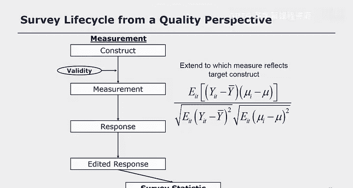
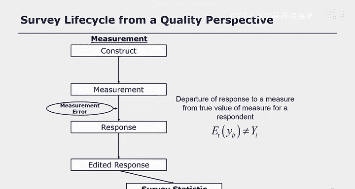
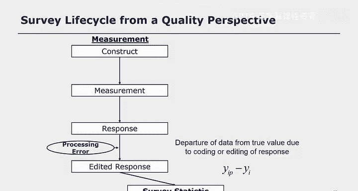

# 22：质量视角下的调查生命周期II——评估指标 📊

在本节课中，我们将从质量视角继续探讨调查生命周期，重点学习评估调查质量的核心概念与指标。我们将了解效度、测量误差及其来源，并通过公式来精确理解这些概念。

---

让我们从一个略有不同的角度，来看看公民质量视角。

上一节我们讨论了效度。现在，我们将为其提供更多概念背景。

对于一个给定的调查试验和实现，个体受访者的个体测量值与所有受访者的平均测量值之间存在差异。这个差异反映了**个体值与整体值之间的测量误差变异**。

我关注的是整体值，因此每一次试验、每一个单元都只是该整体值的一个反映。同样地，在构念层面，从每个个体到整体均值也存在变异。这里不再是个体试验间的变异，因为对所有试验取平均后，每个个体有一个构念值 μ_i，但我们感兴趣的当然是所有人的平均值 μ。因此，这里再次存在差异，即个体与整体之间的变异。

这两个不同变异的期望值，通过各自变异平方差的平方根来计算，就是**效度**的一个度量。我们将有一个小练习，帮助你理解这些公式。

**效度公式概念：**
效度涉及比较个体测量值与真实构念值之间的差异。其核心思想是评估测量是否准确反映了我们想要测量的概念。

---

**测量误差**在概念上甚至更容易理解。

对于某个特定问题，每个个体 i 在第 t 次试验中的回答是 Y_it。对所有试验取期望值，这个值应该等于真实的测量值。但如果不等，我就存在**测量误差**。

**测量误差公式：**
`测量误差 = 个体观测值 Y_it - 真实值 μ_i`

---

这种测量误差的一个来源，我们常常不会想到，那就是**调查中的访问员**。

访问员可能同时导致**变异和偏差**。即使经过相同的培训程序，不同的访问员收集的数据也可能导致调查统计量的变异。发生这种情况的原因多种多样，这个领域仍有大量未解之谜。

例如，一个概念是，不同的访问员会吸引不同的受访者。因此，在**谁同意接受访问员调查**这方面存在一些变异（这属于无应答误差），同时，受访者如何报告和回应特定的访问员也存在差异。

假设我是一名看起来健康的男性访问员，我正在调查或访问人们，询问他们的健康状况。如果他们相对于他们所看到的我（的健康状况）来评估自己的健康，他们可能会在某些量表上报告出与面对一位年长、有明显健康问题的访问员时不同的健康状况。因此，这里也存在变异。访问员在如何追问和引导受访者提供额外信息等方面也存在差异。

其他更明显的测量误差来源包括**受访者本人、问卷本身以及数据收集的模式**。

---

从质量视角审视调查生命周期，我们还提到了**处理误差**。

这简单地是**处理后的值与真实值之间的差异**，源于编码错误或对回答的编辑。因此，虽然编码和处理旨在纠正我们已有的错误，但如果处理结果偏离了受访者实际给出的、或在给定特定测量构念下本应给出的答案，它也可能引入误差。

**处理误差公式：**
`处理误差 = 处理后记录的值 - 受访者真实值`

---

**总结**

本节课中，我们一起学习了从质量角度评估调查的关键指标。我们深入探讨了**效度**的概念及其与个体-整体变异的关系，明确了**测量误差**的定义和计算公式，并分析了其多种来源，特别是常被忽视的**访问员效应**。最后，我们介绍了**处理误差**，即数据后期处理过程中可能引入的偏差。理解这些误差来源对于设计和实施高质量的调查至关重要。