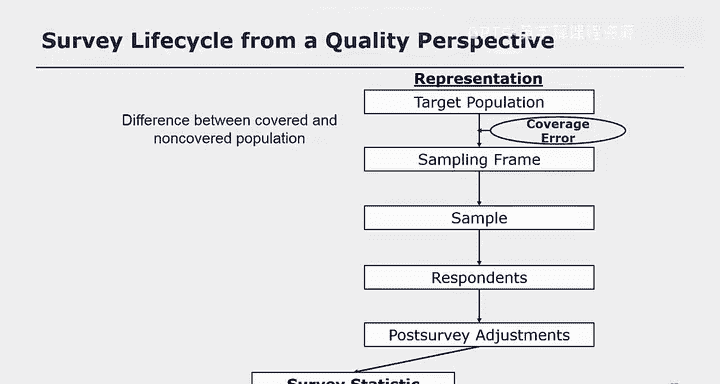
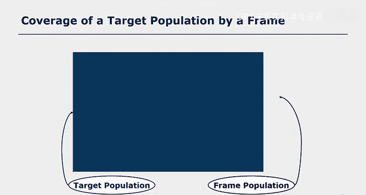
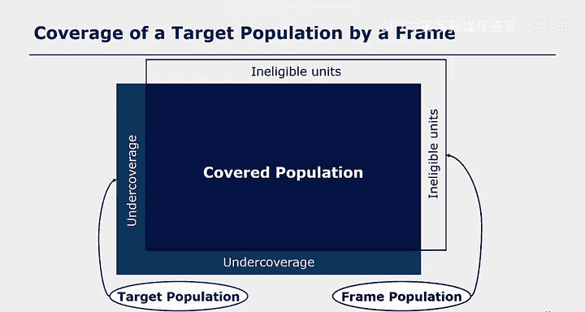
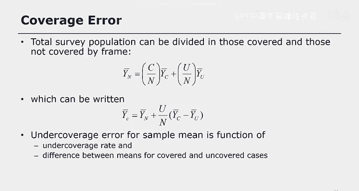
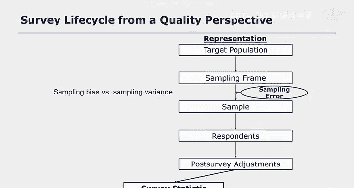
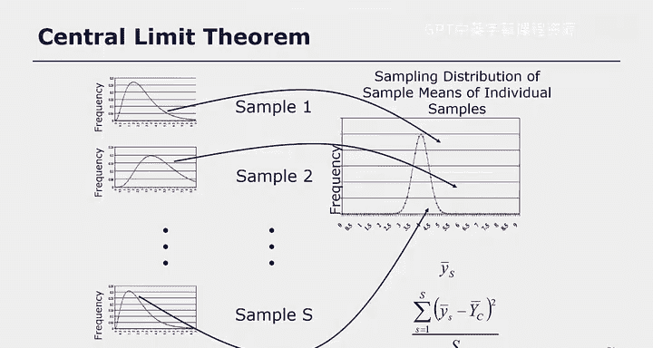
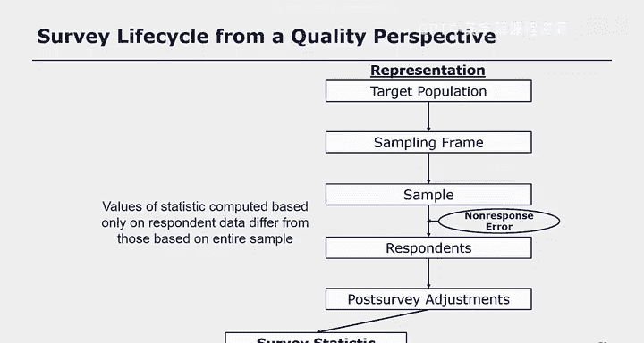
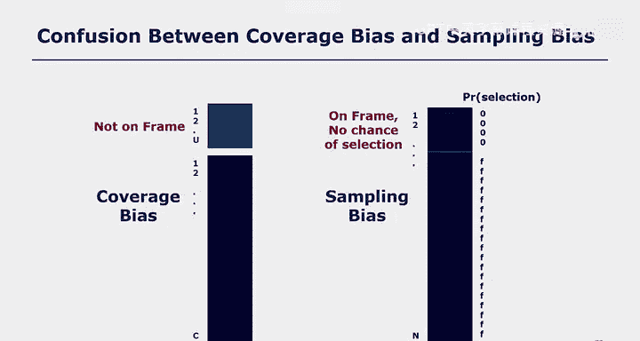
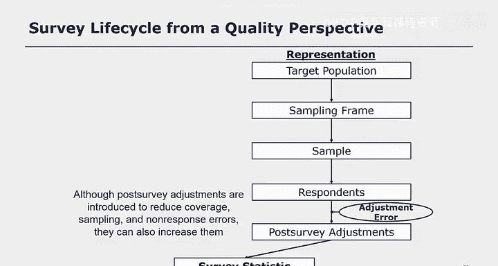
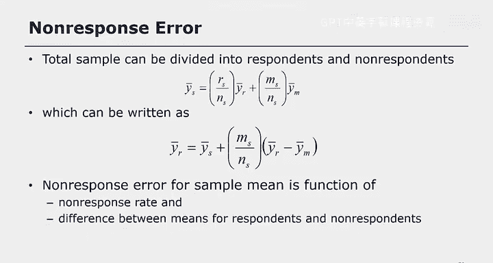

# 密歇根大学《调查数据收集和分析》第1课：框架 - P23：质量视角下的调查生命周期III——覆盖与抽样 📊

在本节课中，我们将从质量视角继续探讨调查生命周期，重点关注**代表性**方面的问题。我们将学习覆盖误差、抽样误差、无应答误差和调整误差，理解它们如何影响调查结果的准确性。

上一节我们介绍了调查生命周期中的质量视角，本节中我们来看看代表性方面的具体误差来源。

## 覆盖误差

覆盖误差发生在调查的第一步，即从**目标总体**到**抽样框**的转换过程中。它指的是被抽样框覆盖的单元与未被覆盖的单元之间的差异。

为了更好地理解，请看下图。假设这个蓝色方块代表我们的目标总体。

理想情况下，抽样框覆盖的总体应与目标总体完全一致，这样就不会产生覆盖误差。

但实际情况往往是，抽样框的覆盖范围有所偏移，被覆盖的总体只是目标总体的一部分。

例如，假设我们的目标总体是美国所有18岁以上的家庭住户。过去，当电话簿信息完整时，我们可以使用列出的电话号码作为抽样框，至少能覆盖所有拥有固定电话的家庭。但现在，电话框（固定电话列表）已无法覆盖全部人口：它包含一些不合格的单元（如机构、空号或重复号码），同时也遗漏了许多未被覆盖的单元（如仅使用手机的用户）。

因此，总调查总体可以被分为被抽样框覆盖和未被覆盖的两部分。

如果用公式表示，我们可以将总体均值 `Y_bar` 分解为被覆盖部分（下标C）和未被覆盖部分（下标U）的加权平均：

`Y_bar = (N_C / N) * Y_bar_C + (N_U / N) * Y_bar_U`

其中：
*   `N_C / N` 是被覆盖单元的比例。
*   `N_U / N` 是未被覆盖单元的比例。
*   `Y_bar_C` 和 `Y_bar_U` 分别是这两部分在目标变量 `Y` 上的平均值。

由此可以推导出覆盖误差的表达式：

`覆盖误差 = (N_U / N) * (Y_bar_C - Y_bar_U)`

**覆盖误差的大小取决于两个因素**：
1.  **未被覆盖的比例 (`N_U / N`)**：即覆盖率不足的比率。
2.  **被覆盖者与未被覆盖者在目标变量上的均值差异 (`Y_bar_C - Y_bar_U`)**。

如果均值差异为0，那么无论未被覆盖的比例多大，都不会产生偏差。反之，如果均值差异很大，即使未被覆盖的比例很小，也可能导致显著的误差。

## 抽样误差与抽样偏差

接下来我们区分两个重要概念：抽样误差（随机误差）和抽样偏差（系统误差）。

**抽样误差**（或抽样方差）纯粹是由于从总体中随机抽取不同样本而产生的变异。每个样本都可能包含略微不同的个体，因此样本统计量（如均值）会围绕总体参数波动。在调查统计中，我们常用置信区间和标准误来量化这种不确定性。

**抽样偏差**则是一种系统性误差，它发生在抽样框中的某些单元被赋予**零概率**被选中时。例如，在一般的家庭住户抽样中，军事基地的人员可能完全不被覆盖，他们的被选概率为零，这就会导致抽样偏差。

理解抽样分布有助于区分二者：如果我们从总体中反复抽取大量样本并计算其均值，这些样本均值的平均值将等于总体均值（无偏），但其自身存在方差（抽样误差）。抽样偏差意味着这个“平均值”本身已经偏离了总体真值。

**覆盖偏差与抽样偏差的关键区别在于**：
*   **覆盖偏差**：指个体根本不在抽样框上，因此完全无法被选中。
*   **抽样偏差**：指个体在抽样框上，但由于抽样设计问题（如被赋予零概率）而无法被选中。

## 无应答误差

无应答误差发生在从**样本**到**实际受访者**的步骤中。我们基于受访者数据计算的统计量，可能与完整样本的数据存在差异。

缺失数据有两种形式：
1.  **单元无应答**：整个样本单元的数据完全缺失（如图中整行缺失）。
2.  **项目无应答**：受访者回答了调查，但某些具体问题（项目）的数据缺失。

与覆盖误差类似，我们可以将总样本视为由受访者（R）和无应答者（M）组成。总体样本均值可表示为：

`Y_bar_sample = (N_R / N_sample) * Y_bar_R + (N_M / N_sample) * Y_bar_M`

无应答误差则为：

`无应答误差 = (N_M / N_sample) * (Y_bar_R - Y_bar_M)`

它同样取决于**无应答率**和**受访者与无应答者在目标变量上的均值差异**。

## 调整误差

最后是调整误差。在调查后期，我们常使用事后分层或其他加权调整方法来纠正覆盖、抽样或无应答带来的偏差。

然而，**如果调整本身不正确，反而会引入新的误差**，即调整误差。例如，使用了不准确的辅助信息或错误的模型进行校准，都可能导致估计结果进一步偏离真值。

## 核心概念总结

以下是本段课程中你应该掌握的关键概念：

**变量误差与系统误差**
*   **变量误差**：指那些在不同次调查实施中会变化的误差，例如抽样误差和某些测量误差。
*   **系统误差**：指那些在每次调查中都以相同方向影响结果的偏差，例如覆盖偏差、抽样偏差和无应答偏差（当存在模式化的无应答时）。

**重要提示**：
没有绝对“好”或“坏”的调查，只有针对**某个具体统计量**的误差大小。这意味着在同一项调查中，有些估计值（如某个比例）可能误差很大，而另一些估计值（如另一个比例或回归系数）则可能非常精确。

**调查方法学**，就是研究如何减少这些误差，并将这些原理应用于实际调查设计的科学。

---

本节课中我们一起学习了调查生命周期中代表性方面的四种主要误差：覆盖误差、抽样误差、无应答误差和调整误差。我们理解了它们的来源、计算方式以及关键影响因素（覆盖/无应答率以及子群间的差异）。掌握这些概念是评估和改进调查数据质量的基础。