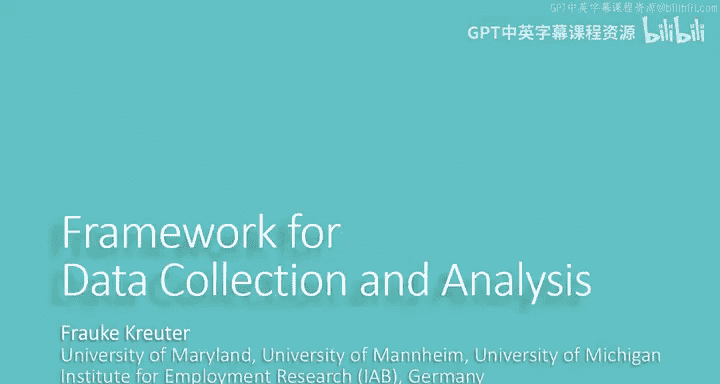
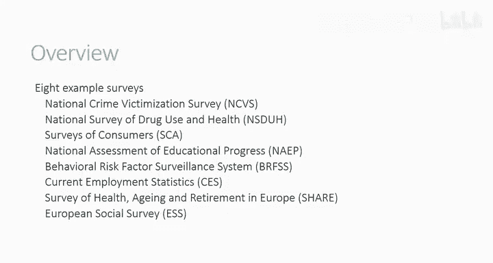
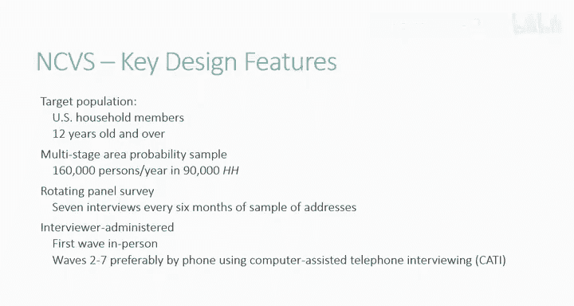
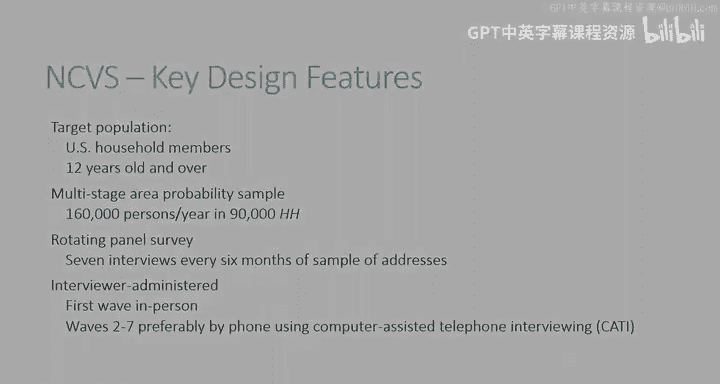
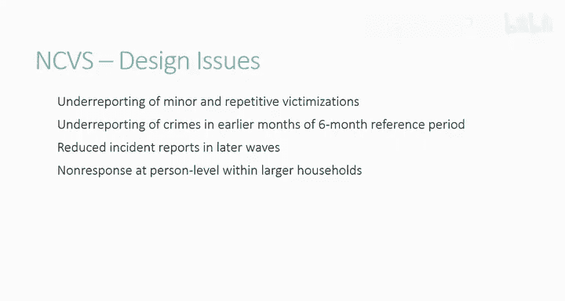
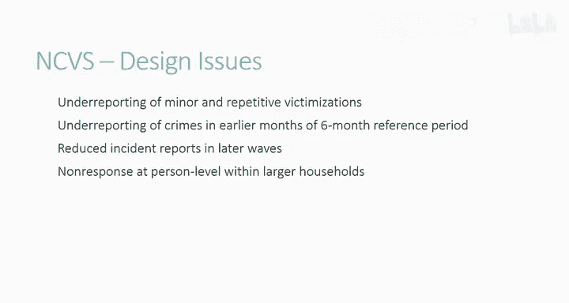

# 24：全美犯罪受害调查(NCVS) 📊

欢迎来到我们数据收集与分析课程框架的第四部分。

在第四模块中，我们将向您描述六个示例调查。

我们会在课程网站上提供这些调查的补充材料。

我们在描述这些示例调查时，会重点突出一些**全调查误差框架**和**全调查质量框架**的特征，这些框架您在上一个模块中已经见过。

我们鼓励您深入研究这些调查，并在您自己的国家寻找类似的调查，观察它们在关键要素上有何不同。

通过这种方式，您将拓宽视野，了解收集此类数据的不同机会，以及各国在方法和质量上的差异。

以下是我们将提供或讨论的八个示例调查的概览。

我将在视频片段中逐一为您讲解每一个调查。

显然，在视频讲座中我们只能提供非常简要的材料。

但这些调查都很有趣，因为它们提供了服务于政策需求、研究需求的关键指标，通常也服务于私营部门公司的需求，这些公司希望了解特定国家甚至更大实体（如欧盟）的状况，欧盟对跨欧洲国家的数据很感兴趣。

因此，所有这些类型的调查都在收集政策和社会科学指标。

我们将讨论的这一系列调查中的第一个是**全美犯罪受害调查**。

这项调查的目的是出于一种担忧，即警方记录可能低估了犯罪发生率。

这是一个有趣的案例。来自警方记录的犯罪统计数据，是可用于分析的行政数据的一个很好的例子。

事实上，在美国，目前正在进行一项巨大的努力，试图将这些不同的行政数据库连接起来，以便为犯罪和司法系统提供一个清晰的图景。

然而，如果一项犯罪没有向警方报告，就会出现犯罪覆盖不足的情况，并且没有相关记录。

因此，即使您可能拥有关于每一起已报告犯罪的、没有缺失值且没有数据录入错误的行政记录，但对于那些未报告或实际上未报告的犯罪，则没有任何记录。

这是目的之一。

另一个目的是，各国认为感知受害具有价值。

因此，即使并非所有事件都是犯罪，也存在一种受害感知和对潜在受害的恐惧感知。

这是一个有趣的社会指标，并已导致许多国家收集与这里看到的犯罪受害调查有些类似的调查。

在美国的这项调查中，通过自我报告测量家庭和个人受害情况。

因此，有一个家庭层面的报告者，报告整个家庭的情况，然后是家庭中的个人。

其他一些调查也有家庭样本的概念，然后要么调查家庭中的每个成员，要么在家庭筛选阶段进行选择。

通过犯罪受害调查，可以报告和分析由调查变量确定的各种亚群体的受害率。

目前，NCVS正在考虑重新设计，该调查已经进行了许多有趣的方法学研究。如果您有兴趣，可以查阅那些旧的方法报告，我们将在问卷设计课程中再次讨论其中的一些内容。

以下是NCVS的关键设计特征，供您从方法论学家的角度审视。

*   **目标总体**：美国家庭成员，12岁及以上。
*   **抽样设计**：多阶段区域概率抽样，每年约90,000个家庭中的16,000人。
*   **调查模式**：称为轮换面板调查，意味着进行七次访谈，每次间隔六个月，然后使用新的家庭/个人。因此，受访者会在几年内处于一个类似的小型面板中，之后会访谈其他人。
*   **数据收集方式**：访谈员管理。第一波是面对面进行，第2至7波优选通过电话进行，采用计算机辅助电话访谈。

这里有趣的一点是，第一次调查，这类调查通常作为“界定访谈”进行，以便记录截至该时间点发生的所有事情，然后之后可以随时回溯参考，查看是否再次报告到该时间点。这将在问卷设计课程中讨论。

说到问卷设计，这是全美犯罪受害调查的问卷，底部链接提供了完整版本。

这里是一个较旧的截图。您还可以看到这里发布的一些结果，这是1994年至2011年一系列年份中，每千名12岁及以上人口的受害率差异。

这些是其他设计问题，如前所述。

这项调查的目的是克服相对于警方记录的漏报问题，但当然，正如我们讨论过的，调查本身也存在误差。

因此，这里通常存在对轻微、重复性受害事件的漏报，这与记忆问题有关。

记忆和回忆将是问卷设计课程中的一个完整部分。

还存在参考期问题，这是良好问卷设计的另一个相关部分。

此外，我们还有个人层面的无应答问题。

某些人群通常难以找到或难以进行访谈。

老年人更有可能参与调查，年轻人则可能性较低，部分原因是他们在犯罪受害调查中较少在家。

这一点很重要，因为最有可能受害的人和最有可能成为受害者的人，可能恰恰是最难联系到的，因此可能不属于调查本身或拒绝参与。

---

**本节课总结**

在本节课中，我们一起学习了全美犯罪受害调查作为一个重要的示例。我们了解了其设立目的——弥补警方犯罪记录的不足并测量感知受害。我们探讨了其关键设计特征，包括目标总体、抽样方法、轮换面板设计以及数据收集模式。最后，我们分析了该调查面临的主要误差挑战，如记忆偏差、参考期效应以及特定人群的无应答问题。这为我们理解如何应用全调查误差框架来评估一项具体调查的质量提供了实际案例。