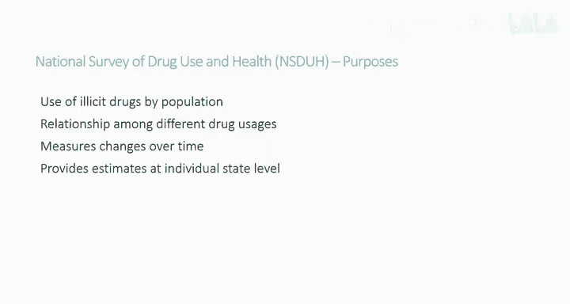
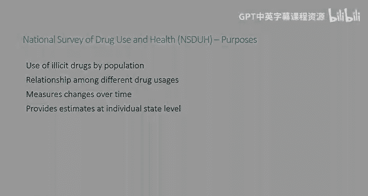
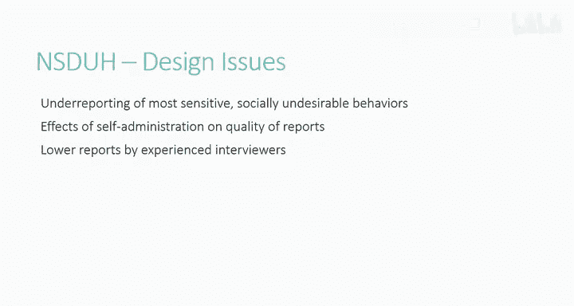

# 密歇根大学《调查数据收集和分析》第1课：框架 - P25：全美药物使用与健康调查 (NSDUH) 🧪📊

在本节课中，我们将学习第二个重要的全国性调查案例：全美药物使用与健康调查。我们将了解其调查目的、核心设计特征以及在实际操作中需要注意的关键问题。

上一节我们介绍了全美犯罪受害调查，本节中我们来看看另一个同样重要的社会调查。

## 调查目的

第二个调查是全美药物使用与健康调查。其目的是为了测量不同人群细分领域以及全国整体人口的非法药物使用情况。

如果你回想模块一的内容，其主要目标之一确实是对整体人口进行描述性统计。但同时，它也关注不同药物、不同用药行为之间的关系，并可能测量其随时间的变化趋势。

也许这些差异性问题与第一个调查（犯罪调查）略有不同。

## 核心设计特征

以下是全美药物使用与健康调查的几个关键设计特征：

*   **目标人群**：略有不同，为**美国12岁及以上的家庭成员**。
*   **抽样方法**：采用**多阶段区域概率抽样**。我们将在抽样课程中更详细地讨论如何实施这种方法。
*   **调查类型**：这是一个**重复横断面调查**。这意味着在不同时间点调查的不是同一批人，而是在某个特定时间点对一组特定人群进行调查，然后在另一个时间点再对另一组随机人群（本例中约为70,000名美国家庭成员）进行调查。虽然可能偶然有人被访谈两次，但通常情况并非如此。
*   **数据收集模式**：该调查采用访谈员主导的方式，具体为**计算机辅助个人访谈**，这是我们之前介绍过的一种数据收集模式。由于调查内容非常敏感，部分问卷通过**音频计算机辅助自填访谈**完成。在这种模式下，访谈员会暂时离开，受访者戴上耳机听问题，然后自行将答案输入电脑。

## 测量与设计挑战

如果你想测量随时间的变化，当然必须确保从每个时间点到下一个时间点的测量具有可比性，并且确保数据收集中不包含混淆因素，以免造成实际上并未发生变化的假象。这一点对全美犯罪受害调查也同样重要。

因此，如果你有一个长时间序列的调查，并计划进行设计变更，那么一个可行的好办法是：让部分样本采用新设计，同时保留另一部分样本沿用旧设计。这样你就能区分出哪些变化是由设计变更引起的，哪些是真正随时间发生的变化。

## 潜在问题与数据获取

同样，这里也有一些关于这些社会统计数据的报告图表，以及一个指向SAMHSA（药物滥用与心理健康服务管理局）网站的链接。希望你能通过它查阅到这些随时间变化的实际数据。

这里也存在一些设计上的问题。对于最敏感和社会不容许的行为，可能存在**低报**的情况。这既是问卷设计的问题，也在一定程度上与数据收集模式有关，因为你可能会决定不采用访谈员主导，而改用自填式调查。

## 总结

本节课中，我们一起学习了全美药物使用与健康调查。我们了解了其旨在描述和关联全国药物使用情况的核心目的，掌握了其针对12岁及以上家庭人口、采用多阶段概率抽样和重复横断面设计的关键特征，并探讨了在测量长期变化和处理敏感话题时确保数据可比性与准确性的重要设计考量。