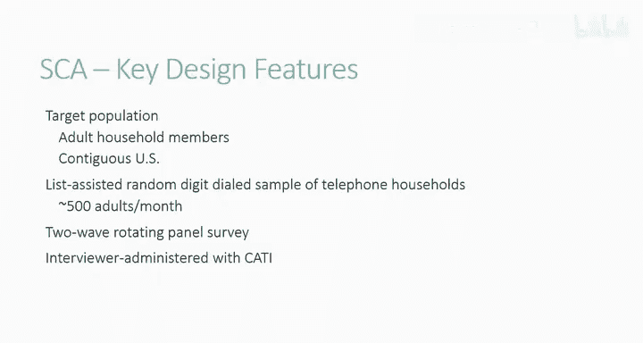
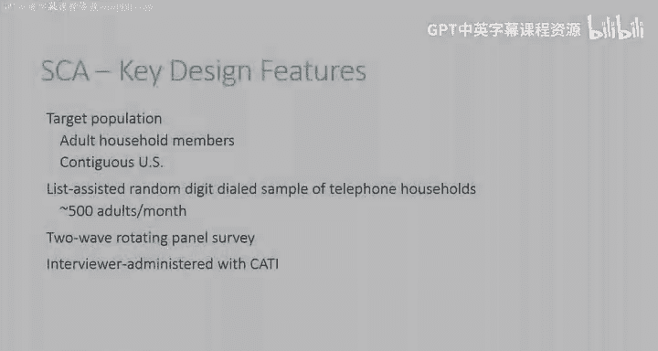
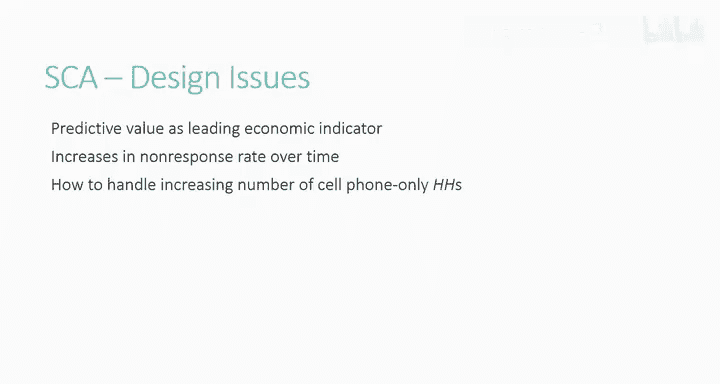

# 26：统计区域分类(SCA) 📊

在本节课中，我们将学习系列调查中的第三个——消费者态度调查。我们将探讨其目的、测量内容、目标人群、抽样框架、设计特点以及当前面临的方法论挑战。

---

## 概述

消费者态度调查旨在测量公众对财务事务的态度，并希望以此预测未来的行为。它测量对个人和国家经济属性的态度、储蓄和借贷行为、购买意愿，以及所有这些项目随时间的变化。

## 调查目的与内容

该调查的核心目的是通过测量态度来预测行为。以下是其测量的主要内容：

*   **态度测量**：针对个人和国家经济属性的看法。
*   **行为测量**：包括储蓄和借贷行为。
*   **意向测量**：例如购买意愿。
*   **趋势测量**：跟踪以上所有项目随时间的变化。

仅通过观察行为很难获得这些信息。虽然可以分析信用卡记录来获取类似数据，但无法捕捉到人们的**感知**。而研究者和公共政策制定者往往对感知与行为之间的关系感兴趣。

## 目标人群与抽样框架

该调查的目标人群同样是**成年家庭成员**，即18岁及以上人士。



然而，它的抽样框架非常不同，采用的是**列表辅助随机数字拨号**。其基础是一个电话号码库，然后将最后几位数字替换为随机数，以提高涵盖已列出的和未列出的电话号码的几率。

随着我们对抽样框架的思考深入，如今必须补充**手机号码**，才能真正构建一个覆盖全体人口、给予每个人平等被抽中机会的公平框架。



## 调查规模与设计

该调查规模较小，每月约访问500名成年人，但持续进行。它是一个**双向轮换面板调查**。

```
受访者将被访问两次，然后轮换出调查。
```

此调查同样由访员执行，但通过**电话**进行。

## 问卷与数据应用

如果你对消费者态度调查的问卷感兴趣，可以访问相关网站获取片段示例。关于该数据的报告非常丰富，例如教科书中的案例，或探讨失业预期与美国就业率变化之间关系的报告。你可以在相关网站或各种经济期刊上找到更多链接。

## 设计挑战与未来思考



除了已提到的特点，该调查面临的设计问题还包括：电话调查的**无回答率**随时间显著上升。这是一个巨大的方法论挑战，由于各种原因（尤其是难以取得联系），通过电话联系人们变得越来越困难。

因此，我之前提到的**纳入手机号码框架**的需求日益迫切。或者，可能需要改变提问方式，例如从长问卷转向单项问卷，或转向我们之前介绍的**谷歌调查**来捕捉此类情绪。

一个有趣且尚未有定论的研究问题是：为了获得对整个国家态度的正确估计，本调查所使用的**基于概率的随机数字拨号抽样框架**究竟有多重要？例如，**谷歌调查**能否成为一个良好的替代数据源？

---

## 总结

本节课我们一起学习了消费者态度调查。我们了解了它如何通过测量经济态度和行为意向来预测未来趋势，认识了其独特的列表辅助随机数字拨号抽样框架，以及作为电话执行的双向轮换面板调查的设计特点。最后，我们探讨了当前电话调查面临的无回答率挑战，并思考了纳入手机框架或采用新调查模式（如谷歌调查）的可能性。