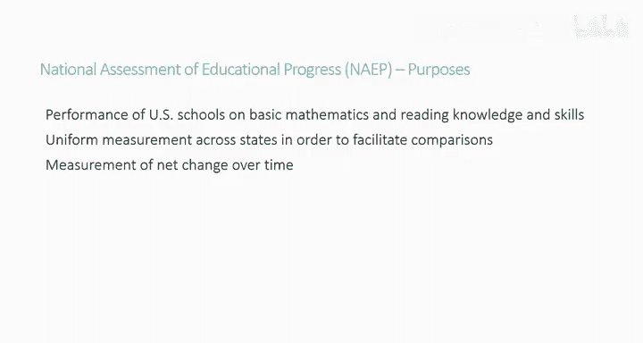
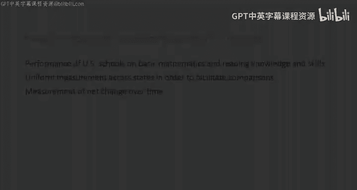
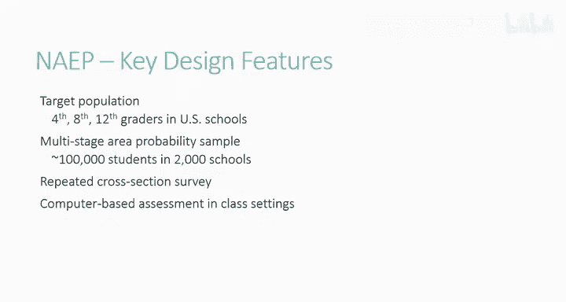
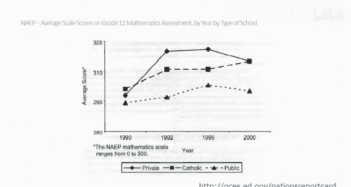
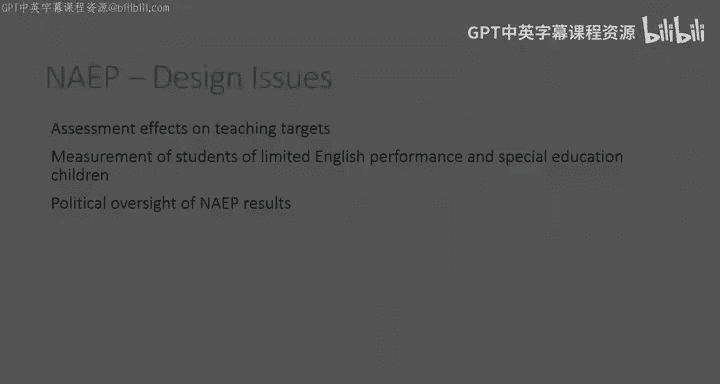
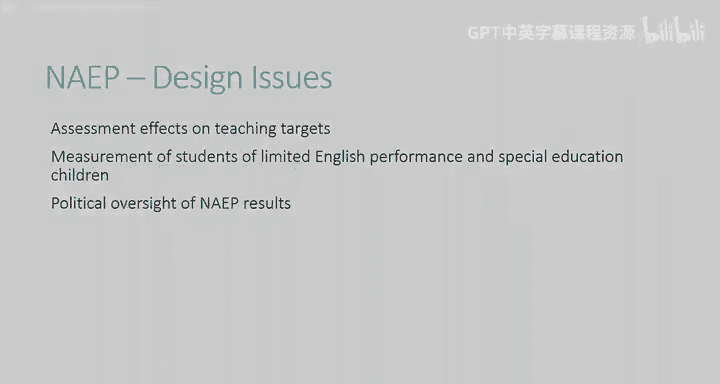

# 📊 密歇根大学《调查数据收集和分析》第1课（P27）：全美教育进展评估(NAEP)

在本节课中，我们将学习本系列的第四项调查——全美教育进展评估（NAEP）。我们将了解其目标、调查对象、抽样设计、数据特点以及相关的设计考量。

---

## 调查目标 🎯

上一节我们介绍了多种国际性教育评估调查。NAEP 的目标与 PISA、TIMSS 等调查类似，旨在测量学生的数学和阅读技能。其核心目标是提供美国各州之间统一的测量标准。

**主要目的**：
*   便于比较各州和学校的教育水平。
*   测量教育水平随时间发生的变化。

---

## 目标群体与抽样设计 👥

本节中我们来看看 NAEP 的调查对象和如何选取样本。其目标群体是美国学校中的四年级、八年级和十二年级学生。

NAEP 采用多阶段区域概率抽样方法，这与之前介绍的调查类似。其样本规模约为 **2000 所学校中的 100，000 名学生**。

由此产生的数据结构具有明显的层次性（例如，学生嵌套于学校中）。因此，学习相关的**多层次数据分析**课程对于正确处理此类数据、准确报告和估计结果至关重要。

以下是其关键设计特点：
*   **调查类型**：重复横截面调查。这意味着样本被选取、接受测试后即释放，不会进行后续追踪，因此**不是**固定样本调查。
*   **实施方式**：基于计算机的评估，由现场工作人员在各学校组织实施。

---

## 问卷与数据示例 📝

现在，我们来看一下 NAEP 的问卷形式和生成的数据。其问卷形式有所不同，因为其中包含针对学生的测试题目。

（注：示例图片中显示了测试题目和正确答案，但学生实际测试时不会看到答案。如需查看完整的评估测试，可访问美国国家教育统计中心网站。）

以下是一个数据示例，展示了美国私立、公立和天主教学校十二年级学生数学评估的平均分数趋势图，时间跨度约为十年。

（我们可以在此基础上，再增加十年甚至二十年的数据来进行更长期的分析。）

---

## 设计考量与影响 ⚠️

最后，我们来探讨 NAEP 调查中一些重要的设计考量及其社会影响。总体而言，该调查希望评估教学目标的成效和学生的语言表现。

但在测量时需注意：
*   **测量混淆问题**：例如，数学测试可能要求学生阅读题目并书写答案，这在一定程度上与学生的英语水平相混淆。
*   **政治与社会影响**：NAEP 数据具有高度的政治敏感性，备受关注。许多人会根据这些数据选择居住地和学区，进而影响学区质量和房价。这是需要牢记的重要社会背景。

---

## 总结 📋

本节课中，我们一起学习了全美教育进展评估（NAEP）。我们了解了它作为一项大型教育评估调查的目标、其针对特定年级学生的目标群体、采用的多阶段概率抽样方法，以及由此产生的层次性数据结构。我们还看到了其基于测试的问卷形式、生成的数据示例，并讨论了在测量设计和数据解读时需要注意的混淆问题及其广泛的社会经济影响。