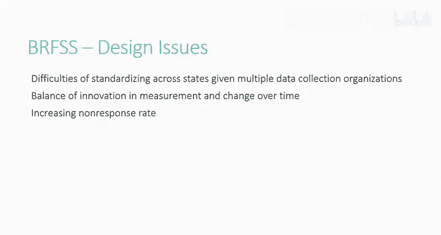

# 课程1：框架 | 第28课：行为风险因素监测系统(BRFSS) 📊

在本节课中，我们将学习行为风险因素监测系统（BRFSS）。这是一个在美国各州层面收集健康相关数据的重要调查。我们将了解其目的、设计特点以及在实际操作中面临的一些挑战。

---

## 概述

行为风险因素监测系统，常被称为BRFSS或“B-fuss”。它的主要目的是为各州提供健康指标和风险相关行为的测量数据。该系统为州级公共卫生官员提供评估依据。值得注意的是，它不仅提供当前状态的快照，还进行持续测量，因此数据的一致性至关重要。

## 调查设计与目标人群

上一节我们介绍了BRFSS的总体目标，本节中我们来看看它的具体设计。

该调查的目标人群在全美定义一致：即家庭中的成年人。它是一项重复的横断面调查，与我们之前讨论过的调查类似，因此不采用固定样本组。数据收集通过访问员进行的电话访谈完成。

以下是该调查问卷的一个片段示例，以及由此调查生成的一些数据报告样例。你可以在美国疾病控制与预防中心（CDC）的网站上找到这些以及更多的结果。

## 数据收集的设计问题与挑战

之前提到的设计问题对于BRFSS来说尤为有趣，因为很难在所有不同的州之间标准化数据收集流程。各州的数据收集机构操作方式差异很大。

例如，有些机构拥有专门负责BRFSS的访问员，他们使用同一份问卷进行成千上万次访谈。试想一下，如果你第500次询问同一个问题，你会如何执行？因此，可能会存在一些访问员效应，你将在后续课程中了解更多相关内容。

但这只是挑战之一。此外，该系统还面临平衡创新与测量、随时间变化保持可比性，以及因人们不愿参与调查而导致的应答率下降等问题。

## 新兴数据来源的替代可能性

如今，像谷歌搜索这样的平台试图提供替代性指标，例如谷歌流感趋势搜索关键词——即用户在网站上的搜索词。这些平台开发了算法，将这些搜索词与CDC也收集的关键指标关联起来。

未来，BRFSS中的某些测量指标很可能会被这类新型数据收集工作所取代。

---

## 总结

本节课中，我们一起学习了行为风险因素监测系统（BRFSS）。我们了解了它作为州级健康数据来源的核心目的、其针对成年人的电话调查设计，以及在跨州标准化、访问员效应和应答率方面面临的挑战。最后，我们还看到了来自互联网大数据的新型指标可能对传统调查方式构成的补充或替代趋势。