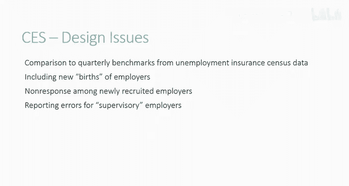
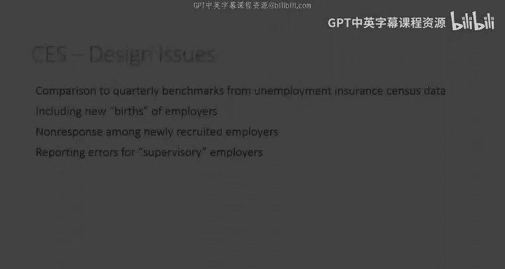
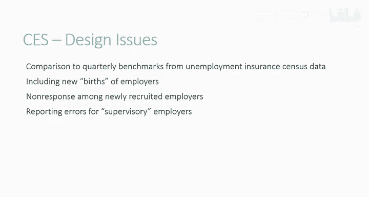

# 29：现时人口调查(CES) 📊

在本节课中，我们将要学习一种与我们目前所见略有不同的调查——现时人口调查。这是一种旨在捕捉美国月度就业人数变化的数据收集工作。

## 📈 调查概述

现时人口调查的核心设计目标是追踪美国就业市场的变化。这包括就业岗位数量的变化、美国工人工作时长的变化以及工人收入的变化。

## 🏢 核心设计特点

上一节我们介绍了调查的一般概念，本节中我们来看看现时人口调查的几个关键设计特点。

以下是该调查的几个主要特征：

*   **目标总体**：目标总体不再是个人，而是**组织**。在此特定调查中，拥有**一名或多名雇员**的机构即符合目标总体条件。
*   **抽样方式**：样本从一个名录中抽取。数据收集涉及约**140家企业和政府机构**，这实际上代表了更多的个体工作场所。
*   **面板设计**：该调查是一个**旋转面板调查**。这意味着一些企业会留在面板中参与多轮调查，而另一些则会退出。在这种情况下，面板长度不一定是固定的。

## 🔄 数据收集方法

了解其设计特点后，我们来看看其独特的数据收集方式。

数据收集采用了一种非常不同的方式进行。它使用了一种称为**EDI**的方法，即数据收集方（此处是美国人口普查局）与特定公司之间的**电子数据交换**。

此外，还有其他可替代的数据传输模式可供使用，例如：
*   **传真或触摸式数据录入**
*   **纸质表格**
*   **IVR**，即**交互式语音识别**

人们越来越希望，也能将这些替代数据源用于我们所见过的其他一些调查服务中。

## 📊 重要产出与设计挑战

在介绍了数据收集方法后，我们来看看该调查的重要产出以及伴随的设计问题。

现时人口调查的重要产出包括，例如，经过季节性调整的**各州失业率**。这里展示的是2015年的数据。

然而，伴随着这些重要数据，也出现了一些设计上的挑战：

*   **及时报告**：现时人口调查的数据（尤其是失业率数字）有固定的发布日期。
*   **数据基准化**：调查非常强调人口普查局拥有的**失业保险数据**。将这些数据作为基准进行校准可能是一项挑战。
*   **纳入新企业**：将新成立的企业（那些尚未在名录中，但当然对经济增长有贡献的）纳入调查是一个挑战。
*   **无回答问题**：新招募的雇主中经常出现无回答的情况。
*   **报告错误**：根据报告在公司层级结构中所处的位置，可能会出现报告错误。

调查表格的填写与报告是同时完成的。

## 🎯 总结

本节课中，我们一起学习了现时人口调查。我们了解到它是一种以组织为目标总体的调查，采用旋转面板设计和电子数据交换等多元收集方式，用于追踪美国就业市场的月度变化，并面临着及时性、数据校准和覆盖新企业等设计挑战。