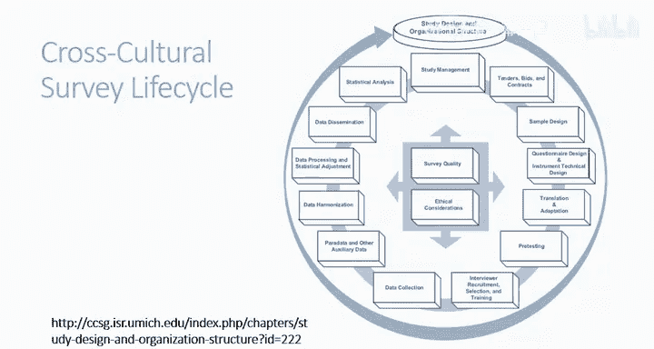
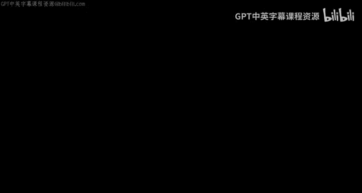
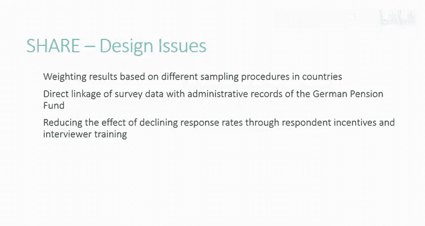
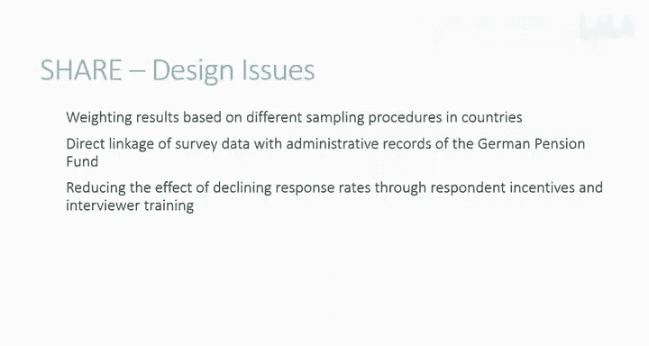

# 密歇根大学《调查数据收集和分析》第1课：框架 - P30：欧洲健康、老龄与退休调查(SHARE) 🧓🌍

在本节课中，我们将学习跨文化调查中的一个重要案例——欧洲健康、老龄与退休调查。我们将了解其设计、关键特征以及面临的方法学挑战。

---

在上一节我们讨论了调查设计的一般流程后，本节中我们来看看一个具体的跨文化调查实例。首先，我们需要理解跨文化调查所特有的生命周期。

密歇根大学调查研究中心内的跨文化调查小组拥有一个资源丰富的网站。该网站提供了大量关于调查设计，特别是针对跨文化研究和美国以外地区调查的信息。这一点很重要，因为许多现有文献主要基于美国背景，而这个网站为美国以外的研究者提供了特别有用的资源。

在该网站的生命周期图中，你可以看到一个熟悉的调查流程。这个流程与我们之前讨论的样本设计和问卷设计等环节类似。然而，其中有两个环节是跨文化调查所特有的：**翻译与适应**不同文化背景，以及最终的**数据协调**。

以下是该生命周期图的核心阶段概述：
*   **设计**：包括概念定义、问卷设计等。
*   **翻译与适应**：将调查工具适配到不同的文化和语言环境中。
*   **数据收集**：执行实地调查。
*   **数据处理**：包括数据清理和编码。
*   **数据协调**：将来自不同文化背景的数据进行标准化和整合，以便比较分析。

---

现在，让我们聚焦于符合这种跨文化调查模式的两个具体案例。我们首先介绍的是**欧洲健康、老龄与退休调查**。

SHARE是一项跨国调查，主要目标是评估欧洲各国与公共政策、文化和历史相关的问题，但其核心目标是全面描绘老龄化过程。该项目由欧盟委员会资助，旨在研究老龄化及其在不同国家间的差异。

SHARE本身在进行数据协调。它在美国有一个姊妹研究，称为“健康与退休研究”，同样由密歇根大学运行。此外，英国的“英国老龄化纵向研究”也是一个相关的有趣资源。

以下是SHARE调查的关键特征：
*   **目标人群**：定义为**50岁及以上**的人群。
*   **地理范围**：目前在**20个**不同的国家进行，已完成**五轮**调查。
*   **抽样方法**：每个国家采用不同形式的**概率抽样**，样本根据各国的常规情况选择，大多数国家使用个人登记册。
*   **样本量**：大约调查了**110,000**名个体。
*   **数据收集方式**：调查通过**访谈**进行，并包含一些我们之前提到的物理测量（生物标志物），例如收集干血斑，以及进行握力等物理测试。

这是一项设计精良的调查，收集的数据非常有价值。你可以在SHARE网站上找到问卷的PDF版本。此外，用于分析数据和进行二次数据分析的信息也越来越多，包括收集的关于访员的**辅助数据**。

这里有一个SHARE的输出示例，展示了**教育程度与身体健康**在所有参与国之间的相关性。至少在国家层面，可以看到很强的相关性。当然，我们需要谨慎对待由数据分组可能带来的生态学谬误。但在单个国家内，样本量也足够强大，可以单独检验这些效应。

---

对于方法学家和即将进入该领域的你来说，SHARE的设计问题尤其值得关注。

以下是SHARE面临的一些核心方法学挑战和解决方案：
*   **加权**：基于各国不同抽样程序对结果进行加权是一个棘手且具有挑战性的问题。
*   **数据链接**：目前，SHARE调查数据仅与**德国养老基金**的行政记录直接链接，未来将扩展到其他国家。流程是询问受访者链接许可，对同意者进行数据链接。
*   **提高应答率**：通过**访员激励**和**访员培训**来努力降低应答率下降的影响，在这方面也进行了有趣的方法学研究。

---

本节课中，我们一起学习了跨文化调查的框架，并以欧洲健康、老龄与退休调查为例，深入探讨了其目标、设计特点、数据收集方法以及面临的方法学挑战。理解这些大型跨国调查的复杂性，对于设计和分析高质量的调查数据至关重要。