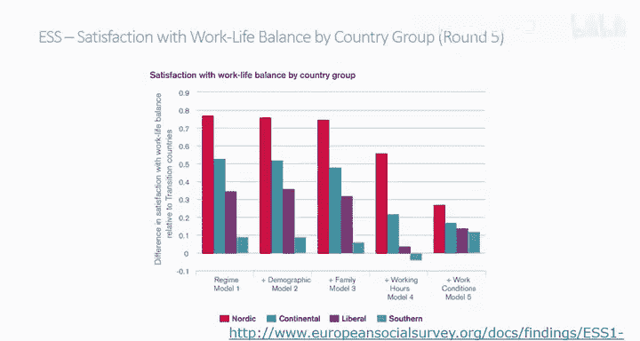
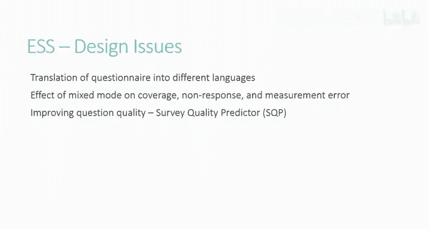
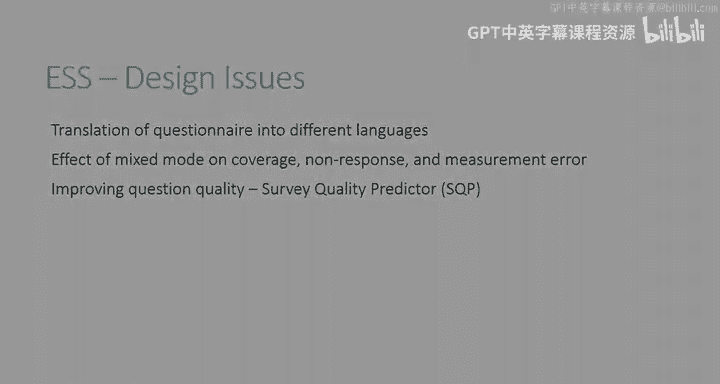
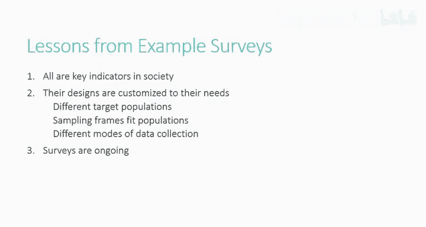
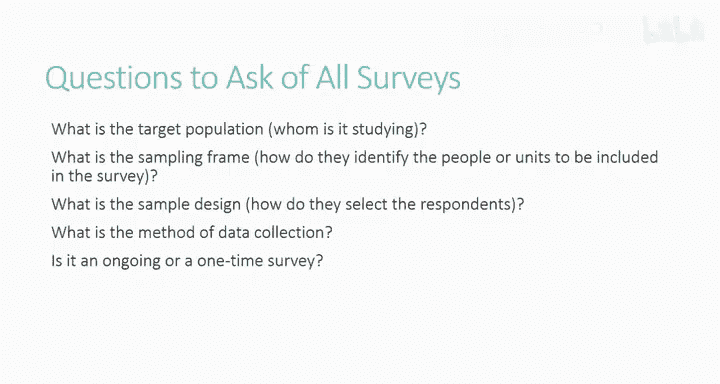

# 31：欧洲社会调查(ESS) 📊

在本节课中，我们将学习欧洲社会调查（European Social Survey, ESS）的基本情况，包括其目的、设计特点、数据收集方式以及相关的设计挑战。通过了解ESS，我们可以更好地理解大规模跨国调查的运作机制及其在社会研究中的重要性。

---

## 🎯 调查目的与背景

欧洲社会调查是另一项重要的欧洲跨国调查。其目的是自2001年起，描绘整个欧洲的态度、信仰和行为模式。因此，它目前已积累了相当长的时间序列数据。

你们中的一些人可能熟悉美国的“综合社会调查”（General Social Survey），这类调查在美国已进行了很长时间，是此类调查的“母舰”。欧洲社会调查则由欧洲科学基金会发起，并最终获得了一项大奖。它是覆盖欧洲各国的一个非常优秀的调查工具，包含轮换主题模块。

---

## 📝 核心设计特点

以下是欧洲社会调查的关键设计特征。

*   **目标总体**：限定为**15岁及以上**的居民。
*   **覆盖范围**：涵盖36个国家内私人家庭中的居民，不论其国籍、公民身份或语言。当然，随着移民增多，这成为一个大问题，因为需要访员能够用所有这些不同的语言进行问卷调查。
*   **抽样方法**：采用了不同形式的概率抽样。我们将提供一些链接，指向一项非常有趣的研究，该研究展示了招募方式如何可能在不同国家间导致调查偏差。
*   **实施要求**：每个国家都实施了通用的抽样指导方针，并对每个国家的最低有效样本量有要求。

---

## 🔄 调查设计与数据收集

上一节我们介绍了ESS的核心设计参数，本节中我们来看看其具体的数据收集模式和时间安排。

该调查是重复的横截面调查，这意味着每次重复调查时访问的是不同的人。这与SHARE调查不同，SHARE是一项固定样本追踪调查，即同一批人反复参与数据收集。固定样本追踪调查本身存在一些问题，Fred Conrad在数据收集课程中将会提及。

正如我所说，欧洲社会调查是横截面调查，因此在每一波调查中访问的是不同的人。它是**每两年**收集一次，目前正在进行的是第8波（2016年）。

该调查同样是访员面访，但采用计算机辅助。访员携带笔记本电脑以这种方式进行数据收集。这里有一个问卷示例，你可以看到很多态度问题。以下是一组属于此介绍性陈述的条目列表。完整问卷可以通过下面给出的链接访问。

---

## 📊 数据分析示例

这里有一个数据分析示例，展示了按国家组划分的工作生活满意度平衡情况。

在ESS网站上还可以找到更多分析。

---

## ⚠️ 设计挑战与改进

对我们而言，这里再次令人感兴趣的是设计问题，它们具有挑战性。

正如我提到的，将问卷翻译成多种不同语言是一个挑战。ESS正在进行一项混合模式实验或探索，这对覆盖误差、无应答误差和测量误差都有影响。

多年来，人们一直在持续努力改进问题质量，并由此衍生出了SQP项目（调查问题预测项目）。我们将在问卷设计课程中更多地讨论这个项目。

---

## 💡 从案例调查中汲取的经验

现在，从我们展示的所有这些案例调查中可以总结出一些经验教训。

它们都在收集社会中的关键指标。

如果你还记得模块1中，当我们介绍替代性的有机数据源时，目前正在进行一场非常有趣的辩论或实验，探讨哪些社会指标可以不使用这种昂贵的调查数据收集方式，而是通过具有同等质量的替代数据源来收集。这是当前一个非常有趣的讨论。

但目前，在大多数地方，人们普遍认为，对于我们刚才介绍的这类指标，调查仍然是获取信息的主要数据收集方式。

对于我们展示的每一项调查，其设计都是根据需求定制的。它们有不同的目标总体，有非常不同的、符合调查目的的抽样框，并且采用了不同的数据收集模式。所有这些调查都仍在进行中。

现在，对于你看到的任何调查，你都应该问以下几个我们通过这些例子讨论过的关键问题：

*   **目标总体是什么？** 这项研究在研究谁？
*   **抽样框是什么？** 他们如何识别被纳入调查的人或单位（并不总是人）？谁有机会被询问、有机会提供他们的信息？
*   **抽样设计是什么？** 总的来说，你可能需要了解这一点，以便进行适当的方差估计，正确捕捉你估计值中的不确定性。
*   **主要的数据收集方法是什么？** 是纯粹的调查、问卷设计，还是与关联的管理数据配对？
*   **数据是以何种其他形式收集的？** 它是一项持续进行的调查还是一次性调查？对于持续进行的调查，你需要知道特定问题。如果是固定样本追踪调查，则存在损耗问题，即随着时间的推移，参与的人越来越少。但好处是，持续并随时间重复进行的研究，可以从上一波调查中学到很多，并应用到下一波。

因此，希望我们能在本专业课程的后续部分分享一些这方面的知识。

---

## ✅ 总结

本节课中我们一起学习了欧洲社会调查（ESS）。我们了解了其描绘欧洲社会态度的长期目标、针对15岁及以上居民的核心设计、横截面与固定样本追踪调查的区别、计算机辅助面访的数据收集方式，以及其面临的多语言翻译和混合模式实验等设计挑战。最后，我们总结了评估任何调查时应关注的核心问题框架，包括目标总体、抽样框、抽样设计和数据收集模式。

通过本课程，我希望我们成功地为你提供了一个关于收集和分析数据意味着什么的总体框架，包括需要考虑的关键点、潜在的质量标准以及可能的误差来源。感谢你参与第一门课程，希望你继续与我们同行，并享受其他课程。