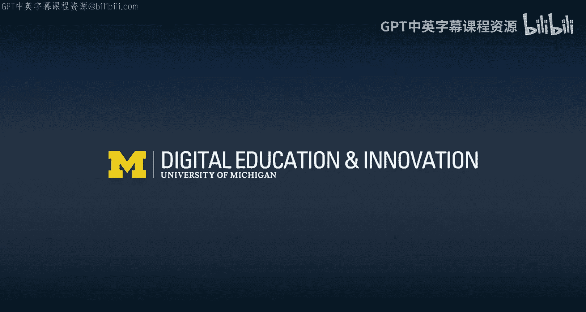

# 01：课程导览 🧭

在本节课中，我们将要学习数据科学伦理课程的核心目标与重要性。课程将探讨大数据时代下，数据科学家在处理数据时面临的伦理挑战、所有权问题以及应承担的社会责任。

---

几年前，大数据时代已经来临。如今我们生活的世界，是上一代人无法想象的。

我是一名数据科学家。这个项目的目的是让其他数据科学家思考我们领域的伦理问题。

---

上一节我们提到了数据科学领域的伦理问题，本节中我们来看看一个具体的例子。如果我给你拍了一张照片，从法律和普遍认知的角度来看，这张照片属于谁？这张照片拍的是你，但照片是我拍的，所以我拥有它。那么，我可以用哪些方式使用这张照片？我是否可以使用这张照片，以及我是否可能以伤害你的方式使用它？

现在，将这个问题延伸到数据领域。

---

如果我有一些关于你的数据，这些数据是你的，还是我的？因为是我收集的。我们试图理解：我对这些数据的所有权是什么？你对这些数据的所有权又是什么？以及一方对另一方负有什么义务？这些问题并不简单。

---

如果你甚至不知道可能做错了什么，你就无法开始纠正问题。如果我们对什么是正确、什么是错误都无法达成共识，那么我们甚至没有动力去修正任何问题。

首先，社会需要对什么是正确、什么是错误达成共识。我认为在数据科学领域，我们还没有进行过那种广泛的讨论。

---

从这种共识出发，我们需要一个框架来思考如何以不同的方式实践数据科学，从而做出正确的事情。正确地实践数据科学实际上可以保证公平性。

---

密歇根大学在培养未来各领域的领导者方面处于前沿。在密歇根大学的数据科学培训中加入伦理成分，是密歇根大学应该做的正确之事。

---

如果你正在处理数据，你必须记住你拥有巨大的权力，而巨大的权力伴随着巨大的责任。这门课程将教你如何在行使这种权力时保持负责任的态度。

---

以下是本课程希望达成的目标：
*   接受过伦理培训的数据科学家将带来更好、更符合伦理的数据科学实践。
*   这对数据科学有益，对整个社会也有益。

---

本节课中我们一起学习了数据科学伦理课程的设立背景、核心问题（如数据所有权）以及学习伦理对数据科学家个人和整个社会的积极意义。理解并实践伦理，是负责任地运用数据权力的基础。