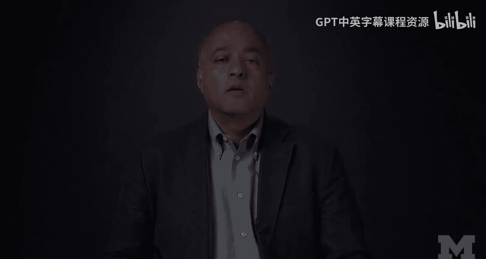

# 02：什么是伦理？🤔

在本节课中，我们将学习伦理的基本概念，理解为什么伦理对于数据科学实践至关重要，并探讨伦理如何作为我们共同遵守的规则，使社会整体受益。

---

## 概述

欢迎来到数据科学伦理课程。在实践数据科学时，正确地行事非常重要。如果我们只了解课堂上可能学到的技术，并盲目地应用它们，我们可能会以多种方式做错事。在本课程中，我们将看到一些可能犯错的方式，并学习如何思考问题以避免这些错误。

---

## 伦理的定义

让我们从一个基本定义开始：什么是伦理？伦理是我们所有人都自愿遵守的规则，因为它使我们所有人的世界变得更美好。它们帮助我们区分对与错。它们是文明的基石。如果我们没有伦理，我们就不文明。

---

## 伦理与恐惧、法律的区别

让我们看一个例子。伦理原则阻止我偷你的钱包。现在，还有其他事情可能阻止我偷你的钱包。如果你更高大强壮，我可能不想偷你的钱包，因为我害怕你会打我。但即使你更矮小瘦弱，伦理也会阻止我。也有可能我不偷你的钱包，仅仅是因为我担心被抓然后被关进监狱。而伦理会阻止我偷你的钱包，即使我完全没有被抓的可能。这是我们认为是正确的基本原则。

---

## 伦理与宗教、法律的关系

宗教教导我们以良好的方式行事。有诸如“不可偷盗”之类的戒律。大多数宗教都提倡伦理行为。但伦理不一定具有宗教性。伦理是共享的价值观。宗教也常常是共享的价值观，因此伦理可能源于宗教信仰，但并非必须如此。

伦理也不是法律。我们常常陷入对法律合规性的思考，但这不应该是我们担心的全部。

考虑一个例子：你告诉我一个秘密，我承诺不告诉任何人。然后我违背了承诺，传播了关于你的大故事，引发了一场丑闻。我可能没有违反任何法律，我因为对你食言而受到惩罚的可能性不大。但我想我们都同意，这样做我是不道德的。这里存在一个共享的社会原则：我向你保证保守你的秘密，但我没有遵守诺言。

伦理不是法律。法律常常遵循伦理，因为伦理是我们共享的社会价值观。法律通常是为了强制执行这些共享的社会价值观而制定的。

---

## 共享价值观与法律的作用

拥有共享价值观的问题是，即使我们有共享的价值观，也并非每个人都会遵守伦理。因此，我们可能都有一个共享的价值观，认为偷窃是错误的，但这并不意味着没有小偷。这只是意味着，作为一个社会，我们已经同意偷窃是错误的。然后我们会有法律说，嘿，如果你违反了这个社会规则——我们不应该偷窃——那么就会有惩罚，这些惩罚由法律决定。从这个意义上说，法律被用来帮助强制执行伦理行为。其他社会契约也可以做到这一点，例如人们被排斥。

---

## 伦理的经济学视角

思考伦理好处的一种方式是从经济学角度。在大多数情况下，当每个个体都努力最大化自己的个人利益时，整个社会整体上会达到最佳状态。这是自由市场的基础，也是现代经济的基础。

但也存在这样的情况：个人利益是以社会成本为代价的。当这种情况发生时，就需要共享的社会价值体系来处理这些情况。

经济学教科书中有一种说法叫做“公地悲剧”。其思想是：有一片开放的田野，即公地，由整个村庄共享。既然这是一片共享的田地，让我的羊在公地上吃草是可以的。这样，我需要购买的牧场就更少，我可以养更多的羊，因为我的羊可以利用公地上的草以及我自己土地上的草。但如果村里的每个人都做出同样的判断，那么公地上的土地就会被过度放牧。没有人照顾它，我们最终得到的是一片荒地，而不是我们本可以共同享受的茂盛草地。避免这种情况的唯一方法是，我们作为一个村庄团结起来，就如何在不过度开发的情况下从公地中受益达成一些规则。

---

## 规则的成本与收益

总结一下：规则是限制我能做的事情，因此，我遵守规则会产生相关的成本。但如果我遵守这条规则的成本小于其他人遵守相同规则时我获得的收益，我可能仍然希望有这条规则。正是这一点，使我们从这些驱动行为规则的共享价值观中获得经济利益。

---

## 现实生活中的例子

让我们考虑一个简单的例子。假设我们没有关于如何驾驶的规则。那么，我们的道路上将一片混乱。当交通堵塞时，我常常希望能在道路的另一侧或路肩上行驶。交通规则不允许我这样做，那一刻我可能会感到沮丧。但是，我们都看到了我们所有人同意特定规则并同意在道路特定一侧行驶的好处。如果我们没有那条规则，我们都会开得更慢。大多数时候，这条规则使我们能够比没有这条规则时更快地到达目的地。

让我们看另一个例子。如果你有垃圾，而其他人也乱扔垃圾，那么你就没有动力妥善处理你的糖果包装纸。即使走到附近的垃圾桶扔掉你的糖果包装纸可能只需要几秒钟的努力。当你看到这么多垃圾时，这样做就不值得了。因此，垃圾的存在会导致更多的垃圾。另一方面，如果我们都同意，作为一种社会价值观，我们不应该乱扔垃圾，并且我们大多数人都能很好地将包装纸扔进垃圾桶而不是街上，那么街道就是干净的。我们也更容易遵守规则，因为我们从遵守规则中受益，因为其他人也在遵守规则。所以，这又是一个共享价值观，是伦理体系的基础。

---

## 总结

本节课中，我们一起学习了伦理是什么。伦理是我们都同意遵守的共享规则，因为遵守它们能带来好处。这些规则通常充满了对与错的观念。在这第一讲中，我们学习了什么是伦理，以及为什么遵守伦理行为对我们所有人都有利。

在下一讲中，我们将把这一点与数据科学联系起来。