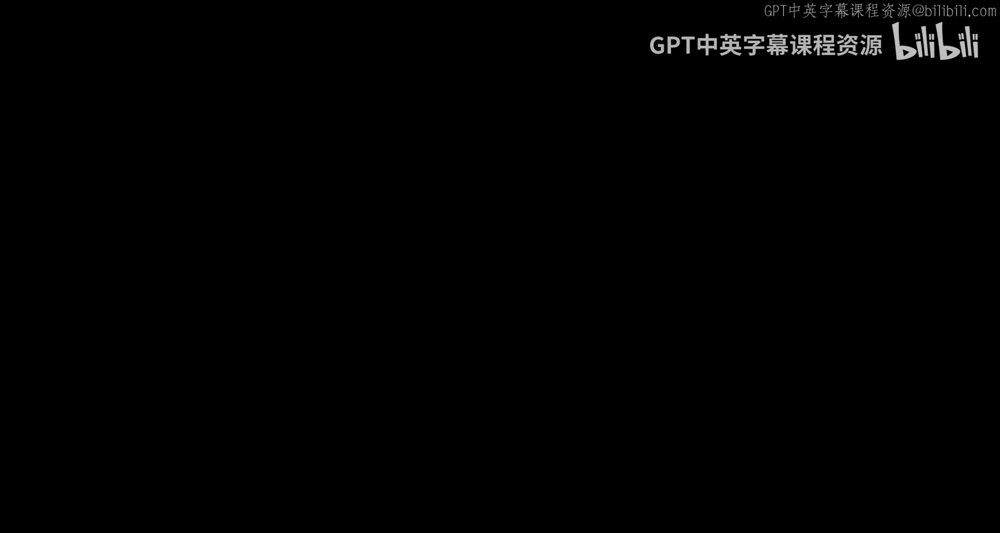

# 04：案例分析：垃圾邮件非关肉类 🥩

在本节课中，我们将通过一个历史案例来探讨一项技术实践如何从“创新”演变为“不道德”，并最终被法律所约束。我们将分析垃圾邮件的起源、社会共识的形成以及相关的法规。

## 背景与起源

上一节我们讨论了技术应用与社会价值观的互动。本节中，我们来看看一个具体的例子：垃圾邮件的诞生。

时间是1994年。互联网尚处于早期阶段。许多聪明人正试图探索这个新媒介的潜力，思考如何利用它。其中，亚利桑那州有两位律师，劳伦斯·坎特和玛莎·西格尔，他们想到了通过互联网这个新媒介接触广大受众的主意。

这两位律师是移民律师。他们的目标客户是那些可能对美国政府当时计划运行的绿卡抽签感兴趣的人。他们的做法是发送关于此抽签的消息，并邀请人们雇佣他们作为律师来帮助赢得抽签。他们将这条消息发布到了他们知道的所有可以发布的地方。

当时有一个叫Usenet的系统，他们向许多Usenet群组发布了消息。这相当于向所有人发送未经请求的电子邮件。这是我们如今所知的“垃圾邮件”的第一个著名案例。“垃圾邮件”这个词源自蒙提·派森的一个喜剧小品。

## 社会共识的形成

最初，这两位律师的策略取得了相当大的成功。他们获得了许多新客户，并夸耀其方法的成功。他们甚至成立了一家咨询公司，来帮助其他企业通过这种新媒介接触新客户。换句话说，在当时，这是一个好主意，一项创新的商业实践，是人们尝试利用新媒介创造价值的探索。

然而，随着时间的推移，这类消息的数量增长到了我们普遍认为不可接受的程度。社会逐渐形成了一种共识：垃圾邮件不是好东西。这是我们不希望鼓励、甚至不希望容忍的事情。在我看来，这形成了一种伦理共识：发送垃圾邮件是不道德的。这种行为违背了我们今天的社会规范和价值观。

## 法律与规范

为了支持这一共识，美国国会通过了《反垃圾邮件法案》。该法案基本上规定：

以下是该法案的核心要求：
*   **明确标识**：发送商业电子邮件必须清晰标明发送者身份，即企业名称和地址必须明确说明。
*   **退订选项**：必须提供清晰且易于操作的退订选项。
*   **尊重选择**：如果消费者选择了退订，企业必须尊重这一选择。

如今，我们所接触的正规企业发送电子邮件并允许我们轻松退订的方式，正是遵循了这些规定。

## 共识与现实

存在“垃圾邮件是坏的”这一社会共识，并不意味着就没人发送垃圾邮件了。即使在今天，仍然存在大量未经请求的电子邮件。也有大量技术致力于让我们看不到这些垃圾邮件。

然而，关键在于，那些发送垃圾邮件的人并不以此为荣。他们不会炫耀，你也不会听到有学生说：“嘿，猜怎么着，我在一家新的垃圾邮件公司找到了一份很棒的工作，我的工作就是发送更多更好的垃圾邮件。”

---

本节课中，我们一起学习了垃圾邮件从一项“创新”商业实践演变为社会公认的不道德行为，并最终被立法监管的过程。这个案例清晰地展示了技术实践如何与社会价值观互动，以及伦理共识和法律在塑造我们数字环境中的重要作用。