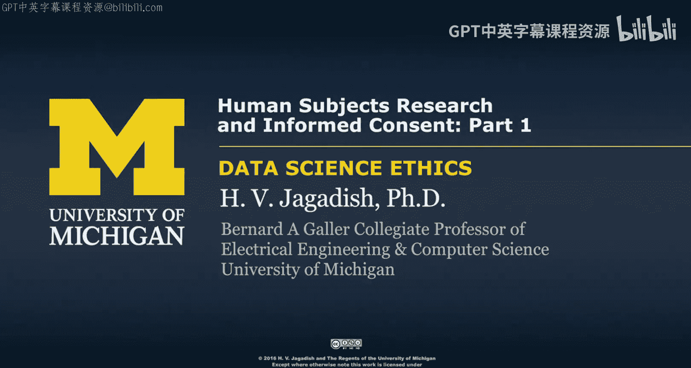

# 05：人类受试者研究与知情同意（上）👥

在本节课中，我们将要学习数据科学伦理中的一个核心议题：人类受试者研究。我们将探讨为何伦理在数据科学中至关重要，并深入了解“知情同意”这一基本概念及其历史背景。

## 为何伦理在数据科学中至关重要？🤔

数据科学伦理之所以重要，通常是因为我们在实践数据科学时所做的任何事情，都会对人类产生影响。

为了理解人们是如何思考这一问题的，在本模块中，我们将审视人类受试者研究以及知情同意的概念。

## 什么是人类受试者研究？🔬

让我们首先谈谈“人类受试者研究”意味着什么。这里有一个臭名昭著的研究案例。

该研究在塔斯基吉大学进行，由美国疾病控制与预防中心资助。其目的是试图了解未经治疗的梅毒的发展过程。在1932年，梅毒没有很好的治疗方法。因此，从医学调查的角度来看，了解它导致的衰弱情况可能是一件合理的事情。

为了开展这项研究，组织者招募了阿拉巴马州的600名黑人佃农。他们建立了一个看起来相当常规的研究：有399名患有梅毒的参与者和201名未患病的参与者。这样他们可以进行研究，比较患病组与对照组在各种情况下的差异。参与者需要做的就是定期到诊所报到，在那里他们会接受健康检查，会获得针对其他可能影响他们的小问题的医疗护理，还能吃到热饭，因此他们参与了研究。在这些访问中，他们也会进行抽血等操作，这些血液样本随后会作为研究的一部分进行分析。

## 塔斯基吉研究的伦理问题 ⚠️

问题是，抗生素被发明了。到1947年，青霉素已成为治疗梅毒的标准疗法。但从来没有人费心去告诉研究的受试者。也没有人用青霉素治疗这些研究受试者。这项研究就这样年复一年地进行下去，直到1972年，在一些举报者的推动下，公众爆发了强烈抗议。当时普遍有一种强烈的感觉：无论这项研究可能具有什么医学价值，让数百名贫困人口在已有治疗方法的情况下不接受梅毒治疗，所造成的伤害都是不可接受的。

其结果就是催生了所谓的“机构审查委员会”，我们稍后会讨论。

## 知情同意的核心原则 ✅

这些机构审查委员会或审查机构将要监督的是一个称为“知情同意”的过程。其理念是，如果任何研究是在人类受试者身上进行的，那么这位人类受试者必须被告知实验的相关信息。必须自愿、在没有任何胁迫的情况下同意参与实验。并且必须有权在任何时候撤回同意。因此，即使他们同意参与实验并作为受试者，如果过了一段时间他们改变了主意，希望退出，他们应该有权这样做。

在塔斯基吉研究中，这些知情同意的原则没有得到满足，因为受试者没有被充分告知实验信息。他们被误导了，没有被告知可能的治疗方法，也没有被告知他们的梅毒不会被治疗。基于这种不正确的信息，他们“自愿”同意了实验，也许他们有权在任何时候撤回同意，但没有人明确告知他们拥有这项权利。

这里的核心问题是，实验者在评估收益与危害。通常在这类情况下，危害是针对个体受试者的，而收益是针对社会或科学的。如果收益归于一方，而危害归于另一方，这种评估有时会与收益和危害归于同一方的情况不同。知情同意的一个关键原则是，可能受到潜在危害的一方——即人类受试者——必须自己决定，对社会（以及可能以报酬、免费食物等形式反映给受试者的好处）的收益，是否值得他们承担的风险。

## 机构审查委员会的作用 🛡️

由于人类受试者很难完全了解收益与危害的全部细节，因此产生了“机构审查委员会”的概念。这个IRB的职责是审查人类受试者研究，尝试权衡危害与收益，确保知情同意的原则得到适当遵循。这个委员会的成员具有多样性，包括非科学家。它应该包括一些能为科学价值辩护的科学家，但也应包括能广泛代表社会的非科学家。机构审查委员会必须批准研究。特别是，他们必须批准人类受试者在参与研究前实际签署的知情同意书。

## 知情同意的例外情况 ⚖️

然而，知情同意也存在例外情况。例如，在心理学中，经常有人想研究某些东西。比如说，某人对种族的反应。如果他们想研究这个，他们可能会有研究志愿者，让不同种族的研究人员进行实验，而研究本身是为了观察人类受试者对不同种族科学家的反应。但受试者被告知的研究目的与此完全无关，这只是他们参与研究的一个借口。因此，这种“掩饰”在心理学实验中非常常见。而使用任何形式的掩饰的问题在于，你实际上并没有告知受试者真实情况。

当存在违反知情同意原则的情况时，机构审查委员会会特别谨慎。他们会努力确保这种违反是进行研究所必需的最小程度的违反，并且违反的类型不太可能对人类受试者造成伤害。在伤害可能性大得多的情况下，比如医学研究，通常不需要违反知情同意原则（即不需要使用掩饰手段）。因此，人们不会期望机构审查委员会批准此类违反。

---

本节课中，我们一起学习了人类受试者研究的基本概念，通过塔斯基吉研究的案例了解了违反伦理可能造成的严重伤害。我们明确了“知情同意”的三个核心原则：**充分告知、自愿参与、随时退出**。同时，我们也认识了**机构审查委员会**在监督研究伦理、权衡风险与收益方面的重要作用，并了解到在特定领域（如心理学）知情同意可能存在有限的例外，但需受到严格审查。理解这些历史教训和基本原则，是我们在数据科学工作中尊重和保护个人权利的第一步。