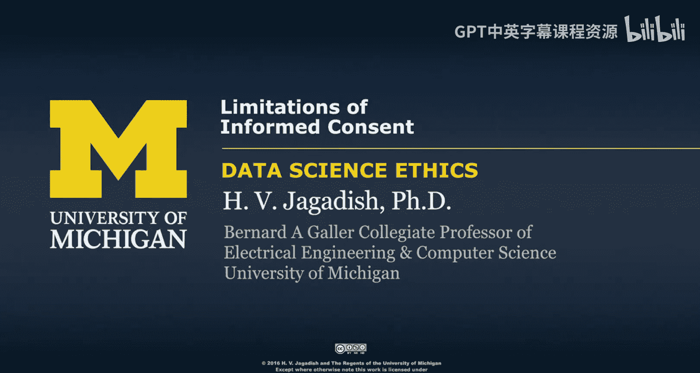

# 07：知情同意的局限性

在本节课中，我们将要学习“知情同意”这一概念在数据科学领域的应用与局限性。我们将探讨其起源、在当代数据收集中的实践挑战，以及数据再利用所引发的伦理问题。

## 知情同意的起源与当代实践

上一节我们介绍了知情同意的概念，本节中我们来看看它在数据科学中的具体应用。

知情同意的概念最初是在**以人类为对象的实验**背景下发展起来的。其标准流程是：先获得同意，再前瞻性地收集数据。

然而，在当今数据科学家的日常工作中，情况往往不同。首先，许多活动并非传统意义上的“实验”。通常是先收集数据，然后才进行分析或实验。数据收集通常发生在用户与希望收集数据的实体（如商家或软件供应商）互动时。

在这种情况下，“知情”往往意味着隐藏在冗长、密集的法律条款中。例如，当你想使用某项服务时，会收到一份包含大量法律术语的协议，并且必须在点击“我接受”后才能使用该服务。

虽然从法律角度看，获取这种形式的同意对收集方有利，但它远非一种清晰、明确的许可。从体育伤害相关的诸多诉讼案例中，我们可以找到法律先例，并以此类推来理解获取同意对数据收集的好处，以及“知情”的真正含义。

## “知情”与“自愿”的挑战

从伦理角度出发（暂且不论法律），我们可以说，如果声称用户因收到一份他们实际上没有机会阅读的冗长条款而“知情”，这本身就存在**怪异之处**。

“自愿”的概念也值得商榷，因为同意通常是在用户意图执行特定操作（如使用软件服务或购买产品）的当下获取的。用户没有时间和机会仔细思考，这也不是在他们购物体验早期就被告知、以便他们可以比较不同供应商要求并纳入决策的事项。相反，这发生在他们决策过程的后期，在他们已经决定要做什么之后。这就像在你决定走某条路线后，突然被告知需要支付过路费。

## 案例分析：Facebook的研究实验

让我们看看知情同意如何运作，并以Facebook可能进行的研究实验为例来思考。

Facebook在其用户协议中明确告知用户，它可能为研究目的收集用户数据。自2012年那项著名的“情绪传染”实验后，它确实一直在这样做。因此，Facebook可能满足了其用户协议的字面要求，但它仍然遭到了用户的强烈反对。

问题不在于Facebook做错了什么。实际上，Facebook在思考隐私问题和用户数据使用方面做得相当不错。只是因为它处于前沿，是一家大公司，拥有我们许多人的非常私密的数据，并且常常在其他人之前就陷入社区的争议焦点。

## 数据再利用的伦理困境

以上是关于数据收集的知情同意。但接下来还有一个问题：数据实际上将被用于什么目的？

我可能为了获得特定服务而将我的数据提供给商家。我不希望商家将这些数据用于其他目的，例如向我推销其他东西。我只希望他们将其用于我与之签约的特定服务，并且我不希望商家与其他用户分享这些数据。

因此，我可能在同意中禁止数据的**再利用**。这意味着：你可以收集这些数据，但你获得的许可是在特定情境下的，这个情境很重要，你不能在其他情境下使用它或将其出售给他人。

然而，数据再利用并非全是坏事。企业常常有业务需要这样做。例如，我的信用卡公司显然需要收集关于我消费和还款的数据。他们需要与信用报告机构共享这些数据。虽然我可能不太喜欢这一点，但这是我必须接受的社会设置的一部分，也是信用卡公司应该告知我、并且我同意的事项。如果我要获得信贷，就需要参与这个包含信用报告的生态系统。

即使不是业务必需，再利用也可能具有巨大的社会价值。我与医院共享医疗数据以获得更好的医疗护理。但我可能完全不介意，甚至非常乐意我的医疗数据被用于医学研究。我可能会很高兴关于我疾病进展和健康状况的信息将帮助后代战胜某些病魔。

关键在于，具体的**研究问题**、科学家希望研究的内容，可能在我接受治疗时是未知的。问题是在之后才提出的，而数据早已收集完毕。这被称为**回顾性数据分析**，与前瞻性数据收集相对。

这里的问题是：我们如何能获得一份同意协议，既为受试者提供了足够的信息使其知晓同意内容，又足够宽泛以涵盖一系列未来可能提出的研究问题？因此，这是一项平衡之举，需要在知情同意中提供足够的信息使其有意义，同时又不能过于局限。

## 总结

本节课中我们一起学习了知情同意在数据科学中的核心挑战。

大多数我们感兴趣、将要分析的数据都是由人类创造的、关于人类的，或者其影响会波及人类。当我们实践数据科学时，必须考虑这种影响。正是对这种影响的考量，构成了数据科学伦理实践的基石。