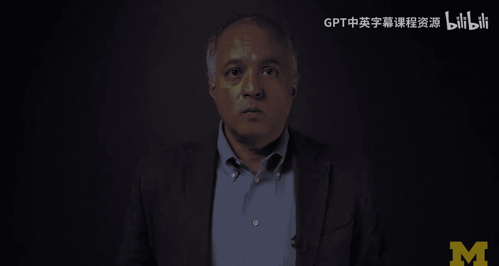

# 09：数据所有权 📜

在本节课中，我们将要学习数据所有权的核心概念。我们将探讨数据究竟归谁所有，分析传统知识产权（如版权）如何为理解数据所有权提供参考，并审视数据收集、整理与传播过程中涉及的伦理与法律问题。

## 谁拥有数据？🤔

上一节我们介绍了课程主题，本节中我们来看看数据所有权的核心问题。数据是关于你的，因此你可能会认为你拥有这些数据。但这真的是你的吗？让我们思考一下旧技术时代的情况。

如果我写了一本你的传记，我拥有我所写内容的版权。如果你不喜欢我写的内容，实际上你无能为力，除非我写得不准确，并且以损害你的方式撒谎，在这种情况下，你可以起诉我诽谤。

如果我为你拍了照片，我拥有这张照片。对于我能做的事情有一些限制。可能存在我不能拍照的私人区域，也可能存在我不能使用照片的方式。例如，我不能将照片用于暗示性代言或暗示性诽谤。

暗示性诽谤是什么意思？例如，这里有一张照片。这大概不是乔治·W·布什总统实际做过的事。但有人认为创建这种经过Photoshop处理的图像会非常有趣。可以看出，如果这不是一位公众人物，这种照片可能会贬低他人，损害某人的职业生涯或声誉，他们可能会提起诉讼。因此，这是通过篡改图像进行的诽谤。

你实际上不必篡改图像。我们都有状态不佳的时刻。如果有人恰好捕捉到这样的时刻并将其公开，我们可能会感到非常尴尬。因此，我们面临一个问题：可能因为有人拍下了一个不讨喜的时刻，并用它来定义我们是谁，从而创造一个损害我们职业生涯和声誉的环境。

## 知识产权框架的参考 📚

当思考数据所有权时，我们如何处理书籍和照片等事物的历史可能会有所帮助。我可以记录关于你的事情。如果我记录了关于你的事情，我可以随意处理它。对于我可以记录关于你的内容类型以及我可以如何处理这些内容，可能存在一些合理的限制。但我的记录就是我的记录。实际上，我们一直以来都是这样做的。在没有电子世界的时代，我们有推荐信，我们有流言蜚语。这些事情都以人为对象，而这些对象可能会受到这些推荐信或流言蜚语内容的影响。但他们在法律上确实没有太多追索权。

为了理解这在知识产权方面如何运作，我们的社会主要考虑三种主要的知识产权类型。

我们一直在讨论的是**版权**。版权是指我们拥有特定的艺术表达形式。如果你拿走了我的受版权保护的作品，然后重新编排它，比如说你拿走了我的书并翻译它，那么翻译作品就是衍生作品。它并非完全原创，因为你并非从零开始创作。但它也与我写的不完全相同。你加入了自己的创造力，并在创建翻译时付出了自己的努力。关于衍生作品的规则在版权运作方面更为复杂。你只有在获得原创作品所有者许可的情况下才能创建衍生作品，但一旦获得许可，你就可以做你想做的事。衍生作品归你所有。

还有其他几种知识产权类型，我认为它们较少适用于数据：**专利**，即制造或做某事的想法；**商业秘密**，即我拥有且不告诉任何人的东西。我们不必深入所有这些细节。我想指出的要点是，如果我们考虑适用于艺术表达的版权，我们理解它是如何运作的，并且存在作品完整性的概念。

因此，如果我使用一张图像并展示它，我可以注明所有者。我在这里展示的幻灯片中有许多图片，这些图片大部分不是我拍摄的。我从某人那里获得，并说明我从谁那里获得，以及允许我这样做的许可证。我给予图片所有者应有的赞誉。

## 数据使用的归属困境 🔍

如果我使用你的数据，理论上，我应该做同样的事情。问题是，我通常不会拿走你所有的数据并按原样使用。我会做的是，取一小部分你所知道的信息，与我已知的信息合并，创造出新的东西。最终，通常我只能说我使用了你的一些数据。你的某些输入以某种方式被我纳入到我现在所说的内容中。我无法确切说出是什么、有多少或量化它。充其量，我只能说你可能告诉我的事情以某种方式促成了我现在所说的内容。这有点模糊，使得人们难以获得应有的赞誉。

这就是为什么我们一直在讨论**赞誉**。对于人们想要拥有并获得赞誉和所有权的事物，也有另一面需要考虑。

## 数据作为文化遗产的保存与传播 🌍

存在大量的文化遗产。在现实世界中难以访问的事物，数字化数据通常是保存我们文化的好方法。因此，如果我们有绝版的东西，它们可能会永远丢失。想想古代手稿。人们付出了巨大的努力来数字化这些手稿，并使它们可用。

数字化数据不仅可以保存文化，还可以传播文化，如果你思考图书馆的运作方式。总体思路是图书馆购买一批书籍，读者可以去图书馆借书。因此，图书馆实现了一个图书共享系统。在一个小世界里，你可以有一个小型图书馆，小型图书馆将拥有它买得起的几本书。在一个我们拥有庞大通信网络的世界里，没有理由拥有许多小型图书馆。你可以拥有一个单一的通用虚拟图书馆。你可以拥有书籍的数字副本，可以借给世界上任何地方的任何图书馆用户。

就如何实现这一点而言，如果图书馆购买一本副本，出版商会因购买一本副本而获得报酬，并且你总是可以确保一次只有一个用户使用它。因此，通过数字化，图书馆可以成为一种在全球范围内传播文化的机制，这是如果你停留在传统技术领域内无法做到的。

## 数据收集与整理的价值创造 💎

数据收集和整理需要付出巨大的努力。即使我们开始时使用的是免费且可自由获取的东西，也需要付出巨大的努力来清理、验证、标准化、整合数据，并将其置于某人可以使用的形式。一旦有人付出了这种努力，他们就创建了一个他们拥有的数据集合。这是他们辛勤工作的成果。他们可以选择将其公开，或者他们可能说他们现在拥有了一项数据资产，并希望获得赞誉，无论是名誉、金钱还是他们希望以任何形式获得的回报。当然，如果你开始时使用的数据本身不是免费的，同样适用。

请注意，你实际上不需要艺术创作者来主张所有权。你可以拥有人们免费提供给你的数据。然后你可以将它们全部整合在一起。整合所有数据的努力仍然赋予你所有权。例如，维基百科拥有著名的众包数据。它是一个由世界各地的人们共同构建的百科全书。个体贡献者并不拥有它。维基百科拥有这部百科全书。当然，维基百科做出了社会决定，并与贡献者签订了合同，承诺将其免费提供给所有人，但他们并非必须这样做。

如果你查看众包声誉网站，如Yelp、Rotten Tomatoes或TripAdvisor。这类公司的商业模式完全依赖于社区中的人们表达他们对在这些网站上评级的企业的意见。这些意见通常是由无偿贡献的人自由提供的。关键点在于，无论贡献者是否获得报酬，所收集的数据随后都成为这些数据收集者和聚合者的财产。正是他们的收集、他们的组织以及他们为创建这个集合所付出的努力，才产生了价值。他们可以自由地出售广告或通过这些数据赚钱，以他们认为合适的任何方式。

---

本节课中我们一起学习了数据所有权的复杂性。我们了解到，数据虽然关于个人，但其所有权并不天然归属于个人，而是受到传统知识产权框架（尤其是版权）的影响。数据的价值往往源于收集、整理和聚合的过程，这使得数据整合者能够主张所有权。同时，数据在保存和传播文化遗产方面扮演着重要角色。理解这些原则，有助于我们在数据驱动的世界中，更清晰地思考权益归属与价值分配。