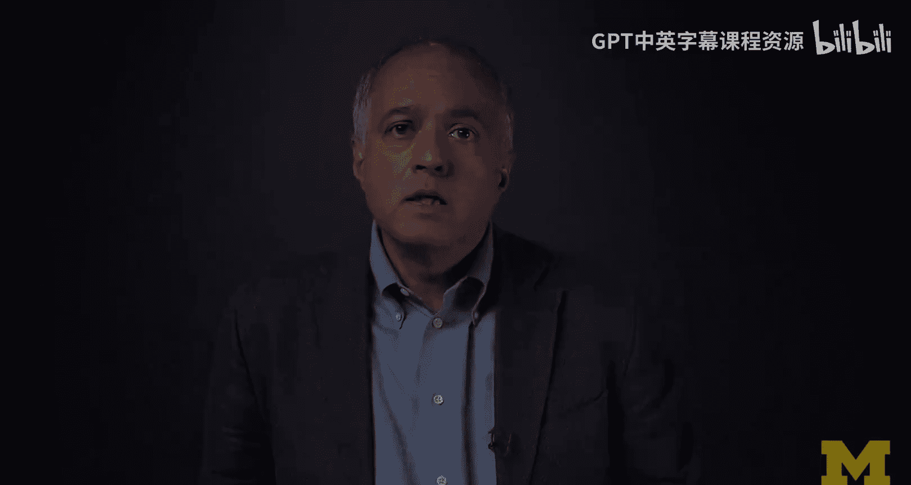

# 11：数据所有权终章

在本节课中，我们将要学习数据所有权讨论的最后一个关键议题：数据销毁。我们将探讨当企业停止运营时，个人数据的命运，以及为何这构成了数据伦理中的一个重要挑战。

上一节我们讨论了数据所有权的复杂性，本节中我们来看看当数据收集者自身不复存在时会发生什么。

## 数据销毁的必要性

企业在与我们进行业务往来时，合法地收集数据。总体而言，正如我们一直所说的，企业希望维持客户的良好意愿。因此，它们有时可能会做出令客户不满的事情，但这通常是因为它们没有意识到会如此严重地触怒客户。企业并不想惹恼客户。这为我们提供了一定程度的保证，即它们不会做出极其恶劣的事情。

然而，一旦公司停止运营，这种保证便不复存在。如果一家公司破产，那么数据就成为其资产之一。我们面对一家破产的公司，其所有资产都将被出售。数据资产会像其他任何资产一样被出售，并且通常会卖给第三方。而通常，意图滥用这些数据的第三方会出价最高。

因此，作为向企业提供数据的贡献者，当我在与它们进行业务往来时，我希望在公司破产时，已收集的数据能够被销毁，而不是被出售。

## 现实案例与法律保护

这并非仅仅是理论上的担忧。实际上，这已经在多家公司身上发生，例如 **RadioShack**、**Borders** 和 **ConnectU**。

破产法现在实际上提供了部分保护。基本上，法律规定，无论公司的隐私政策是什么，即使在公司破产后，该政策也必须继续有效。

## 总结与核心原则

本节课中我们一起学习了数据所有权的终章，特别是数据销毁的重要性。

总而言之，数据所有权确实非常复杂。它比艺术品等其他事物的知识产权所有权更难理清。即使对于你实际上愿意分享的事物，这种所有权也很复杂，因为例如，**给予恰当的 attribution（署名）** 非常困难。

我们必须认识到一个关键点：在大多数情况下，**我们并不拥有关于我们自身的数据**。由他人收集的、关于我们的数据，其所有权归属于收集者。

尽管如此，我们可能对这些不属于我们但关于我们的数据拥有一定的控制权。我们需要建立一些原则来思考这种控制权。而这，正是关于隐私权讨论的核心关切。