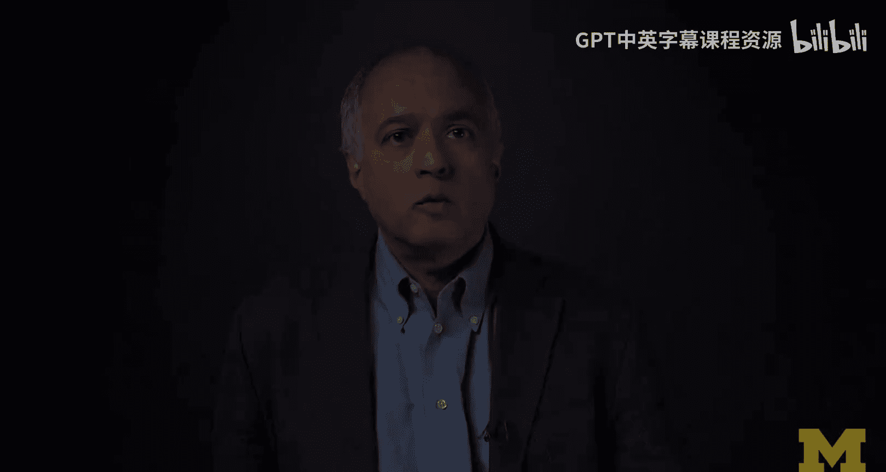
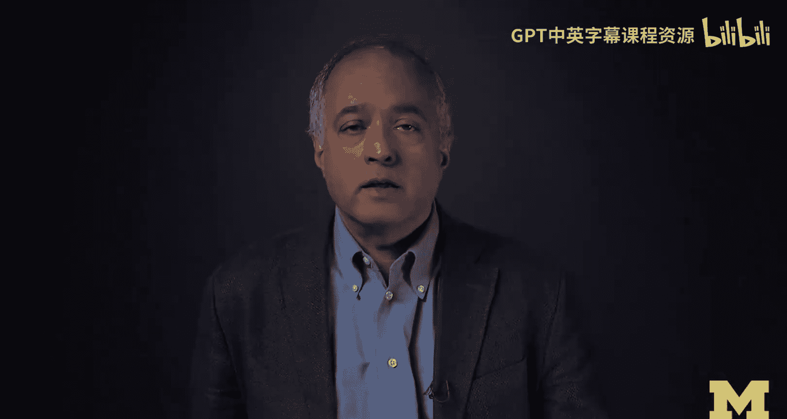

# 13：隐私权 🔒

在本节课中，我们将要学习隐私的概念、其重要性以及在大数据时代面临的挑战。我们将探讨隐私的历史渊源、现代含义及其对个人和社会的影响。

---

## 什么是隐私？

上一节我们介绍了课程主题，本节中我们来看看隐私的定义。从希腊神话来看，曾有一位名叫阿格斯·潘诺普斯的百眼巨人。他时刻保持警惕，因为当部分眼睛休息时，其他眼睛仍会保持清醒。

基于这个神话，18世纪的杰里米·边沁设计了一种称为“全景监狱”的建筑结构。其核心理念是，位于建筑中心的一名守卫可以监视所有囚犯。囚犯无法得知自己是否正被监视，因为守卫可以选择观察任何方向。有时他可能看着你，有时则不会。

但正因为囚犯无法确定自己是否被监视，他们会始终表现得如同被监视一样。这个概念在今天依然存在。

---

## 现代全景监狱

上一节我们了解了全景监狱的历史概念，本节中我们来看看它在现代社会的体现。这里有一个现代版的全景监狱例子：安全摄像头，或者更准确地说，是典型房屋中的一系列安全摄像头。

为此目的，你甚至不需要实体摄像头。考虑到你在网络上的互动、与商家的在线交易都被记录，最终会形成类似这幅漫画的情景。我们在这里看到了全景监狱的“Facebook守卫”。

问题并非Facebook真的监视你的一举一动，而是我们的行为如何受到影响？因为我们担心像Facebook这样的公司可能通过监视来了解我们的一切行为。

---

## 对隐私的不同观点

在技术世界中，尤其有些人看到这种现象，并不认为它是坏事。事实上，已有文章指出，人们相信如果完全没有隐私，每个人都会变得完全诚实。因为每个人都知道或可能知道别人在做什么，这会使每个人保持正直。没有伪装的余地，也没有欺骗的空间。

然而，这是一种过于简单化的描述。隐私是一种基本的人类需求。即使对于那些自称“没什么可隐藏”的人来说，这也是事实。想象一下，如果你上厕所时没有隐私，难道不会感到不适吗？并非因为你做错了什么，也并非羞耻之事，只是感觉不对劲。

---

## 隐私的社会价值

除了个人层面，隐私还具有社会效益。我们民主制度的核心部分是匿名投票。你需要能够隐藏你的选票，才能自由投票，而不必担心来自他人的压力。

基于所有这些原因，隐私是重要的，我们需要思考在这个充满大数据和数据分析的复杂世界中，如何管理隐私。

---

## 总结

本节课中我们一起学习了隐私的概念及其演变。我们探讨了从希腊神话到边沁全景监狱的历史渊源，以及现代技术如何创造了新的监视形式。我们分析了隐私作为基本人类需求的重要性，即使对于“无秘密”的人也是如此，并强调了隐私在维护民主自由方面的社会价值。最后，我们认识到在大数据时代，审慎管理隐私是一项至关重要的挑战。