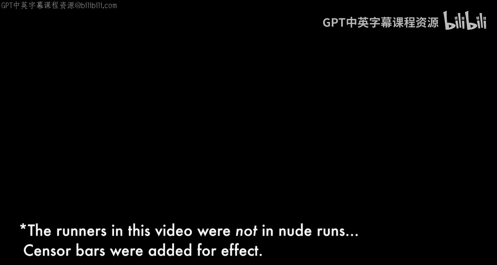

19：案例分析：校园裸跑事件

在本节课中，我们将通过一个具体的案例——“校园裸跑”事件，来探讨信息技术如何改变社会规范、影响个人隐私，并最终导致一项长期传统的消亡。

“裸跑”曾是密歇根大学一项长期的传统。在冬季学期的最后一天，学生们会以裸体的方式跑过校园。

在社会中，我们对于何为得体的着装有着某些共同的价值观。“裸跑”正是一个公然违背这些标准社会习俗的活动。

然而，这种违背是**一次性**的，并且是以一种特定的、善意玩笑的精神进行的。这是一项在学生中流行且持续了很久的活动。它并非大学官方赞助的活动，但是一项被**默许的传统**。

在这种活动期间，人们会拍摄照片。但这些照片通常只会存放在私人相册中。人们可以展示并说：“看，这是我学生时代做过的事。”这与网络时代出现的情况截然不同。

随着网络的出现，情况开始发生变化。照片被拍摄下来后，会被发布到网上，供所有人观看，并且**永久存在**。

此外，这项活动本质上是一种充满青春冒险精神的行为。它本身**并无任何色情意味**。

然而，被发布到网上的这些照片，其**上下文环境**常常是色情露骨的网站。因此，即使是完全相同的图像，现在也产生了不同的观感。

所有这些带来的最终结果是，学生们原本围绕其年少轻狂行为所享有的某种**隐私**，不复存在。参与此类活动可能会带来**终生的后果**，对职业生涯等造成潜在的严重损害。

自然地，大学管理者开始警告学生这种新出现的隐私缺失所带来的危险。在几年之内，这项长期的传统便**戛然而止**。

今天，“裸跑”已不复存在。它成为了现代信息技术的牺牲品。

在本节课中，我们一起分析了“校园裸跑”案例。我们看到了信息技术（特别是网络的公开性与永久性）如何改变了行为的语境与含义，侵蚀了个人隐私，并最终促使一项社会传统因潜在风险而消亡。这个案例清晰地展示了技术发展对社会规范和个人生活的深远影响。