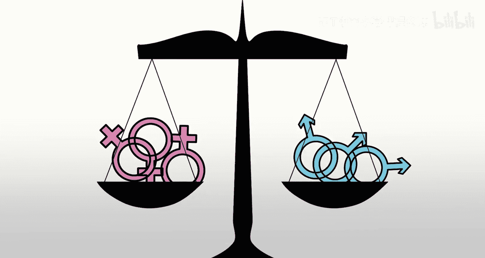

# 30：三盲鼠实验

在本节课中，我们将通过一个具体的医学研究案例——“三盲鼠实验”，来探讨数据收集中的一个核心伦理问题：研究样本的代表性。我们将了解，如果数据收集的样本群体与最终应用结果的群体不匹配，可能会导致怎样的严重后果。

---

## 数据收集与目标群体的匹配问题

每当收集数据时，都必须考虑数据收集所覆盖的群体。同时，需要判断你希望应用数据收集与分析结果的群体，是否与收集数据时的群体一致。

医学领域是这个问题的一个典型体现。在20世纪90年代之前，医学试验通常不注重性别平衡。例如，某种药物的临床试验中，大多数受试者为男性，这种情况并不罕见。如今，这种做法已不再被接受。当前的标准做法是确保男性和女性以大致相等的比例参与试验，除非有特定的科学理由不这样做（例如，在研究卵巢癌时，显然不会纳入男性受试者）。

---

## 从人类试验到动物研究的延伸

虽然上述原则已应用于人类临床试验，但直到最近，动物研究领域的情况并非如此。许多科学发现是通过在实验室研究小鼠等动物而取得的。

事实证明，雄性和雌性小鼠的行为存在极大差异。雄性小鼠通常具有攻击性，需要单独饲养。雌性小鼠则更具社会性，通常群居。根据具体的医学研究，实验可能只使用单一性别的小鼠。实际上，大多数研究仅使用雄性小鼠，但也有相当一部分研究仅使用雌性小鼠。

我们对各种生物过程的认识，在雌性和雄性小鼠之间并不总是一致的。例如：
*   多发性硬化症的进展方式在雄性和雌性小鼠之间存在差异。
*   感受疼痛的某种特定机制在雄性和雌性小鼠之间也不同。

如果你在雄性小鼠身上发现了一种有效的镇痛机制，该机制对雌性小鼠可能完全无效，因为雌性小鼠并非通过该机制感受疼痛。因此，如果一项研究仅基于雄性小鼠开发出一种新型止痛药，那么这种药物对女性可能完全无效。

---

## 新规带来的平衡与新问题

为了避免此类情况，自2015年起，美国国立卫生研究院要求，即使在动物研究中，也必须保持性别平衡（除非有充分理由不这样做）。这带来了更好的平衡，但随着研究结果的新报告以及研究结果中性别差异的披露，新的问题也随之产生。

例如，如果雄性小鼠被单独关在笼中，而雌性小鼠被群养，那么观察到的某些差异，可能是由压力水平或社交互动的差异引起的，还是真正源于雌雄小鼠生物系统构造方式的不同？

除非我们实际考虑了所有这些因素的组合，否则我们将无法得知答案。而这通常在经济学上是不可行的，除非某个特定问题变得极其重要。

---

## 核心要点总结

本节课中，我们一起学习了“三盲鼠实验”的案例。其核心要点在于：你必须仔细思考你所研究的群体。你必须确保，如果你打算将研究细分为不同的群体，你是在正确的群体上收集数据，并且需要审慎考虑如何进行这种细分。样本的代表性是确保研究结果有效且公正应用于更广泛群体的伦理基石。