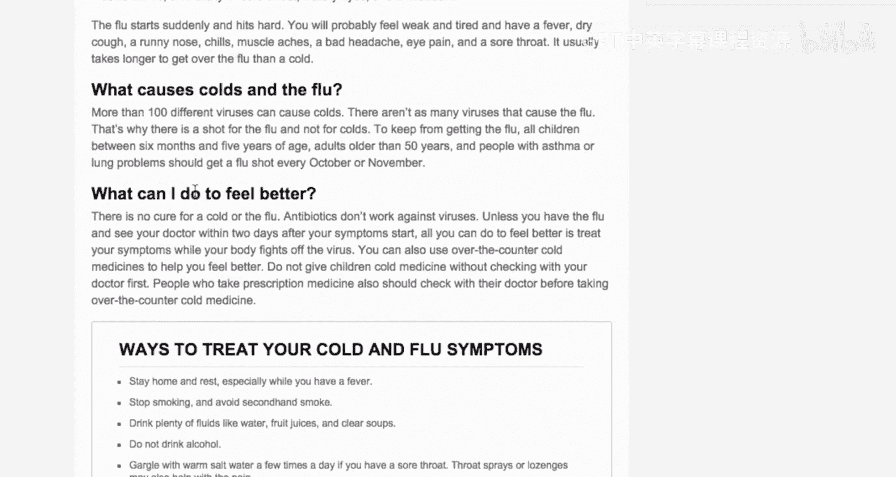

# 34：谷歌流感趋势分析 🩺


在本节课中，我们将通过一个经典案例——谷歌流感趋势（Google Flu Trends）项目，来探讨大数据预测模型在实际应用中可能遇到的挑战与伦理考量。这个案例清晰地展示了数据科学项目从成功到失败的过程，以及背后复杂的原因。

## 项目背景与初始成功

上一节我们讨论了大数据关联性的力量，本节中我们来看看一个具体的应用实例。谷歌流感趋势项目于2008年首次推出，其核心思想是利用用户在谷歌搜索引擎中输入的关键词来估计流感的流行程度。

该系统的运作基于一个简单的**相关性模型**：
```
流感病例数 ≈ f(特定搜索词频率)
```
在项目初期，这个模型取得了显著的成功，其预测结果与官方疾控中心的数据高度吻合。



## 系统原理与潜在问题

整个系统建立在一组与流感发生相关的特定搜索词之上。然而，这些关键词与流感之间的关联性成因复杂。

以下是关键词的大致分类：

*   **直接相关词**：例如“流感症状”、“发烧”，这些词可能与流感有直接的因果关系。
*   **间接相关词**：这些词与流感的相关性是在数据中被发现的，但可能没有合理的解释，属于纯粹的统计关联。
*   **混杂因素词**：谷歌团队特别指出需要校正的一类词。例如，流感在冬季更流行，而一些冬季常见的搜索词（如“NBA篮球赛”）也因此与流感病例数产生相关性。这种相关性并非因果，而是因为两者都受季节这个“混杂因素”影响。

谷歌团队剔除了那些能明确识别出受其他因素不当中介的相关性。但保留下来的词，并不意味着不存在未知的混杂因素。由于搜索词列表未公开，我们无法确切知晓。

## 模型失效与原因分析

然而随着时间的推移，谷歌流感趋势的表现开始变差，持续高估流感的流行程度，最终在几年后被完全放弃。那么，是什么导致了失败？

我们所处的世界并非一成不变。以下是几个关键的变化因素：

1.  **谷歌搜索算法改变**：谷歌不断优化其搜索引擎，旨在为用户提供更有用的结果。例如，在2008年，搜索“流鼻涕”可能不会直接显示流感相关信息；而如今，搜索引擎可能会尝试提供帮助，引导用户了解感冒与流感的区别。这种搜索结果呈现方式的细微变化，会影响用户后续的搜索行为。
2.  **用户行为演变**：人们对搜索引擎的使用方式和反应也在随时间变化。
3.  **搜索词生态变化**：上述变化导致了一个核心问题——今天用户搜索的词，与2008年系统最初设计时所关注的词，可能已经不再相同。模型所依赖的**基础相关性已经漂移**，但模型本身没有持续地重新校准以适应这种变化。

## 经验教训与未来展望

那么，这是否意味着此类大数据预测模型毫无用处？并非如此。但相关的数学方法和实践准则仍在探索和完善中。

目前的普遍共识是，你需要有一些**基准事实**（Ground Truth）来进行校准。例如，美国疾病控制与预防中心关于流感病例数的官方数据。如果手握这种校准数据，你就可以将其与从搜索词中获得的额外信息结合使用。

这样做的好处是，能够获得在时间和地点上**粒度更细**的信息，这是传统监测方法无法实现的。一旦获得了更精细粒度的信息，就可以用于构建更好的流行病学模型，预测流感疫情的传播等。如果仅仅依赖疾控中心的官方数据，这类任务将非常困难。

---


本节课中我们一起学习了谷歌流感趋势项目的兴衰。这个案例深刻地揭示了大数据预测模型面临的挑战：**相关性不等于因果性**，**现实世界是动态变化的**，而模型可能基于过时或带有偏见的关联。它提醒我们，在利用大数据进行重要预测时，必须保持谦逊，持续用现实数据进行验证和校准，并充分考虑社会与技术环境变化带来的影响。