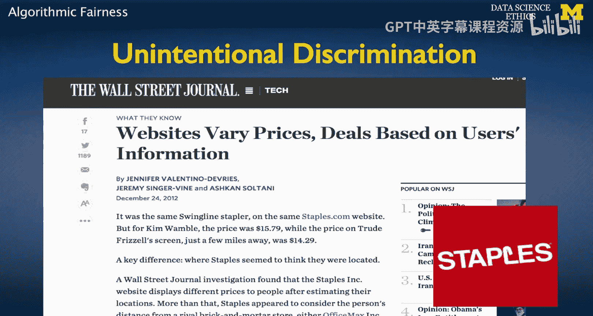

**第35：算法公平性** 🧠

在本节课中，我们将探讨算法公平性这一核心议题。我们将了解算法如何产生偏见，以及这些偏见可能通过哪些方式影响决策过程。通过学习，你将理解算法公平性的重要性，并掌握识别和应对算法偏见的基本方法。

---

上一节我们介绍了算法公平性的基本概念，本节中我们来看看一个具体的例子。

一家公司仅有10%的女性员工，且存在一种“男性俱乐部”文化，使得女性员工难以获得成功。该公司的招聘算法基于当前员工表现的数据进行训练。根据当前数据，算法给女性候选人的评分较低。算法准确地反映了当前公司内女性员工因文化障碍而难以成功的现状。然而，这一算法的直接后果是，公司会因此雇佣更少的女性员工。

这就形成了一个算法的恶性循环：算法因训练数据而产生偏见，而该偏见又进一步加剧了数据中的不平衡现象。

---

上一节我们看到了一个算法偏见的实例，本节中我们来看看导致算法产生不良结果的几种常见原因。

以下是三种可能导致“好数据”产生“坏结果”的情况：

1.  **相关属性**：使用与受保护特征（如种族、性别）高度相关的其他属性进行决策，可能导致间接歧视。
2.  **误导性结果**：即使算法预测在统计上是“正确”的，也可能因其固化历史不公而产生有害的社会结果。
3.  **算法博弈**：用户或系统通过了解算法规则，采取特定行为以获取有利结果，从而扭曲了算法的本意。

---

上一节我们列出了几种偏见来源，本节中我们首先深入探讨“相关属性”的问题。

在美国，种族歧视是一个长期存在的社会问题，并有诸多法律予以禁止。例如，法律禁止大学在招生中考虑种族因素。然而，如果大学希望实现学生群体的多样性，他们可能会寻找其他与种族高度相关的特征作为替代指标。

一个著名的例子是德克萨斯大学，他们采用了“本州每所高中成绩前10%的学生自动录取”的政策。鉴于德州高中存在一定程度的种族隔离现象，这一政策能在不直接考虑种族的情况下，实现学生群体的种族多样性。

同样，历史上曾有贷款机构希望歧视黑人借款人。法律禁止后，他们转而采用“划红线”的方法，即根据社区种族构成（作为种族的替代指标）来决定是否提供贷款。如今，法律也禁止了这种基于地域的歧视。

核心观点在于：大数据技术既为这种基于代理属性的歧视提供了便利，同时也为我们检测和应对此类歧视提供了工具。作为负责任的数据科学家，我们有责任运用技术力量去做正确的事。

---

上一节我们讨论了利用相关属性进行间接歧视的问题，本节中我们来看看如何定义和识别歧视。

在考虑歧视时，意图很重要。我们必须明确我们希望避免哪种歧视。

我们可以从两个层面来讨论歧视：

*   **个体层面歧视**：指目标群体中的个体，与另一个除群体身份外完全相同的个体，受到了不同对待。例如，资质完全相同的黑人和白人求职者，一人收到了面试通知，另一人却没有。
*   **整体结果歧视**：指在总体结果上，目标群体与对照组（如总体人口）之间存在差异。我们可以通过比较成功率、录取率等比例来衡量。

需要记住的是，**无意识的歧视**难以完全避免。例如，2015年卡内基梅隆大学的一项实验发现，高薪职位的在线广告展示给女性的数量显著少于男性。这很可能是因为广告投放算法基于历史点击率进行优化，而历史上男性点击这类广告更多。这并非某家公司的故意歧视，而是算法在无意中固化了现状。

---

本节课中，我们一起学习了算法公平性的核心挑战。我们了解到，算法可能因为训练数据不具代表性、存在历史偏见或使用了相关代理属性而产生歧视性结果。我们区分了个体层面和整体结果层面的歧视，并认识到无意识的歧视同样需要警惕和应对。作为数据科学从业者，我们必须积极运用分析技术来检测和纠正算法中的偏见，确保技术应用促进公平，而非加剧不公。