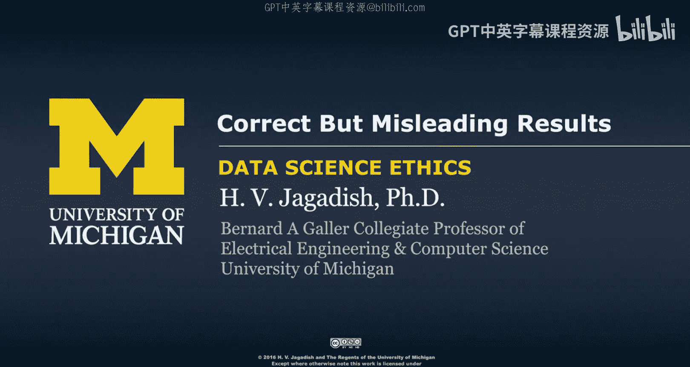
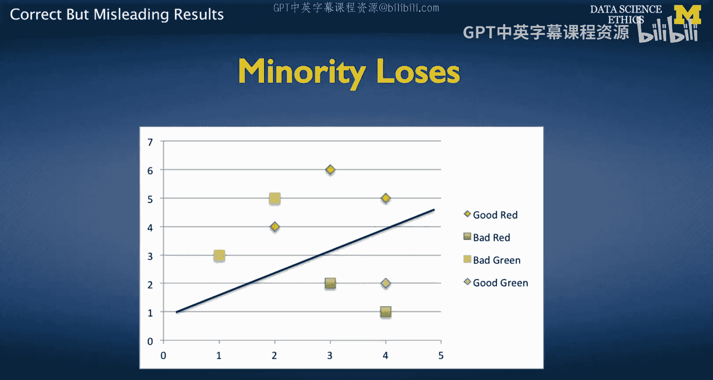

# 35：正确但具误导性的结果

## 概述
在本节课中，我们将探讨数据科学中一个关键的伦理问题：即使分析结果在技术上是正确的，它们也可能通过呈现方式、汇总方法或对数据多样性的忽视而产生误导，从而导致不公平的后果。

---

## 可视化中的误导性呈现
上一节我们讨论了公平性的概念，本节中我们来看看一个常见问题：结果正确但具有误导性。其中一个明显的问题是结果的可视化或呈现方式。

请看这家公司的案例。我们观察其逐年销售额，图表显示出一条惊人的增长曲线，呈现出一个漂亮的“曲棍球棒”形状，末端略有上扬。视觉效果看起来非常出色。

然而，如果观察左侧的Y轴刻度，我们会发现，在六年的时间里，销售额实际上仅从100增长到了205。如果将这些数据以正常的、未缩放的坐标轴绘制，图表可能更接近右侧的图形。我们看到的是一个业绩**稳定、体面、逐年一致**的公司，但绝对没有任何爆炸性增长。实际上，六年间仅有5%的微小增长，并不值得大书特书。

可视化可能是数据被误导性呈现的最明显之处，但这种现象也出现在许多其他地方。

---

## 单一评分系统的局限性
考虑一个基于用户评论的旅行推荐系统，它通常用1到5分来为酒店评分。

以下是两个酒店的例子：
*   **酒店A**：平均评分为 **3.2**。这个3.2分主要由大量的3分和4分构成。
*   **酒店B**：平均评分同样是 **3.2**。但这个3.2分主要由大量的1分和5分构成。

问题是，你更倾向于选择哪家酒店？许多信誉网站只关注平均分，并据此对酒店进行排名和排序。这样一来，两家酒店之间的重要差异就被掩盖了，除非你深入查看具体评分分布。

关键在于，像酒店B这样人们要么爱要么恨的酒店，对你而言可能要么是完美选择，要么是你避之不及的地方，这取决于你更像那些打5分的人，还是更像那些打1分的人。简单地将其称为3.2分并不准确，因为对你来说，它要么是5分，要么是1分。而判断你属于哪一类人，在没有额外信息的情况下并不容易，这些信息当然也不存在于我们看到的单一分数中。

单一评分还存在另一个问题。请看另一个例子：
*   **酒店A**：基于**2条**用户评论，平均分为 **4.5**。
*   **酒店B**：基于**200条**用户评论，平均分为 **4.4**。

你更倾向于哪家？很多人可能会说更倾向于酒店B，而且倾向性很强。4.4分虽然低于4.5分，在排序上4.5可能排在前面。然而，我们都知道在大多数网站上，制造几条虚假好评太容易了，因此我们对那个4.5分心存疑虑。而4.4分看起来是一个我们可以更信赖的、更扎实的数字。这就是为什么即使报告的单一分值较低，我也会选择B而非A。

让我们进一步看一个略微相似的例子。假设现在：
*   **酒店A**：基于**10条**评论，平均分为 **4.5**。
*   **酒店B**：基于**500条**评论，平均分为 **4.4**。

如果只知道这些，如前所述，你可能更倾向于酒店B。但现在，如果你还知道**酒店A只有5个房间**，而**酒店B有500个房间**，这会改变你的决定吗？我的感觉是，此时我们可能更倾向于酒店A，而且倾向性很强。因为酒店A客户较少，理应获得较少的评论。考虑到它比酒店B小得多，评论数较少这一点不应成为它的劣势。

---

## 数据简化与多样性忽视
那么，这一切将我们引向何方？当你需要报告数据分析结果时，通常必须将其提炼简化，这是完成分析所必需的步骤，尤其是在结果消费者是下游算法（另一个将对其进行进一步处理的算法）的情况下。然而，这样做往往会压制数据中许多对决策可能至关重要的丰富信息。

以下是另一个重要数据可能被压制的地方。我们知道世界上有右撇子和左撇子。为了简化，假设世界只由这两类人组成（我们暂且忽略没有手或双手灵巧的人等）。世界上右撇子远多于左撇子。

鉴于世界如此，产品设计师如果必须做出选择，他们会设计支持右撇子的产品，即使这意味着旋钮、操纵杆等需要操作的部件对左撇子来说不那么方便。在产品可以制作成右手版和左手版的情况下，人们可能会生产两种版本。

在右撇子和左撇子的案例中，这是一个简单的场景，我们都明白这意味着什么，并且可以实际观察人们如何做出这些选择。然而，当这些特性不那么容易被理解时，处理起来就困难得多。

让我们看一个世界，其中有一个**红色多数群体**和一个**绿色少数群体**。我们试图区分“好”（钻石形）与“坏”（方形）。如果只看多数群体，我们会得到一条像这样的完美分界线：所有钻石形都在线上方，所有方形都在线下方。

不幸的是，这条分界线对于绿色群体来说完全是错误的划分。在这个例子中，只有少数红点和绿点，多数群体的效应不那么明显。但假设你有成千上万的红点，数量与绿点一样多，你的算法就会画出这样一条线。结果，绿色群体就完全被错误分类了。

---

## 算法偏见的社会后果
因此，你有一个招聘算法，它查看某些属性并基于这些属性来决定聘用谁。这个算法使用的标准已经被调整以适应多数群体。现在，如果某些少数群体的最佳标准恰好不同，那么算法在这些少数群体上的表现就会很差。

由于算法在少数群体上表现不佳，我们遇到了几个不同的问题：
1.  **最佳少数群体申请者可能不被聘用**。正如我们所见，绿点被错误分类。我们有一位非常合格的少数群体申请者，他实际上会表现得非常出色，但由于我们的算法调整不当，这个人被拒绝了。
2.  **被聘用的少数群体员工并非最佳人选**。由于我们算法训练的缺陷，被聘用的少数群体员工可能不是该群体中最优秀的。
3.  **导致对少数群体的进一步偏见**。因为他们不是最优秀的，最终表现可能不如预期。结果，他们不公平地“玷污”了少数群体中的其他人，因为现在算法将“学习”到少数群体表现不佳。

于是，我们始于压制多样性，最终导致了歧视。

---

## 医疗场景中的类似问题
这不仅限于招聘，让我们看看医疗场景。我们进行了一项治疗糖尿病的新药临床试验。结果发现，实际上存在两个截然不同的患者群体，他们被归为一类，因为根据我们目前的医学知识，两组患者都有类似的血糖调节问题。

但由于两组患者的疾病机制不同，这种药物对A组患者非常有效，但对B组患者毫无价值。

让我们看看在这个临床试验中会发生什么：
*   如果**A组是多数群体**，那么该药物将被发现有效。研究报告会显示一定的显著性水平，称该药物有效，并将为任何患有此类糖尿病的患者开具此药，包括B组中对此药无效的患者。
*   另一方面，如果**B组是多数群体**，那么该药物在整个群体中未发现具有足够的显著性效果。我们最终将不会批准该药物。即使存在一个少数患者群体（A组患者）本可以从这种救命药物中受益，它也永远不会上市，永远不会被批准。

---

## 总结
总而言之，本节课我们一起学习了数据科学中“正确但具误导性的结果”这一伦理挑战。我们探讨了：
*   **可视化误导**：通过调整坐标轴等方式扭曲数据印象。
*   **汇总数据的问题**：单一平均值或总分可能掩盖重要的分布差异（如两极分化的评分）或样本可靠性问题（如评论数量）。
*   **忽视群体多样性**：当算法或分析主要基于多数群体进行优化时，可能会对少数群体做出次优甚至错误的决策，这在招聘、医疗等领域会产生严重的公平性后果。

关键在于，以**过于简单化的方式**处理正确的数据，可能导致非常重大的社会后果。作为数据科学家，我们有责任思考如何呈现数据的全貌，并在设计和评估模型时充分考虑不同群体的特性和需求。