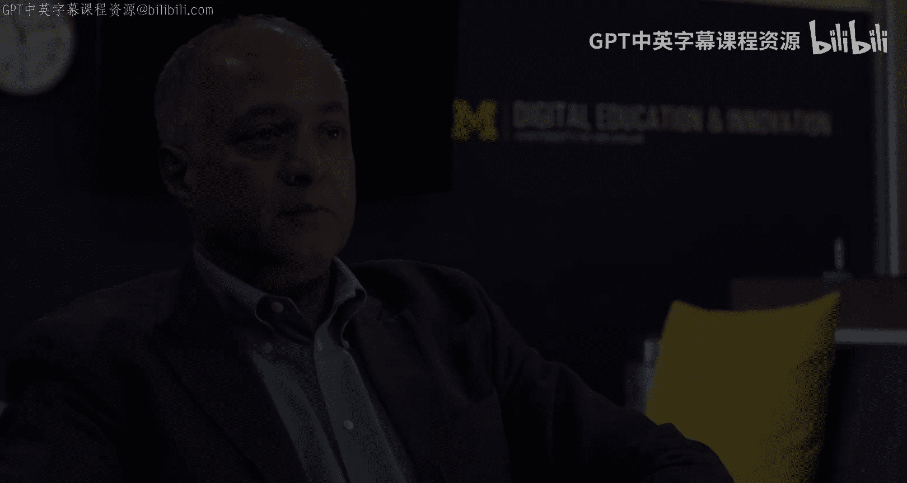
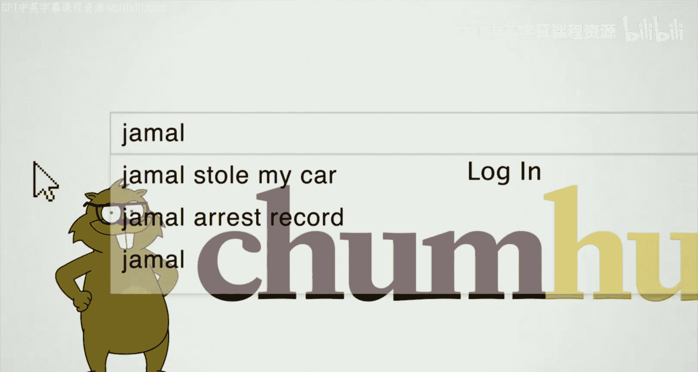

# 40：安全与收益的博弈 🎭

在本节课中，我们将通过分析一个虚构的案例，探讨算法决策如何在实际应用中引发伦理问题，特别是关于安全、偏见与社会公平的权衡。

有时，电视剧比现实生活更能反映深刻的真相。让我们观看CBS系列剧《傲骨贤妻》中的一些片段。这部剧以芝加哥为背景，围绕法律展开。我们关注的重点是剧中一家名为“Chumhum”的大型信息技术公司，其业务范围类似谷歌。具体来说，我们将审视其推出的一款地图产品。

## 地图产品的社会影响 🗺️

上一节我们介绍了案例背景，本节中我们来看看“Chumhum地图”的具体功能及其引发的争议。

我们过去需要提前几周预订，我们的鹿肉馅饼曾被旅游指南推荐，我们被评为四星。然后人们突然不来了。当这是你的心血时，很难不感到是针对个人。为什么Chumhum要负责？他们的地图程序“Chumhum地图”旨在通过引导用户避开城市危险区域来保障安全。绿色代表安全，黄色代表一般，红色意味着远离。当过滤器开启时，行车路线会避开红色区域。过滤器默认总是开启，用户必须手动关闭。所以你失去了步行客流。看这里，当我切换过滤器开关时，它不显示地图红色区域内的商家。这个功能推出后，我就像不存在一样。它说这是不安全区域。是的，一个红色区域。感觉并不危险。是的，除了一件事：有太多有色人种。

我们刚刚看到的情况是，由于Chumhum在其产品中创建了一项旨在服务用户社区的功能，对这位特定的餐厅老板产生了真实的生活影响。

## 算法背后的意图与辩解 ⚖️

了解了产品的影响后，我们接下来看看Chumhum公司在设计此功能时的考量与辩解。

我们的地图没有种族歧视。它由算法运行，而数学没有种族歧视。Chumhum以其多样性为荣。开启安全过滤器阻止游客光顾非裔美国人社区的商家，Chumhum不对其软件使用者的行为负责。是费尔德曼女士选择在一个边缘社区开设四星级餐厅。这不是一个边缘社区。这是一个黑人社区。两者都是，这其实并不少见。等等，他说的没什么不寻常的。看看犯罪率。看看霍姆谷。看看那个为种族主义者辩护的双种族律师。抱歉，你是？那不是……等等，等等。Chumhum不承认有任何不当行为，但本着让世界更美好的精神，哈蒙先生愿意向费尔德曼女士提供5万美元，让她在任何她想开的地方开一家新餐厅。那算什么？Chumhum市值3000亿。我的公司值多少钱？谢谢，因为自从你成为CEO以来，你的股票下跌了22%。你知道吗？你们真是了不起。对你来说，法律在他那边。我们走着瞧。

你起诉Chumhum“侵权干涉预期经济利益”？是的。Chumhum的安全过滤器制造了一种种族主义的“地理围栏”效应，损害了非裔美国人社区企业主的利益。侵权干涉需要证明存在故意或明知的干涉，而这里没有。我们认为有。我想传唤一名证人来证明意图要求不成立。哈蒙先生，Chumhum的安全过滤器有可能具有种族主义意图吗？没有。过滤器仅由两样东西驱动：客观的第三方统计数据（例如犯罪率）和用户生成的反馈（如评论）。是的，完全正确，这完全掌握在用户手中。我的意思是，Chumhum的任何人都无法利用安全过滤器故意干涉原告的生意。不能，即使我们想也不能。谢谢你，哈蒙先生。Chumhum地图是否仅在COS（Chumhum自己的操作系统）上可用？是的。这是一项由互联网研究基金会最近进行的研究。你能读一下那里写的内容吗？COS用户中71%是白人。非裔美国用户占多少百分比？上面说11%。这些数字与你们自己的市场研究相符吗？Chumhum不应为社会经济差异负责。

我们在这里看到，Chumham算法的决策产生了社会影响。问题是，Chumhum地图考虑哪些输入是合理的？如果它客观地只考虑犯罪统计数据，并客观地指出这些是犯罪率较高的社区，这样做可以吗还是不可以？我不知道答案。这是一个关于社会整体共识的问题，即什么话可以说。假设这被认为是合理的。那么还存在另一个问题：Chumhum地图将人们认为安全的社区作为输入考虑，这可以吗？这与从实际犯罪统计数据出发不同。现在这是一种主观评估：“我觉得这个社区安全”，这在很大程度上取决于说话者是谁。我们在这一集中看到的问题是，Chumhum地图聚合的主观评估，其用户群体高度倾斜，大多数评估来自白人，因此反映了个人评估中可能存在的任何种族偏见，关于什么是安全社区。

## 算法中的隐性偏见与数据问题 🤖

这种算法中隐藏的种族主义可能出现在许多其他地方。下一个片段改编自几年前谷歌图像识别发生的一起真实事件。

当他输入他的名字“Jamal”时，自动完成功能建议以“Jamal偷了我的车”或“Jamal逮捕记录”来完成句子。太好了。

但这没有责任……真的吗？你怎么知道它是基于客户的？我的意思是，自动完成功能基于最常用的搜索请求，所以显然，输入“Jamal”的人对逮捕报告比对其他任何东西都更感兴趣。所以Chumhum不种族歧视。它的用户是……我不会争辩说覆盖结果是种族歧视。好的，我们需要处理“动物事件”。我喜欢这个说法。Chumhum有照片识别软件。它将你的照片分类，如“露营旅行”、“迪士尼乐园”、“毕业”。一位顾客指出，它给她朋友的照片打上了标签……

这是乔希，你可以说得更具体一点，你知道……是的，所以照片不是由人标记的，是由算法标记的，而算法无法区分非裔美国女性和动物。嗯，现在可以了，但是……三年前，我们没有提供足够的例子，它在光线和阴影方面有很大问题。它也弄错了很多其他东西，只是没有其他错误看起来如此……种族歧视，对吧。它已经变得更好了。谷歌也有这个问题。算法有没有把白人误认为是动物？为什么会那样？因为它把白人误认为是北极熊或白海豹？不，到目前为止没有。为什么没有？为什么它难以识别非裔美国人，而不是白人？我猜，因为我们没有给它足够的例子。我们不是种族主义者。我不是说你们是。我只是看看你们的工作场所。

我们在本课程中反复讨论了正确抽样数据的重要性，以便拥有正确的人群作为训练任何算法的基础。我们在这个片段中看到的是训练数据选择不当，因为算法训练时没有足够多的非裔美国人面孔。无论后果是否产生了歧视性结果，或者这是否是一个种族问题（在这个例子中确实如此，因此使其更加突出），我认为可以相当直接地说，在这个例子中，算法的设计者搞砸了，因为他们没有使用正确的训练数据。很容易看出有人可能犯这样的错误。关键是要注意并尽力避免这样做。

## 核心要点总结 📝

本节课中我们一起学习了算法决策中安全与收益的复杂博弈。通过《傲骨贤妻》中的案例，我们看到了两个关键问题：

1.  **输入数据的伦理考量**：算法基于“客观”数据（如犯罪率）或“主观”用户反馈进行决策时，可能无意中放大社会现有的偏见与不平等。关键在于社会共识与算法设计的透明度。
2.  **训练数据的代表性至关重要**：算法的输出质量直接取决于其训练数据的质量。如果训练数据不能代表目标人群（例如，缺乏多样性的人脸数据），就会产生带有偏见甚至歧视性的结果，如将特定人种误识别为动物。

核心教训是，数据科学家和产品设计者必须积极审视其算法的数据来源、潜在假设及可能的社会影响，努力确保技术的公平与包容性。