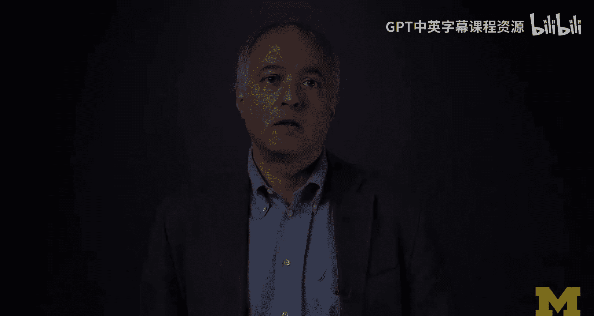

# 42：监控社会 👁️

在本节课中，我们将探讨数据监控社会的现象，分析大规模数据收集带来的益处与挑战，并思考如何在数据利用与个人隐私之间取得平衡。

---

我们首先来谈谈监控。我们正在收集越来越多关于自身的数据，并且这一趋势将持续增长。我们不仅有监控摄像头，还有智能电表，它们以旧式机械电表无法做到的方式，记录着我们的水电消耗情况。我们还有像Fitbit这样的设备，记录着我们参与的每一项活动，甚至是我们的一举一动。随着技术发展，我们的一切行为，每一次呼吸，都可能被记录下来。

我们这样做，是因为作为个体，我们能从收集的自身数据中获益。例如，佩戴Fitbit是为了通过监测运动来获得健康益处。同时，收集的数据也能带来社会效益。例如，执法部门可能通过查看某些详细记录而获益；医学科学可能通过分析大量电子病历而取得进展。

---

上一节我们提到了数据收集的益处，本节中我们来看看完全开放数据的极端设想。从政策角度看，我们可能设想一个极端：决定让所有这些信息记录完全公开，让每个人都能访问，生活在一个“人人皆知一切”、毫无欺骗的世界里。

但问题在于，欺骗实际上可能很重要。我们需要欺骗。我们有一个明确的概念，即“抹去过去的历史”以获得新的开始。在美国，许多罪行的服刑记录在七年后会被清除，交通违规记录则在三年后。我们知道人际关系很复杂，有时，一个新的开始至关重要。仅就社交互动而言，我们时常会说一些善意的谎言。如果我们生活在一个无法说这些善意谎言、必须完全诚实的世界里，我们将需要进行巨大的调整。

---

除了社交层面的考虑，量化过程本身也存在问题。量化过程会**丢失意义**。理解原始数据通常包含丰富的内涵，但当它被简化为一个数字时，这个数字可能无法反映原始数据中实际拥有的丰富信息。我们应该警惕过度依赖这类量化后的数字，而这通常正是我们所创建的记录。

以下是欺骗之所以重要的几个原因：
*   社会需要“重新开始”的机制，例如清除过往记录。
*   日常社交依赖于善意的谎言。
*   量化数据会丢失原始信息的丰富性和语境。

此外，还有更明显和更严重的情况。例如，如果你生活在一个专制政府统治的国家，那么微小的欺骗可能只是为了过上正常生活所必需的。

---

基于以上所有原因，在我们创建这些宝贵且庞大的数据记录时，必须弄清楚如何控制谁有权访问哪些信息。这其中存在艰难的选择。

做出这些选择尤其困难，因为存在一个“匿名化困境”。这个困境的核心在于：**对匿名化数据集的分析可以产生巨大价值，但在大多数情况下，只要有足够的努力，匿名化是可以被破解的**。

因此，我们必须担心任何形式的信息泄露，因为不相关的模式也可能提供识别信息。举一个例子：Netflix发布了过去用户租赁电影及评分的**去标识化数据**。其中一些用户，对其中一些电影，也在社交媒体上发布了影评。将这两组信息关联起来，就足以**重新识别**出部分用户的身份。

---

本节课中，我们一起学习了监控社会的现状。我们认识到，大规模数据收集在带来个人与社会效益的同时，也引发了关于隐私、欺骗的必要性以及匿名化有效性的深刻伦理问题。关键在于，社会需要在利用数据的益处与保护个人隐私、允许必要的社会弹性之间，找到平衡点并建立相应的控制机制。