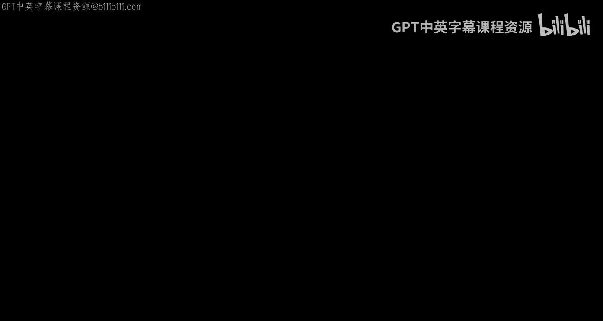
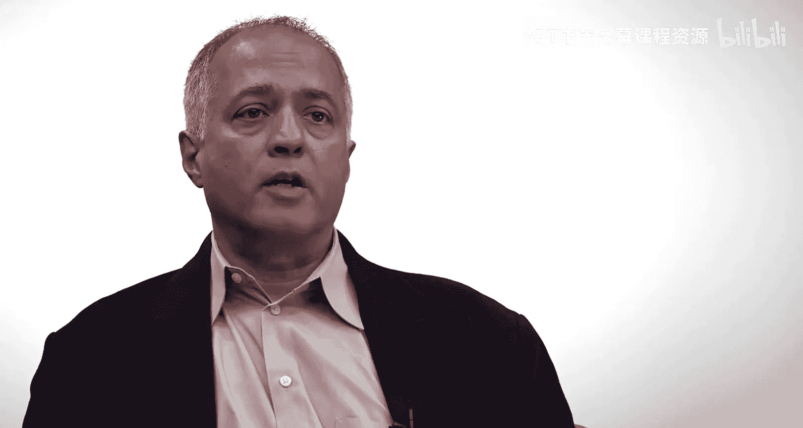
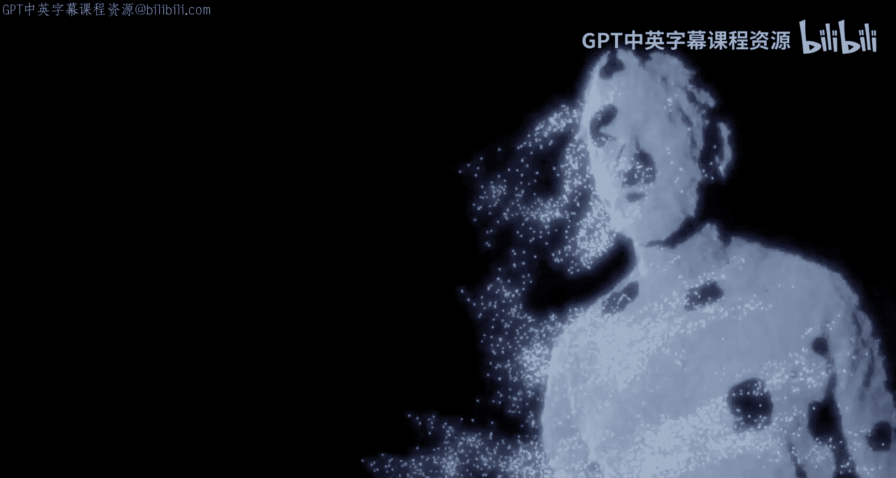
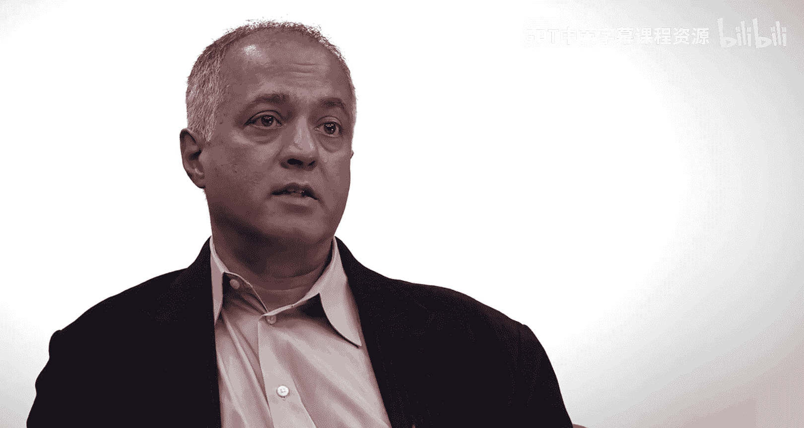
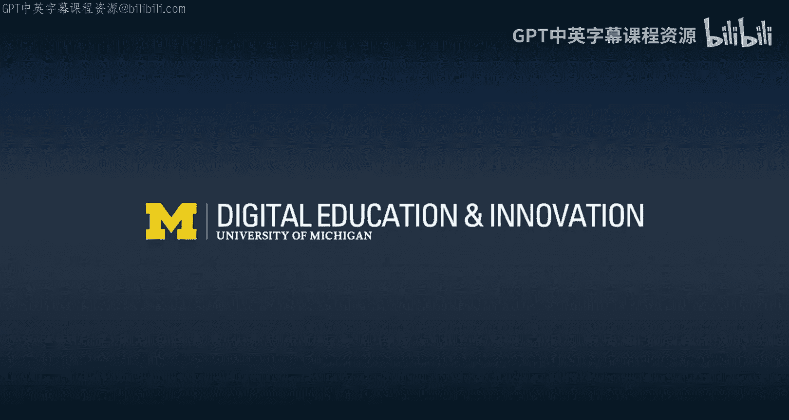
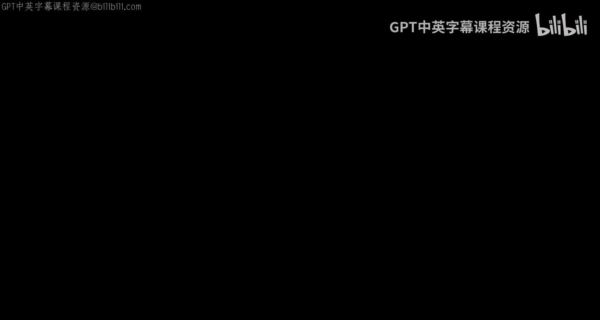

# 密歇根大学《数据科学伦理｜Data Science Ethics》中英字幕 p01 0_数据科学伦理课程导览.zh_en -BV1EGaVzeEbQ_p1-

The age of big data dawned a few years ago and now of course we live in a world today that people couldn't have imagined a generation ago。

I'm a data scientist。What this project is about is having other data scientists think about。

🎼The ethics of。🎼Our field。🎼If I take a picture of you。

 who owns that picture in terms of law and in terms of our general understanding。

 that picture is a picture of you， but I took that picture， I own it。

 What are ways in which I can use that picture and whether I can use that picture and ways that could hurt you Now take this to data。

If I have some data about you， is that your data or is that my data because I collected it？

Just trying to understand。What's my ownership of this？Versus what's your ownership？

🎼And what's the obligation one has to the other is not so straightforward。

If you don't even know what one might be doing wrong， you can't even begin to fix things。

If we don't even agree on what is right and what is wrong。

 then we don't even have a motivation of something to fix。

🎼What one needs to have first is a societal agreement on what is right and what's wrong。

 I think that in the case of data science， we really haven't had。

That kind of broad discussion and then flowing from that。A framework to think about how they could。

Practice。Their data science differently so that they do the right thing doing this right can actually allow one to have guarantees of fairness。

UFM is at the forefront of educating the leaders of tomorrow in almost any field and having an ethics component of that data science training at U ofM is the right thing for UFM to do。

🎼If you're doing things with data， you've got to remember that you have a great deal of power and with a great deal of power comes a great deal of responsibility。

 this course。It's going to teach you how to be responsible in that exercise of power。

Data scientists who have had ethical training will result。

Better more ethical practice of data science。

And I think that this is good for data science and this is good for society at large。

