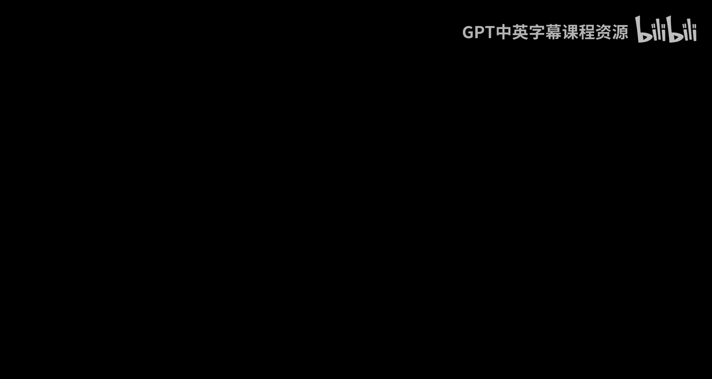
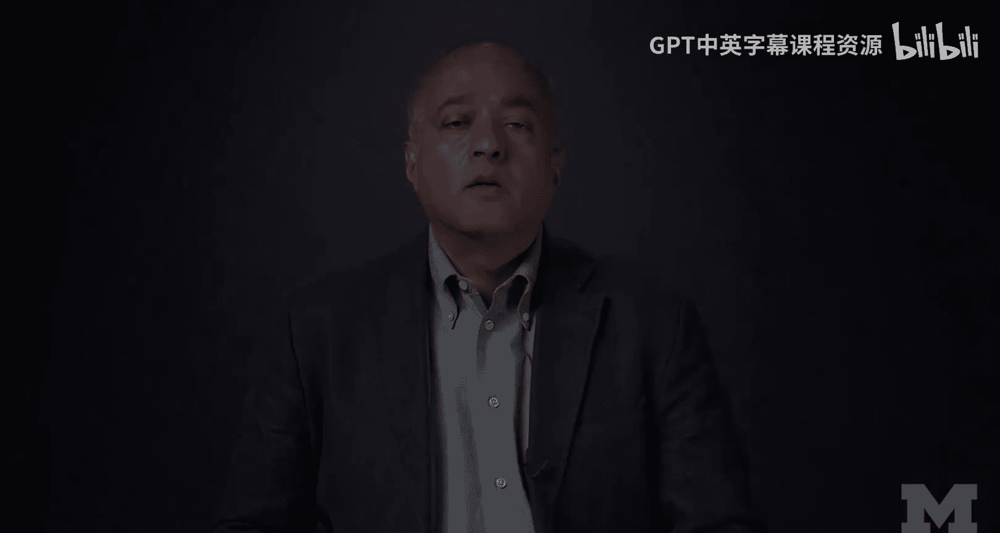

# 密歇根大学《数据科学伦理｜Data Science Ethics》中英字幕 p02 1_什么是伦理.zh_en -BV1EGaVzeEbQ_p2-

Welcome to this course on the ethicthics of data science。

As we practice data science， it is important that we do it right。

There are many ways in which we could end up doing things wrong if all we know about data science are the techniques that we might learn in class。

And we just apply them blindly。In this course， we will see some of the ways in which we could make mistakes and。

Learn about ways in which we could think about the problems so as to avoid these mistakes。

Let's begin with a basic definition， what are ethics。Ethics are rules that we all voluntarily follow。

Because it makes the world a better place for all of us。They help us distinguish right from wrong。

They are the cornerstone of civilization。If we don't have ethics， we are not civilized。So。

 let's look at an example。Ethical principles stop me from stealing your wallet。

Now there are other things that could stop me from stealing your wallet。

If you're bigger and stronger， I may not want to steal your wallet because I'd be afraid that you'd beat me up。

But ethics would stop me even if you're smaller and weaker。

It's possible that I won't steal your wallet simply because I'm worried that I'll get caught and then I'll get thrown in prison。

Ethics stops me from sealing her wallet， even if there's no chance that I will be caught。

It's a fundamental principle of what we think is right。Religions。Teach us to behave in good ways。

There are precepts like thou shalt not steal。Most religions promote ethical behavior。But ethics。

Aren't necessarily religious。Ethics are shared values。And religions are often shared values， too。

And so ethics could flow on account of religious beliefs。But， they need't。Ethics also are not laws。

Often， we get stuck in thinking about compliance with laws。

That's not all that we should be worried about。So， consider。An example where you tell me a secret。

 and I promise to tell no one。I then break my promise。And spread this big story about you。

 And there's a scandal。I may not have broken any law， it's unlikely。

That I would be punished for having broken my word to you。

But I think we would all agree that in doing so， I would have been unethical。

I there's a shared societal principle of I gave you my word to keep your secret。And then。

 I didn't keep my word。Well， ethics are not laws。Laws often follow ethics。

 because ethics are our shared social values。Laws are often created to enforce these shared social values。

The problem with having shared values is。Even if we have shared values。Not everyone will be ethical。

So we may all have a shared value that says it's wrong to steal。

But that doesn't mean that there are no thieves。It just means that societally we have agreed that stealing is wrong。

And then we'll have laws that says， hey， if you break this rule。

 this societal rule of we shouldn't steal。Then there are punishments。

 and these punishments are determined by law。So in this sense。

 laws are used to help enforce ethical behavior。 Other social covenants can do so， as well。

Such as people being ostracized。One way to think about the benefit of ethics。

Is in termss of the economics。So for the most part。

 society as a whole does best when each individual works to maximize their own individual benefit。

This is the basis of the free market。That underlies so much of modern economy。

But there also are situations where individual benefit comes at a cost to society。

And when this happens， shared societal value systems are required to address these situations。

In terms of economics textbooks。There is something called the tragedy of the Commons。The idea is。

 there is an open field。That is the commons It's shared across the entire village。Now。

 since this is a shared field。It's fine for me to have my sheep graze in the commonts。That way。

 I have less pasture that I have to buy， and I can afford to keep more sheep because my sheep can make use of the grass into the commons。

 as well as on my own land。But if everybody in the village makes that same。A judgment。Then。

The land in the commons gets overgrazed。Nobody takes care of it。

 And we end up with a wasteland instead of having a lush meadow that we would all have enjoyed。

The only way to avoid this is for us as a village to come together and agree on some rules with respect to how we can all benefit from the Commons without over exploitloing it。

So to summarize。A rule is something that limits what I can do， and therefore。

 there's a cost associated with me following the rule。

 but I might still like to have a rule in place if the cost to me of following this rule is less than the benefit to me if others follow the same rule。

So that is the thing that causes us to have an economic benefit from these shared values that drive rules that regulate our behavior。

Let's consider a simple example。Suppose we had no rules about how we would drive。Well。

 we'd have chaos on our roads。When there's a traffic jam。

I've often wished that I could drive on the other side of the road， or on the shoulder。

Traffic rules don't allow me to do so。And I might feel frustrated at that moment。But。

We all see the benefit of all of us agreeing to a particular rule and agreeing to drive。

On a particular side of the road。If we didn't have that rule， we'd all be driving much slower。

And most of the time， this rule results in us being able to get to where we want to get too much faster than if we didn't have this rule。

Let's look at another example。If。You have litter。And other people have littered。

 then you're not motivated to do a good job with your candy wrappper。

Even though it may only take a few seconds of effort to walk your canddy wrap nearby trash bin。

It's just not worth it when you see so much trash。And so the existence of litter begets more litter。

On the other hand。If we all agree。As a social value that we shouldn't let。

And most of us are good about throwing our wrappers in the trash and not on the street。

 Then the streets are clean。And it is easier for us to follow the rule because we get the benefits of us following the rule since everybody else is also following the rule。

 So that's， again， a shared value。That is the basis of an ethical system。So to sum up。

Ethics are shared rules that we all agree to follow because of the resulting benefits。

These rules are typically infused with a sense of right and wrong。And in this first lecture。

 weve learned what ethics are and why we're all better off with ethical behavior。In the next lecture。

We will link this up with data science。