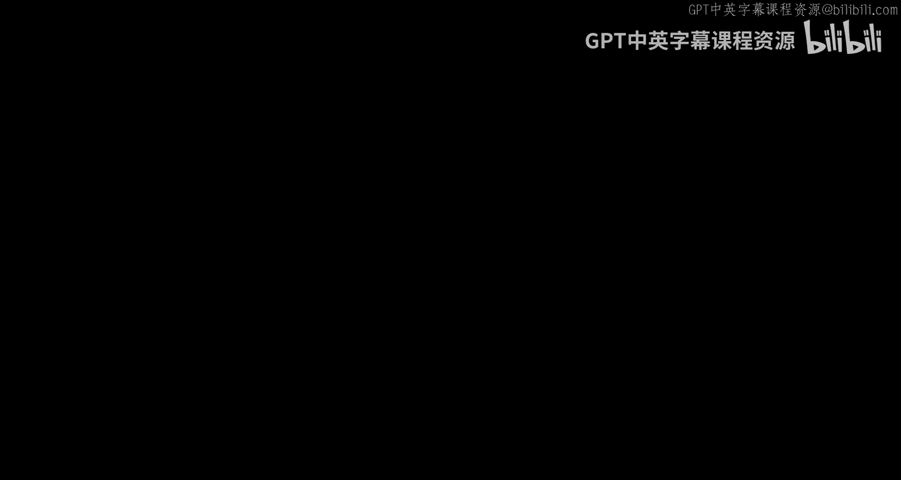

# 密歇根大学《数据科学伦理｜Data Science Ethics》中英字幕 p03 2_数据科学为何需要伦理.zh_en -BV1EGaVzeEbQ_p3-

This segment is about why data science needs ethics。

And in fact， the importance of ethics for data science。If you think about data science in。

Make an analogy with the history of the United States。

When the western part of this continent was settled， it was a wild place。 There were few rules。

People went there。And did the best they could in difficult conditions using ingenuity and were as successful as they could be under the circumstances。

 And part of that was， you took what you could。And you develop techniques to be able to succeed in an environment where there weren't that many rules。

But over time。We have civilization， and we get the civilization。

We no longer can do everything that just because we can。We have to follow rules。

And these are the rules of ethics that give us more benefits than they cost us。

So if you think about data and data science。We have unprecedented access to data today。

And we have unprecedented options for analysis of these data。

And so there's virtually no limit to what data science could do。

The question that we should be thinking about。Is， should we do everything that's possible。

Are there things that are possible to do that we agree。 we shouldn't do。And this may seem odd。

 and this may seem strange， and this is not the normal way in which people think about engineering or the creation of computational artifacts。

 But as we will see shortly， this is actually things that we have already done at least taken the first couple of steps towards。

But first， let's think about how data science has impact。

 Theres tremendous excitement about data science， precisely because it gives us a better way of doing something in so many different aspects of society。

😊，And so it has impact because it has social consequences。But。

This impact can also come with undesired consequences for privacy， for fairness and equity。

 and so on。And ethics gives us the rule book， tells us how we can decide what is O to do and what is not。

As an example。Unsolicited email was something that was considered a great idea in the 1990s。

Over time， spam became a big problem， and today in the US。

 no upstanding business will own up to spaming intentionally。

This is just something that is considered socially unacceptable。In a similar vein。

Much of the work that data scientists do has potential for delivering great values can help in so many different ways。

Developing a shared sense of ethical values is necessary if we want to reap the benefits of data science。

 while minimizing the harm that it could possibly do。

