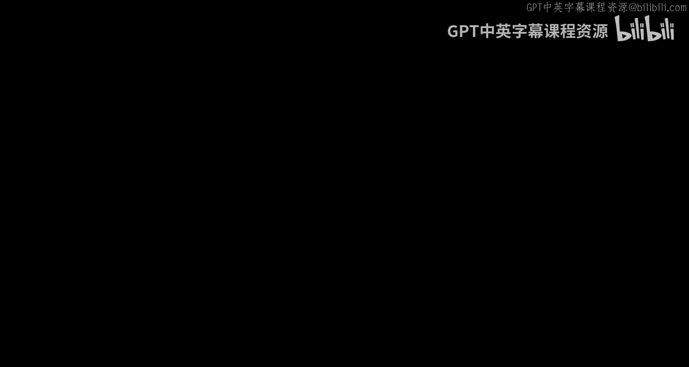

# 密歇根大学《数据科学伦理｜Data Science Ethics》中英字幕 p04 3_案例分析：垃圾邮件非关肉类.zh_en -BV1EGaVzeEbQ_p4-

嗯。

So the year was 1994。The internet was young。🎼And there were a lot of clever people trying to figure out what to do with this new medium and exploring the possibilities that it opened up in particular。

 there was a pair of。Attorneys in Arizona。Lawrence Cantor and Martha Seieaggel。

who came up with the idea of reaching out to a vast audience through this new medium， the internet。

 these attorneys were immigration attorneys and they wanted people who would be interested in their services for a green card lottery that the US government at that point was planning to run。

What they did was send out a message about this lottery and asking people to hire them as attorneys to help them win the process。

And they posted it。🎼To every place that they knew how to post it。

 there was something called the Usenet so they posted a bunch of usernet groups。

 but this is the equivalent of sending unsolicited email to everybody This is the first。

Kn instance of what we now know as spam。The word spam was derived from a Mon Python skit。

Let's take a look at it now。anything without spausage and spa not much spa bacon spam and sausage。

 That as much as spa sausage and spam。There was actually unsolicited email and messages sent。

Prior to the one from these two Arizona attorneys， but those were not necessarily commercial and somehow didn't。

Get elevated to the status of the first spam message。Anyway。

 these attorneys had considerable success with their message。

 they got a lot of new clients and they boasted about the success of their method and they actually set up a business。

 a consulting business to help other businesses。Reach new customers through this new medium。

In other words。This was a good idea at that time。An innovative。Business practice。

 people trying to figure out how to do something valuable with a new medium。Over time。

The volume of these messages。Grew to proportions that we all considered unacceptable。

 there grew a social consensus。That spam was not a good thing。That this was something that。

We didn't wish to encourage， we didn't wish to tolerate even。And。

This is what I view as an ethical consensus of it is not ethical to spam。

It is something that goes against our social norms and values today。And to back this up。

 Congress passed the Cant Spm Act。And what this basically says is that。

If you're going to send a commercial email message。

 you must identify yourself very clearly as a sender that is the business name and address should be clearly stated。

 there should be a clear and easily available unsubscribe option。

And if a consumer chooses that option， then the business must respect this。

And this is how upstanding businesses that we all work with will send us email and allow us not to receive that email easily should we not want to。

Having a social consensus that spam is bad doesn't mean that nobody spams is。

Plenty of unsolicited email。Even today？And there's a lot of technology devoted to。

Having us not see such spam， however。The point really is that the people who spam aren't proud of it。

 they're not going to show off， you're not going to have。A student say，Hey， guess what。

 I got this fantastic job at this new spam company and my job's going to be delivering more and better spam。

