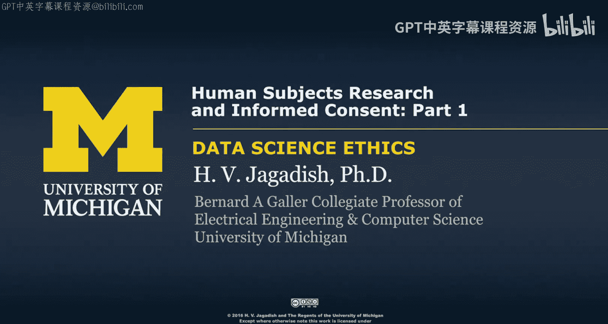

# 密歇根大学《数据科学伦理｜Data Science Ethics》中英字幕 p05 4_人类受试者研究与知情同意（上）.zh_en -BV1EGaVzeEbQ_p5-

The reason that ethics matter in data science is usually because there is impact on humans of whatever things we're doing when we practice data science。

To understand how people have thought about this。In this module。

 we're going to look at human subjects research and the concept of informed consent。

Let's begin by talking about what human subjects research means。There is an infamous study。

Conducted at Tuskegee University。And funded by the Centers for Disease Control。Where。

The idea was to try to understand the development of untreated syphilis。In 1932。

Cyphilis didn't have good treatments。And so understanding the kind of debilitation it caused was possibly a reasonable thing to do from a medical investigation point of view。

To be able to conduct this study， the study organizers recruited 600 black sharecropperpers in Alabama。

And。Set up a fairly conventional looking study， there were 399 participants who had syphilis 201 who didn't。

 and they could do studies where they could see the diseased versus control group in terms of various things and what the participants were required to do was to show up at the clinic on a regular basis where they'd be given health exam。

 they'd be given health care for other small things that might be affecting them。

 they'd get hot meals and so they participated。Now in these visits。

 they could also have things like blood draws and these things like the blood specimens would then get analyzed as part of the study。

The problem is。Antibiotics were invented。Penicillin became the standard treatment for syphilis by 1947。

But nobody ever bothered to tell the subjects of the study。

Nobody treated the subjects of the study with penicillin。

And the study just went on and on and on until in 1972。

 there was a public outcry driven by some whistleblowers。

And there was a general strong feeling at that point that whatever medical value the study may have had。

 the harm that was being done in terms of having several hundred poor people。

Not being treated for syphilis when treatment was available was just not a conionable thing to do。

The result is the creation of what is called。And IRB。Which we'll talk about in a minute。

The thing that these IRBs or these review boards will monitor is a process called informed consent。

the idea is that if any research is conducted on a human subject。

 then this human subject must be informed about the experiment。

Must consent to the experiment voluntarily without any coercion。

And must have the right to withdraw consent at any time。

 so even if they agreed to participate in the experiment and serve as a subject。

 if after a while they changed their mind and they wish to drop out。

 they should have the right to do so。These principles of informed consent were not met at Tuskegee because the subjects were not informed about the experiment。

They were misinformed， they were not told about possible treatments。

 they were not told that their syphilis would not be treated。And with this incorrect information。

 they did voluntarily consent to the experiment， and maybe they had a right to withdraw consent at any time。

 but it's not clear that anybody ever told them that they had that right。

The big issue here is that the experimenter was assessing the benefit versus the harm。

And usually in these sorts of situations， the harm is to the individual subject。

 and the benefit is to society or to science。And if the benefit is to one party and the harm is to another party。

The assessment is sometimes different than if the harm is to the same party as the one that benefits。

And a key principle of informed consent is that the party that might potentially be harmed。

 That is the human subject is the one who has to decide that on balance this benefit。

to society and possibly the way that's reflected in terms of payments or free food or whatever it is that the human subjects were getting。

 whereas worth be in terms of the risk to them。Since the full details of the benefits and harm are difficult for the human subjects to be fully informed about。

 there is this notion of an institutional review board or an IRB。

And what this IRB is supposed to do is look at the human subject study。

Try to away the harm versus the benefits。Make sure that the informed consent principles are appropriately followed。

And this board has a diversity of membership， including non scientists。

 It's supposed to include some scientists who can make a pitch for what the science value is。

 but also nonci who would represent society in broad terms。And。

The institutional review board has to approve the study。And in particular。

 they approve the informed consent that the human subjects。

Will actually sign before they can participate in a study。Now。

 it turns out that informed consent has。Exceptions。For example。In psychology。

There's often a thing that somebody wants to study。Say， for instance。Somebody's reactions to race。

And if that's what they want to study， they may have study volunteers。

 people who conduct the experiment， study assistance of different races。

 and the study itself is to try to see how the human subjects react to scientists of different races。

 let's say， but that's not what they're told， what they're told is that the study is about something completely irrelevant。

Just because that's an excuse for their participating in the study。

So this kind of bruises a very common thing in psychology experiments。

 and the problem with doing having any kind of ruse is that you're actually not informing the subject。

The Inst review board is particularly careful when there are violations of the informed consent principle。

 and they try to make sure that it is the minimum violation necessary for the study to be conducted and that the type of violation is such that。

There is unlikely to be harm to this human subject。In things where harm are much more likely。

 you know， things like medical study， usually one doesn't need to have。

Violations of informed consent in terms of you're not。You don't need a ruse。For the study。And。

Therefore， one would not expect N IRB to approve such violations。

