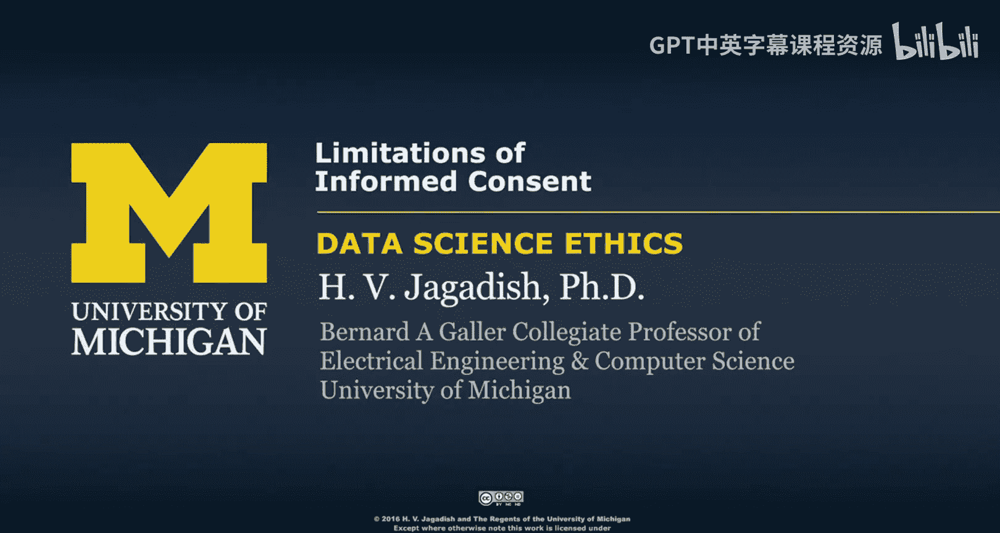

# 密歇根大学《数据科学伦理｜Data Science Ethics》中英字幕 p07 6_知情同意的局限性.zh_en -BV1EGaVzeEbQ_p7-

The concept of informed consent was developed in the context of experiments。

That would be conducted on human subjects and。Data would be collected， prospectively。

After consent had been obtained。Let's look at how this translates into our world today and the kinds of things the data scientists do。

First。The experiments are not often experiments。 There is first， a collection of data。

And the experiment comes afterwards， and the collection of data is often from people who are interacting with somebody who would like to collect that data。

 possibly a merchant。Possibly a software vendor of some sort。Informed in this case。

 is usually something that's hidden in multiple pages of fine print。You want to use some service。

 and you're given。A dump with lots and lots of dense legalese。And you're required to say。

 I accept before you can actually。Use that service。

There is some benefit in the law for the person who's getting this kind of consent。

 but it is very far from being something that is clear， firm permission。

There have been many lawsuits involving injuries and sports activities。

 So there's a long history that one can look at in terms of legal precedent and extrapolate from that to understand the benefits of getting consent。

For data collection。And one can understand what informed really means， and。From an ethical basis。

 setting aside the law， I think that。We all can say that。 There is。Sim。Weirdness。

 if we claim that somebody has been informed because they were given multiple pages of fine print that they really didn't have an opportunity to read。

The notion of voluntary also is a little questionable because the consent is being obtained。

Exactly at the time that the user is intending to perform a particular action like use a software service or by a product。

This is not something that they have time and opportunity to think over。

 This is not something that was shown to them early during their shopping experience。

 where they could worry about。What was required by different vendors。

 and they could fold this into their choice of vendor or choice of product or service。Rather。

 this is quite late in their decision making process。

 This is after they've already decided what they really want to do。 And now suddenly it is。

Pay me this toll。 You can't go on this road after you've decided to drive a particular route。

If one looks at。How informed consent works。 And think about。The example of what Facebook does。

And how。1 would think about a research experiment that Facebook may conduct。

To do say some psychology study。Facebook explicitly tells the user in its agreement that it may collect user data for research purposes。

Certainly， it has been doing so since 2012。After。Its famous mood contagion experiment。

And so Facebook may have met the letter of its user agreement。But it still got hammered by its users。

And I think the issue here is。Not that there's something wrong with Facebook。 Facebook， actually。

Does a very good job of thinking issues of privacy。And what users would like to do with their data。

It's just that Facebook is at the head of the curve。 It's a big company， and it has a lot of。

Very personal data for a lot of us and often gets into the crosshas of the community before anybody else。

 because they're there before anybody else。Okay， so that was informed consent with regard to data collection。

But then there's a question of what is the data actually going to be used for？

So I may give data about myself to a merchant to obtain a specific service。

I don't want the merchant to use these data for other purposes。

 I don't want them to use it to sell me other things。 For instance。

 I may want them only to use it for the specific service that I have contracted with them for。

And I don't want the merchant to share these data with other users。So。I may， for instance。

 give them a consent to disallow repurposing。And this is where we are saying you may collect this data。

 but the data that you collect is。Something where you've been given permission in a particular context that context matters and you may not use it in any other context or sell it to somebody else。

Now， repurposing of data is not all bad。 There often business needs to do this。

So my credit card company obviously needs to collect data about my purchases and about my payments。

They don't have to share this data with the Crit Reporting agency。

 and maybe I don't particularly like that they shared it with the Crit Reporting agency。But。

This is something that I've got to accept is a part of the social setup。

 and this is something that the credit card company ought to be telling me about and that I agreed to。

If I'm going to be given credit。I need to participate in the ecosystem that involves credit reporting and a separate credit reporting agency learning things about my purchases and payments from my credit card company。

Reurposing， even if it isn't a。Business necessary might actually be of great societal value。

I share medical data with my hospital to get better medical care。But。I may not actually mind at all。

 I might be very glad if my medical data is repurposed for medical research。😊。

I might feel happy that information about my disease progression。

 my health is going to help future generations beat some scourge。The thing is。

 the specific research questions that would be asked。

The things that scientists wish to study may not be known at the time I received my care。

The questions come afterwards。The data was already collected。

And this is called retrospectivespec data analysis as opposed to prospective。Data collection。

And the problem here is。How can we obtain a consent agreement。

Where we've given enough information to the human subject that they know what they're consenting to and yet have the consent be broad enough。

To cover a range of possible research questions that one might wish to ask。

And so this is a balancing act in terms of having an informed consent with enough information for it to be meaningful。

To conclude。Most data of interest。Most data that well analyze are created by humans。Are about humans。

Or have impacts that affect humans。When we practice data science。We have to consider this impact。

And it is consideration of this impact， that is。At the cornerstone of ethicalical practice of data science。

