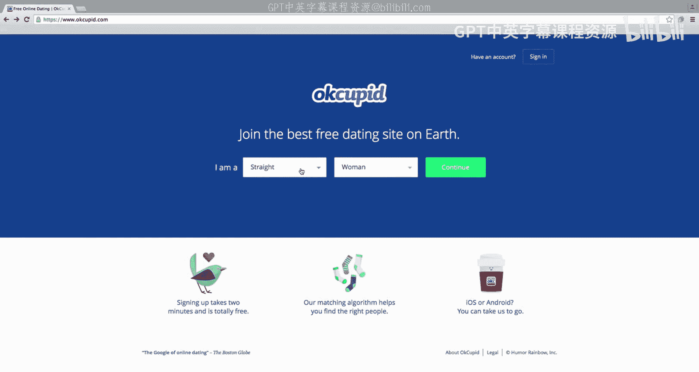
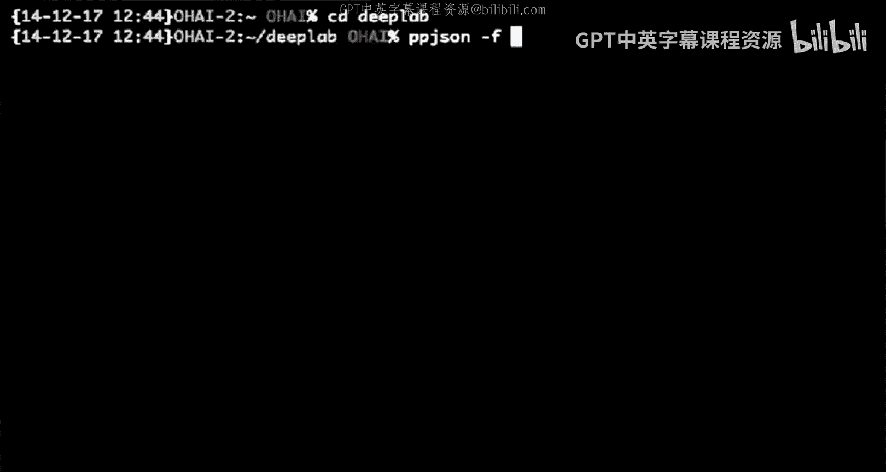
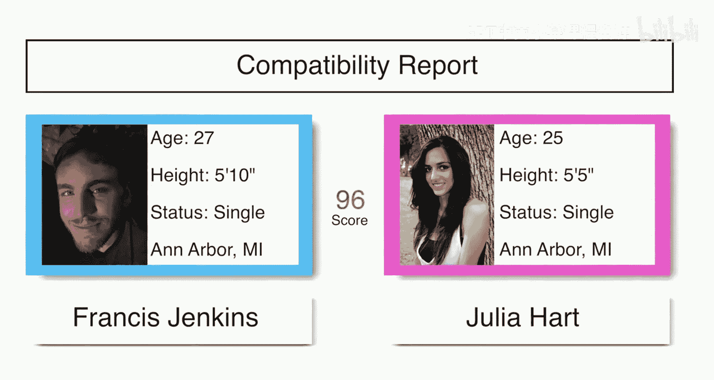

# 密歇根大学《数据科学伦理｜Data Science Ethics》中英字幕 p08 7_案例分析：并非OKCupid事件.zh_en -BV1EGaVzeEbQ_p8-

Matchmaking companies exist on the web， okay Cupupid is one of them。

The way these things work is customers sign up， enter a profile。

And the company tries to find compatibility between user profiles based on what you've told about yourself。

 you'll be recommended people to meet that the company thinks might be compatible with you determining compatibility is of course extremely difficult and。

A company like OKCupid has a proprietary algorithm to try to predict this compatibility。

 they do so by means of developing a compatibility score that is computed through some proprietary function of all the different things that you have in your profile。

Of course， they're trying all the time to improve。Their algorithm and improve the predictive power of the compatibility score that they create。

And for this purpose， they're constantly monitoring how well they do。

 they're constantly tinkering with the algorithm， trying to improve change some weights。

 change some parameters。🎼And some of these changes may be successful and maybe be adopted。

 others may be rolled back and so in this sense， if you're a user of a website like OKCupid。

 you're constantly being experimented upon in that what you're experiencing is an algorithm that is perpetually in development Now。

 OKCupid actually took this thing a couple of steps further。They tried slightly bigger experiments。

 so for example， a thing that they started to do was something called the Love is blind Day。

And on this date， they would suppress photographs in user profiles。

And what this meant was that you would not be able to see the profile photographs of potential people to meet you would of course be able to read what they had written in their profile in terms of their interests and other other text attributes。

 what they found was that even though as humans we all very much care about photographs and that is likely to be a large part of the input in terms of our deciding if somebody looks interesting and attractive。

That not having those profile pictures。Actually resulted in more conversations， more dates。

 and in that sense。Their platform was actually more successful on。This day on the love is blind day。

 So taking this kind of counterintuitive success another step further。

OK Cupupid decided to try an experiment where they wanted to understand the impact on the success of a date of simply being told that you were compatible and so what they did was took people who were actually not very compatible。

 had a low compatibility score and falsely told them that they had a high compatibility score just to bring people together conversely they also took people who had a high compatibility score and told them they had a low compatibility score and they actually did a three by three。

Matrix of this sort with 30， 60 and 90% compatibility score， actual versus 30， 60， 90% declared。

And what they found was the success rate was the highest when。

People were compatible and were told they were compatible， that is at the 1990。Entry of this matrix。

 and it was lowest where they were not compatible and were told they were not compatible at the 3030 entry of this matrix。

That if people were not compatible， but were told they were compatible。

They actually did pretty well and in fact， they did。🎼Just as well as if they were。Compatible。

 but we're told they were not。This is an interesting insight into human behavior。

And this experiment was reported by the CEO of OKCupid in a blog post。When he reported this。

He was cured。On the internet。By a whole range of people and fundamentally。

🎼What this says is in doing this experiment， interesting。As it might be。

That O Cupupid broke the underwritten expectations of society The CEO Christian Rader obviously didn't agree with this general social consensus or maybe there wasn't enough of a social consensus that he and other people like him would think it perfectly acceptable to do what they did in terms of reporting compatbilities course that were intentionally incorrect really what we're doing here is I think socially drawing a line between。

Experiments that companies conduct in the normal course of business because they're trying to improve their product or improve their algorithm。

And yes， sometimes hope for improvements may turn out not to be improvements。

Sometimes companies actually tell you something completely wrong。

 but that's unintentional and that kind of thing we accept。As just the way the world is。

On the other hand， having a company intentionally lieed to you。

 intentionally give you a wrong score is something that。

Most people would consider socially unacceptable。And because of this particular experiment and the discussions that followed。

I would say that this is a matter on which there is greater social consensus today。

Than there was at the time that。OkayCupid actually did conduct this experiment。

