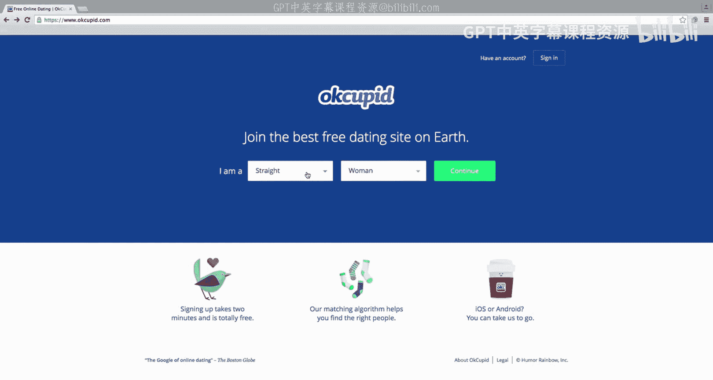
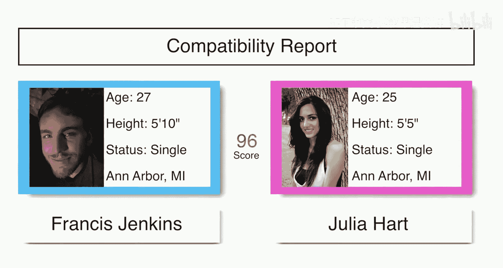

# 数据科学伦理：08：案例分析：并非OKCupid事件

在本节课中，我们将通过一个具体的案例——在线交友平台OKCupid进行的实验，来探讨数据科学实践中的伦理边界。我们将分析该实验的设计、发现以及引发的广泛社会争议，从而理解商业实验与伦理责任之间的平衡。

## 背景介绍

在线婚恋交友平台在互联网上广泛存在，OKCupid是其中之一。这类平台的运作方式是：用户注册并填写个人资料。

平台公司会尝试根据用户提供的个人信息，在不同用户的资料之间寻找匹配度。系统会推荐平台认为可能与你合拍的人选。当然，确定匹配度是极其困难的。

像OKCupid这样的公司拥有专有算法来尝试预测这种匹配度。他们通过开发一个“匹配度分数”来实现这一点，该分数是根据你个人资料中所有不同信息，通过某个专有函数计算得出的。

## 持续的算法优化

平台一直在努力改进其算法，提升所创建的匹配度分数的预测能力。为此，他们持续监控算法的表现。

他们不断调整算法，尝试改进、改变某些权重或参数。其中一些改动可能成功并被采纳，另一些则可能被回滚。从这个意义上说，如果你是OKCupid这类网站的用户，你其实一直在被当作实验对象，因为你所体验的是一个永远处于开发中的算法。

## “爱是盲目日”实验

OKCupid实际上将这种做法推进了几步，尝试了规模稍大的实验。例如，他们开始进行一项名为“爱是盲目日”的活动。

在这一天，他们会隐藏用户资料中的照片。这意味着你将无法看到潜在约会对象的个人照片，但你当然可以阅读他们在个人资料中写的兴趣和其他文本信息。

他们发现，尽管作为人类，我们都非常在意照片，并且照片很可能是我们判断某人是否有趣和有吸引力的重要依据，但隐藏这些个人资料照片实际上导致了更多的对话和约会。从这个意义上说，他们的平台在“爱是盲目日”这一天实际上更加成功。

## 匹配度分数欺骗实验

基于这种反直觉的成功，OKCupid决定更进一步，尝试一个实验，旨在了解“被告知你们很匹配”这一信息本身对约会成功率的影响。他们的做法是：选取一些实际匹配度不高、匹配分数较低的用户，但**故意错误地**告诉他们，他们拥有很高的匹配分数，以此将他们撮合在一起。反之，他们也选取了一些匹配分数高的用户，却告诉他们匹配分数低。他们实际上做了一个3x3的矩阵实验。

这个矩阵包含了实际匹配分数（30%、60%、90%）与告知匹配分数（30%、60%、90%）的所有组合。

他们发现，成功率最高的情况是当人们**确实匹配**并且**被告知他们匹配**时，即矩阵中（90%， 90%）这一项。成功率最低的情况是当人们**不匹配**并且**被告知他们不匹配**时，即矩阵中（30%， 30%）这一项。

然而，如果人们**不匹配**，但**被告知他们匹配**，他们的实际表现相当不错。事实上，他们的表现与那些**匹配**但**被告知不匹配**的人一样好。这是对人类行为的一个有趣洞察。

## 社会反响与伦理争议

OKCupid的CEO在一篇博客文章中报告了这个实验。当他报告此事时，在互联网上受到了广泛的批评。

从根本上说，这表明在进行这个实验时，无论它多么有趣，OKCupid都违背了社会默认的期望。CEO克里斯蒂安·拉德显然不同意这种普遍的社会共识，或者当时的社会共识还不够强大，以至于他和其他像他一样的人认为，故意报告错误的匹配度是完全可接受的。

我们在这里所做的，我认为是社会在划定一条界线：一边是公司在正常业务过程中为改进产品或算法而进行的实验（是的，有时期望的改进可能并未实现，有时公司可能无意中告诉你完全错误的信息，这类事情我们接受为世界的常态）；另一边是公司**故意对你撒谎**，**故意给你一个错误的分数**，这是大多数人认为社会不可接受的行为。

正是由于这个特定的实验以及随后的讨论，我认为在这个问题上，今天的社会共识比OKCupid实际进行该实验时要强烈得多。

## 总结

本节课中，我们一起学习了OKCupid实验案例。我们看到了数据驱动型公司如何通过A/B测试等方法持续优化服务，也探讨了当实验设计涉及故意欺骗用户时，所引发的重大伦理问题。这个案例清晰地表明，技术创新不能脱离社会伦理的约束，用户的信任是平台最宝贵的资产，而维护这份信任需要透明、诚实和尊重。数据科学家和企业在追求洞察与改进的同时，必须认真考虑其行为对用户和社会造成的潜在影响。