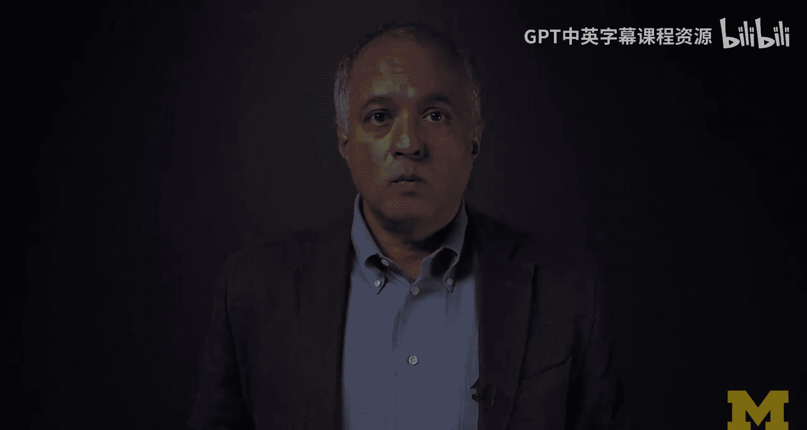

# 密歇根大学《数据科学伦理｜Data Science Ethics》中英字幕 p09 8_数据所有权.zh_en -BV1EGaVzeEbQ_p9-

Welcome to this module and data ownership。

Let's begin by talking about who owns the data。The issue is。The data is about you。

And so you might think you own the data。But is it really yours。Let's think about old technology。

If I write her biography。I own copyright on what I've written。If you dislike what I say。

 there's actually not much you can do。Unless。I've been inaccurate。

 and I've lied in ways in which it harms you。 In which case， you could sue me for libel。

If I photograph you。I own the photo。There are some limits on things that I can do。

There may be private areas in which I cannot take the photo。

There might be ways in which I cannot use the photo。

 I can't use the photo as an implied endorsement or as implied libel。 What does implied libel mean。

 For example， here's this photograph。That is presumably not。What President George W。

 Bush actually did。But somebody thought it would be very funny to create this kind of Photoshopped image。

And。One can see that。If this weren't a public figure。

 this kind of photograph is something that could be demeaning and could harm somebody's  career or reputation。

 And they might sue。 And so this is。Liel through altered images。

You don't actually have to alter an image。We all have moments when we didn't look our best。

 And if somebody just happens to capture such a moment and then makes it public。

This is something that we might feel very embarrassed about。So， we have an issue of。

Possibly creating an environment where。Our careers and reputations are hurt。

Because somebody took a picture of an unflattering moment and used that to characterize who we are。

When one thinks about data ownership。The history of what one does with things like books and photographs are things that might help。

I can record things about you。And if I've recorded things about you。I can do。

Whatever I want to with it。There might be some reasonable limits on the kinds of things that I can record about you and the kinds of things I can do with it。

But。My records are my records。And we've actually done this forever。So without the electronic world。

We've had recommendation letters。We have had gossip。And these things have human subjects。

And these human subjects are potentially impacted by whatevers the content of these recommendation letters or the gossip。

Rumors。But they really don't have much recourse。To try to understand how this would work in terms of。

Intellectual property， the way that our society thinks about them。

There are three main types of intellectual property。

The thing that we've been talking about is copyright。

 copyright is something where we own a particular artistic expression。

If you take my copyrighted work。And then you rearrange it。

 let's say you take my book and you translate it。Then the translation is a derivative work。

It's not completely original because you didn't write it from scratch。

But it's not the same as what I wrote either。Youve。Apped your own creativity。

 and you've put in your own effort in creating that translation。

What happens with derivative works is a more complex。Rule with regard to how copyright works。

 You can create derivative works only with the permission of the owner of the original work。

 but then once that permission is there， you can do what you want to。 The derivative work is yours。

There are a couple of other types of intellectual property， which I think apply less to data。

 their patents， which are ideas for making or doing something。 They are trade secrets。

 things that I have。 and I don't tell anyone。Let's not get into details of all of these things。

 The point I want to make is， if we think about copyright， which applies to artistic expression。

We understand how that works， and there is a notion of integrity of the artifact。

 So if I use an image。I display it。 If I display an image。I can credit the owner。

I have a number of pictures that I'm showing in my slides here， and。These are pictures that。

 for the most part， I did not take。I got from somebody。 and I say here's who I got it from。

 And here's the license that allowed me to do it。 And I give due credit to whoever owns that picture。

If I use your data。In theory， I should be doing the same thing。 The problem is。

 I don't usually take all of your data and use it as is。

What I would do is take a little piece of what， you know， merge with what I know。

 create something new。And at the end of the day。Often， all I can say is I used some data from you。

And there was some input from you that somehow got factored into this thing that I'm saying。

 And I can't really say exactly what and exactly how much or quantify it。 And at best。

 all I can say is that things that you might have told me somehow contributed to what I'm now saying。

And that is a little fuzzy and makes it hard for people to get due credit。

That's why we've been talking about credit。For things that people want to own and and get credit and ownership for。

 there is the flip side， too， which is。There's a lot of。Cultural artifact。A lot of heritage。

And there are things that are hard to access in the real world and digitize data is often a good way to preserve our culture。

So if we have things that are out of print， they can be lost forever。Think ancient scripts。

And there are significant efforts to digitize these， and make them available。

Now not only can digitize data preserve culture， it can also propagate culture if you think about how libraries work。

The general idea is that a library buys a bunch of books and patrons can go to the library and borrow books。

So there's a book sharing system that the library enables。In a small world。

 you can have a small library， and the small library is going to have a few books that it can afford to buy。

In a world where we have vast。Communication networks。

There's no reason to have a lot of small libraries。You can have a single universal。Library。

 virtual library。And you can have a digital copy of the book that you can loan out to any library user anywhere in the world。

And in terms of how one wants to do this， if the library buys one copy。

The publisher gets paid for the purchase of one copy。

 and you can always make sure that only one user uses it at a time。

And so the library through digitization can become a mechanism for propagating culture universally in ways that you couldn't do if you stayed within the realmma of traditional technologies。

Data collection and curation。Takes a great deal of effort。

And even if we started with things that were free and freely available。

There is a great deal of effort to clean and validate and standardize and integrate data and put it in a form。

That somebody can use。Once when is put in this effort。

 somebody then has a collection that they have created that。They own。

 It is the result of their hard work。And they may choose to make this public。Or。

They may say they now have a data asset， and they want to get credit。

 either fame or money or whatever it is that they would like to be rewarded in the form of。Of course。

 the same thing applies if you started with data that wasn't free to begin with。

Note that you actually don't need an artistic creator to claim ownership。

You could have data that people freely gave you。And then you could put it all together。

And the effort of putting it all together still gives you ownership。So， Wikipedia has。Famously。

 crowdsourced data。It's an encyclopedia that people around the world have come together to build。And。

The individual contributors。Don't own this。Wikipedia owns the encyclopedia。Now， da。Have made a。

Social decision and a contract with the people who contribute that they're going to make it available free to everybody。

 but they don't have to。If you look at crowdsource reputation sites。Such as yelp， boot and tomatoes。

 or Tripadvisor。Companies like this all completely have their business model reliant upon。

People in the community expressing their opinion about businesses that they're rating on these sites。

These opinions are freely contributed by people who are not compensated for contributing these opinions。

 usually。The key point， whether the contributors are compensated or not。

 is that the data that get collected。Are then the property of these data collectors and aggregators。

And it is there。Collection and their organization and the effort that they put in to create this collection。

That is a thing that induces value。And they're free to sell ads or make money off of this data。

In whatever manner they see fit。