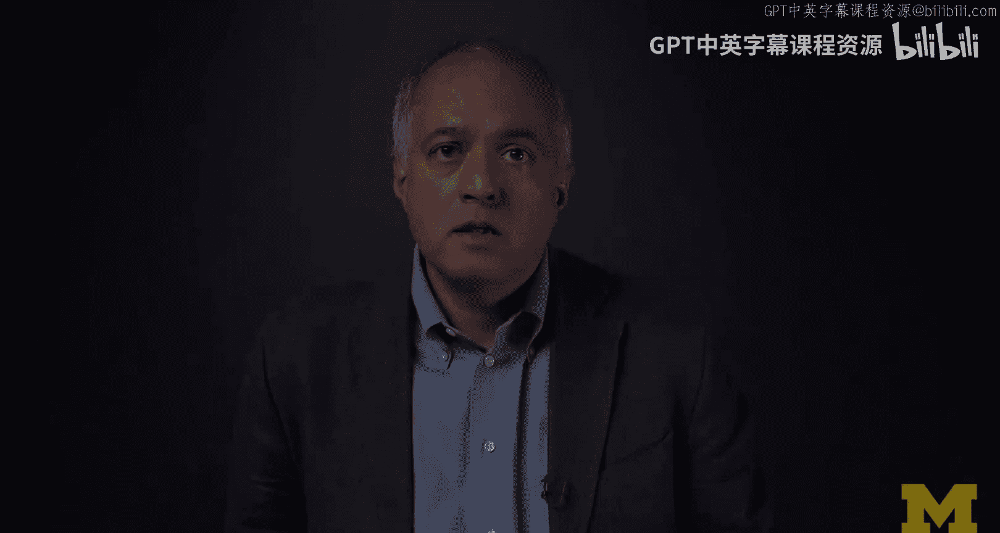

# 密歇根大学《数据科学伦理｜Data Science Ethics》中英字幕 p10 9_数据采集与使用的边界.zh_en -BV1EGaVzeEbQ_p10-

So we've been talking about the fact that。

The data。Are owned by。Whoever records the data。And。To balance this。

 we've got to think about limits on recording and use。

And that's what we'll talk about in this segment。So there's clearly some expectation of privacy。

So if you're in a clothing store fitting room， if you're in a restroom。

Uly don't want to have cameras in there。If you have a phone company。

You really don't want them to listening in to your phone calls。Of course。

There are times when we could agree。To do whatever it is that parties freely agree to。

So you could post for a photograph。And we may agree that I will give you ownership of the photo。

That I will not retain ownership， or you could participate in a research experiment。

And there's informed consent about that。Research funding agencies could require the data collected from the funded research must be made public。

If they didn't have such a requirement， you could own the data collected from your experiments and do what you wish to with them。

So certainly from a。Contractual basis， one could。Arrive at whatever reasonable things one wants to do。

 But let's look at。Things that one does without actually having contracts。So if you go to a store。

 you probably have video cameras there。And we are used to these things。

 and we know that these things can provide security。And we're quite happy that that's what stores do。

In fact， they make us feel more secure。Now， given that stores are videotaping movement of customers in the store。

If they use the data that they collected from this video to improve product placement or to improve the geography of the aisles so that traffic flow is better。

 that's something that we would consider reasonable。

 But if I saw a video of me walking down the aisle in my favorite store on the Internet。

 I would be very unhappy。So even though there isn't actually a contract between me as a customer and the store that I visit。

We have。An expectation， a shared expectation that they may videotape me。

But they will not publish this videotape。If you have a cell phone to be able to get service。

 the cell phone providing company has to know where you are。

 they have to therefore know your location， and if they know your location 24 by 7。

 they know a lot about you， and so it can result in a huge loss of privacy。The question is。

How much of your movement are they allowed to record and what can they do with it。And here。

We have some amount of ferment in terms of what societal expectations are。

So what we find is that there's often a strong reason to record the data。

But there's also potential for misuse。And if that's the case。

 then what we may want is that we want to limit the use and not limit the recording。

So there's a strong reason for a store to have a video camera。And there is a legitimate use for that。

 But we don't want them to use that to make movies that they're going to then show commercially。

The question is， where do these limits come from。And in the case of the store and the video camera in the store。

 it's a voluntary limit on use。 There's no contractual requirement， the store。

Believes and correctly so that in terms of the societal consensus。

 if they were to take these videos of the in store cameras and make them public that the customers would be very upset and they don't want to do this。

In the case of cell phones and and mobile applications on cell phones in particular。

We're still trying to get to a societal consensus， but in general。

Companies know businesses know that customers will get very unhappy if data collected for one purpose。

 get used for。A different purpose that the users didn't expect them to be used for。

These understandings can be put in writing， they can be made part of written contracts。

 and then they can have legal force。And whether they are actually written down or not。

 these understandings remove barriers to many transactions。There is a lot of。

Increase these days in terms of police wearing body cameras。

And so they're now taking videos more and more frequently。Of data interactions with citizens。

And by and large， this is a thing that helps make sure that。The interactions are reasonable。

 and there's a record when questions arise after a fact。But usually。

 citizens are interacting with police when they're not at their best。

 And so this is something that you really don't want posted on the Web。And so again。

 that's another example of there being an assurance that is required for some use to be generally allowed。

Moving from that to government surveillance。If if you look at our security agencies。

 they really don't know what they will need。And if they haven't collected the data。

 they can usually not go back and look for it。And so we actually have this whole set where they suck in a great deal of data and plan never to look at it。

😊，When there is a specific need， they will go and seek authorization。

The equivalent of a warrant to actually go look at the data。

And there is this whole argument about separating recording from use。 If， indeed。

 people can record information and assure people that this recorded information will not be looked at by anybody。

Aither legitimate people。Because they have the right to look at it or because of security breaches。

Then we may actually have some intermediate point where。

We distinguish between data collection and data use。

I think that the whole thinking around this area is still a place where we are having social conversations and there isn't a societal consensus yet。

