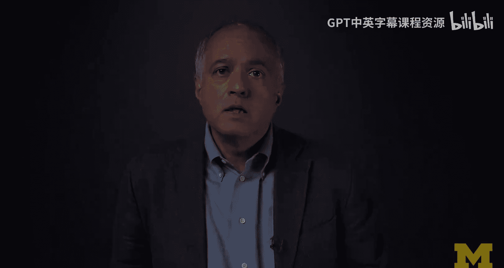

# 密歇根大学《数据科学伦理｜Data Science Ethics》中英字幕 p11 10_数据所有权终章.zh_en -BV1EGaVzeEbQ_p11-

So in this final segment on data ownership， I want to touch upon one additional point that we haven't really talked about thus far。

 and that's data destruction。

Companies legitimately collect data as part of doing business with us。And by and large。

 as we've been saying， companies want to retain the good will of customers。

 And so they may sometimes do things that upset customers。 But usually。

 that's because they just didn't realize they would be at upset customers so much。

Companies don't want to upset customers。 And so that。

Provides us with some amount of assurance that they will not do egregiously bad things。Unfortunately。

 that assurance goes away once the company ceases to do business。 So if a company goes bankrupt。

 then the data is an asset。And we have a bankrupt company。 All its assets are up for sale。

Data assets will be sold like any other assets， and they'll be sold to a third party。

 and usually a third party who intends to misuse the data is the one who's going to。Bit the highest。

And so as a contributor of data to companies when I do business with them。

 I want collected data to be destroyed and not sold when the company goes bankrupt。

This is not just a theoretical thing。 This has actually happened in the case of a number of companies such as Raioshck and Borders and connected you。

Baruptcy law actually now has partial protection。Basically， saying that。

Whatever is the company's privacy policy must survive， even after the company goes bankrupt。

So to sum up。Data ownership is really complex。It's much harder to reason through than intellectual property ownership for other things。

 like works of art。And this ownership is complex even for things that you actually want to share。

Because， for instance， giving credit is very hard。A thing that we have to recognize is that。

 for the most part， we don't own data about us。Data about us that somebody else has collected is owned by whoever collected it。

Nevertheless。We may have some control over these data that aren't ours because they're about us。

And we need to create the principles to reason about this control。And that。Is really the main。

Concern of a discussion about the right to privacy。

