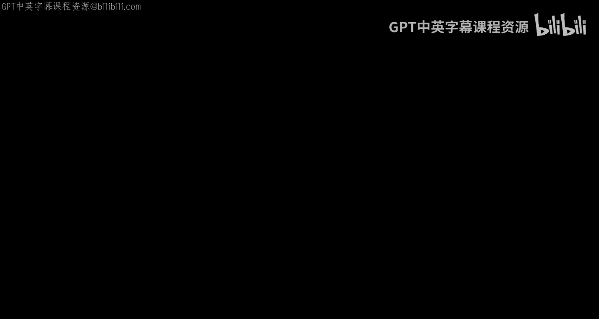
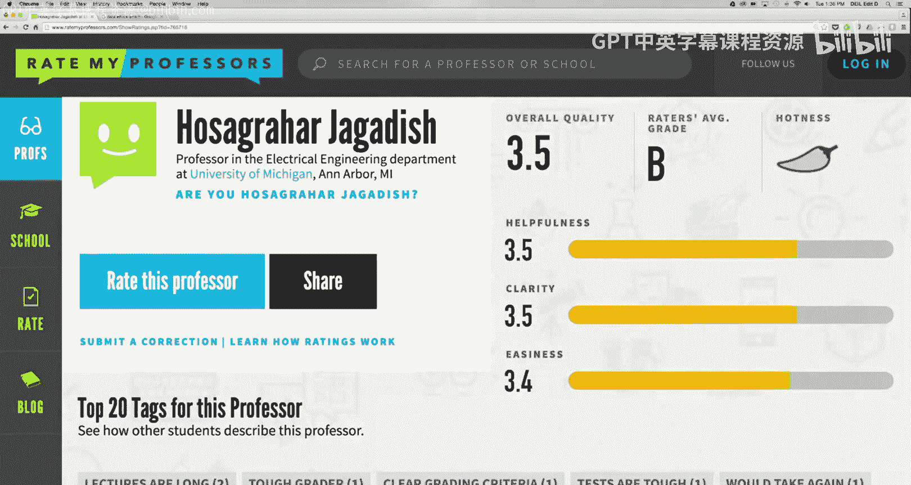

# 密歇根大学《数据科学伦理｜Data Science Ethics》中英字幕 p12 11_案例分析：教授评分平台.zh_en -BV1EGaVzeEbQ_p12-

Students care about how well professors teach。And when enrolling for a class。

 they would naturally like to find out a little bit about how good the professor is to meet this need。

 there are several websites that have dropped up， for example，BreakMyprofessors。com。On this website。

 students who have taken my class go in and enter their comments and their rating of me as a professor。

Other students who are considering taking my class can go read these comments。

Look at these ratings and then decide if I'm a good professor or if they should wait till the course is taught by somebody else or not take the class at all。

In other words， what happens on this website and the data that's on this website has an impact on。

Enrollments in my class。And therefore， potentially on my career as a professor， the thing is。

This is intensely personal information about me， but it is。About me， said by somebody else。

And recorded on a third party website that I have no control over and in fact。

 in general have very little interaction with Now the question is what happens if。There's data。

 there are things that are said on this website that I object to。For example。

 suppose there is some student who's disgruntled， let's say I caught some student cheating。

 they could go in and put a really nasty comment about me and rate me very low。Even worse。

 there isn't much that prevents them from getting 50 of their closest friends。

 let's say they're fracrack buddies。To go in and do the same thing。

And the net result of this kind of mass movement would be that my ratings on this site would plummet。

🎼If such a thing were to happen， I could presumably go and complain to the website and possibly they would investigate and possibly they might do something。

 but it's really totally up to them and their processes and I have。No real recourse， but the data。

Has been gathered by somebody else and it is this somebody else who controls it the data that a site like greatmyprofessors。

com gathers is information that they could，Sell or rent to third parties that they could do what they wish to with。

 it is about me， but it isn't mine。And keeping this distinction between。

Who the data is about and who owns that data。Is important as we go through our discussions of privacy。

