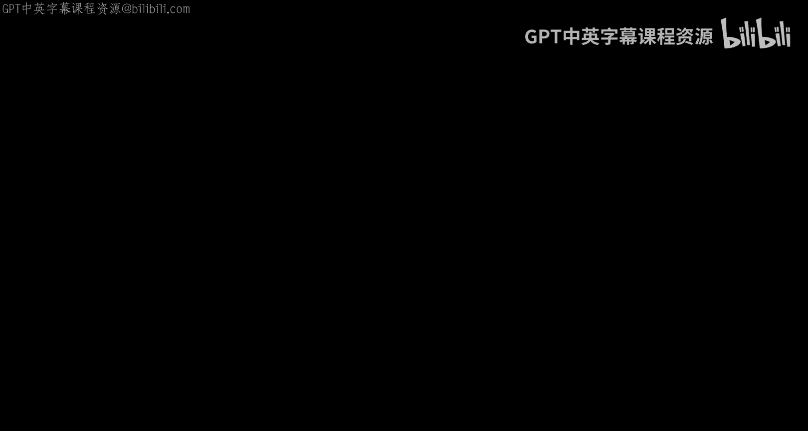
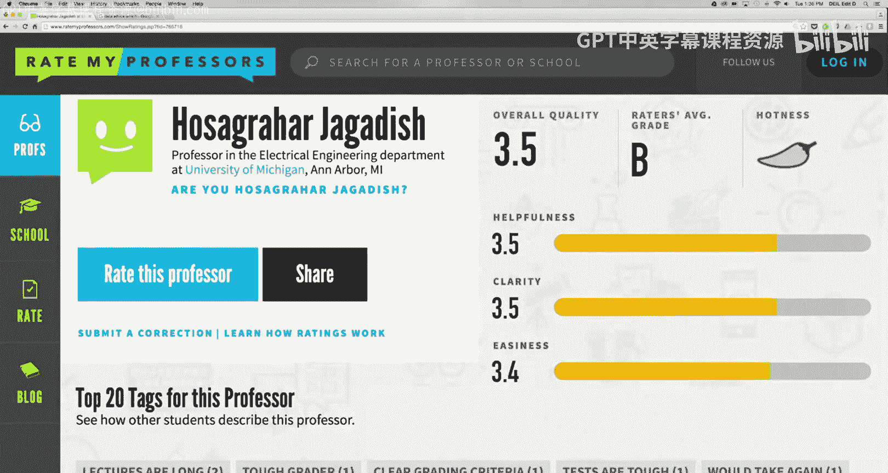

# 数据科学伦理：12：案例分析：教授评分平台

在本节课中，我们将通过一个具体的案例——教授评分平台，来探讨数据所有权、个人隐私以及数据可能被滥用的问题。这个案例将帮助我们理解，当关于我们的数据由他人收集和控制时，会引发哪些伦理挑战。

学生关心教授的教学质量。在选择课程时，他们自然希望了解授课教授的水平。为了满足这一需求，出现了多个网站，例如 RateMyProfessors.com。

在这个网站上，上过我课的学生可以进去发表评论，并给我作为教授的评分。其他考虑选我课的学生可以去阅读这些评论，查看这些评分，然后决定我是否是一位好教授，或者他们是否应该等到其他教授来教这门课，或者干脆不选这门课。

换句话说，这个网站上发生的事情以及网站上的数据，会影响我课程的注册人数。因此，也可能影响我作为教授的职业生涯。

问题是，这些是关于我的、非常私人的信息。但这是关于我的信息，由他人说出，并记录在一个我无法控制的第三方网站上。实际上，我通常与这个网站几乎没有互动。

现在的问题是，如果网站上存在我反对的数据或言论，会发生什么？例如，假设有一个不满的学生，比如我抓到了某个学生作弊，他可能会进去发表一条非常恶毒的评论，并给我打很低的分。更糟糕的是，没有什么能阻止他召集50个最亲密的朋友，比如他的兄弟会伙伴，也去做同样的事情。

这种大规模行动的结果将是，我在这个网站上的评分会暴跌。

如果发生这样的事情，我大概可以去向网站投诉，他们可能会调查，也可能采取一些措施。但这完全取决于他们和他们的流程，我并没有真正的追索权。

但是，数据是由他人收集的，并且由这个“他人”控制。像 RateMyProfessors.com 这样的网站收集的数据，是他们可以出售或出租给第三方、可以随意处置的信息。这是关于我的信息，但它不属于我。

在我们讨论隐私问题的过程中，**区分“数据是关于谁的”和“谁拥有该数据”** 这一点非常重要。这是本案例的核心伦理议题。

本节课中，我们一起学习了教授评分平台这个案例。我们看到了关于个人的数据如何被第三方收集和使用，个人对此可能缺乏控制力。我们探讨了数据可能被恶意操纵的风险，并强调了“数据主体”与“数据控制者”之间的关键区别。理解这种区别是思考数据科学伦理中隐私和公平问题的基础。